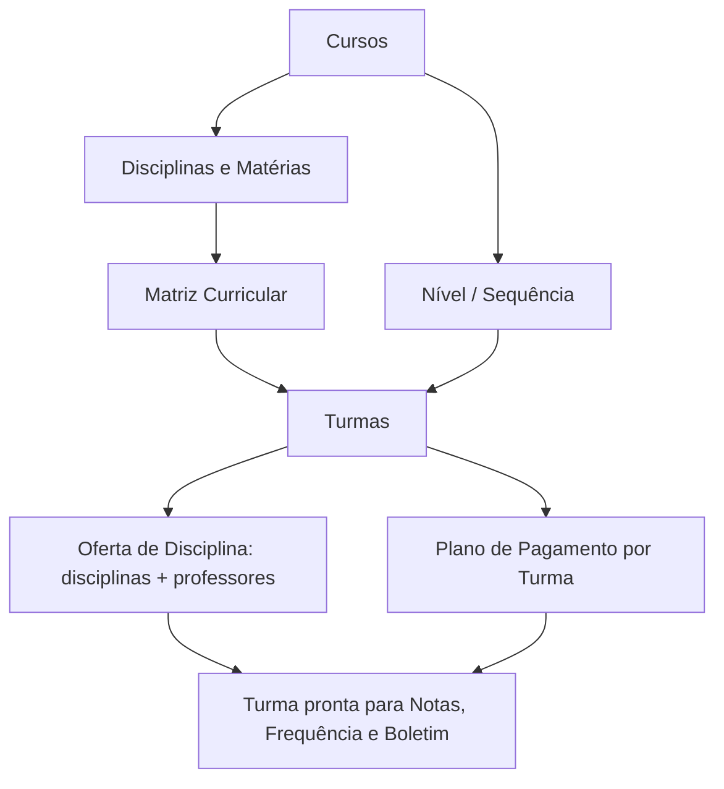

# Módulo Acadêmico

## Objetivo

O módulo **Acadêmico** define a **estrutura escolar** sobre a qual todo o resto funciona: os
**cursos**, as **disciplinas** e **matérias**, as **matrizes curriculares**, os **níveis/séries**,
os **itinerários formativos**, as **turmas** e a **oferta de disciplinas** (quais disciplinas e
professores atuam em cada turma). Também é aqui que se define o **plano de pagamento por turma**.

## Quem pode utilizar

Coordenação Pedagógica, Secretaria e Administrador. É uma área de **configuração**: normalmente
montada no início do ano letivo e ajustada pontualmente.

## Como acessar

As telas ficam nos grupos **Tabelas** e **Acadêmico** do menu lateral (a organização exata pode
variar por escola).

## Mapa do módulo

| Tela | Para que serve | Documentação |
|------|----------------|--------------|
| Cursos | Cadastrar os cursos da escola | [Abrir](cursos.md) |
| Disciplinas | Cadastrar disciplinas e suas regras de boletim/frequência | [Abrir](disciplinas.md) |
| Matérias | Cadastrar matérias que compõem uma disciplina | [Abrir](materias.md) |
| Matrizes Curriculares | Montar a grade de disciplinas/carga horária por período | [Abrir](matrizes-curriculares.md) |
| Nível / Sequência | Definir séries/níveis e sua progressão | [Abrir](nivel-sequencia.md) |
| Itinerário Formativo | Cadastrar itinerários do Novo Ensino Médio | [Abrir](itinerario-formativo.md) |
| Turmas | Criar e configurar turmas | [Abrir](turmas.md) |
| Turma Auxiliar | Criar turmas auxiliares (agrupamentos paralelos) | [Abrir](turma-auxiliar.md) |
| Oferta de Disciplina | Definir disciplinas/professores de cada turma | [Abrir](oferta-disciplina.md) |
| Plano de Pagamento por Turma | Vincular planos de pagamento às turmas | [Abrir](plano-pagamento-turma.md) |

## Ordem recomendada de montagem

---

## Histórico

| Data | Alteração |
|------|-----------|
| 30/07/2026 | Página criada. |
