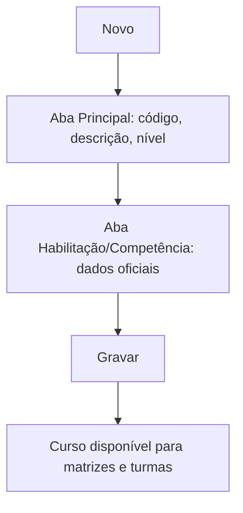

# Cursos

## Objetivo

Cadastrar os **cursos** oferecidos pela escola (por exemplo, Educação Infantil, Ensino
Fundamental, Ensino Médio, cursos livres). O curso é a base da matrícula e do histórico escolar,
e carrega dados oficiais exigidos por INEP/MEC.

---

## Como acessar

```
Tabelas
→ Cursos
```

---

## Quando utilizar

- Ao configurar a escola pela primeira vez.
- Ao criar um novo curso ou atualizar dados oficiais (autorização, códigos INEP/E-MEC).

---

## Como utilizar

1. Abra **Cursos**.
2. Clique em **Novo**.
3. Na aba **Principal**, informe **Código**, **Descrição** e a **Descrição para o histórico**,
   o **Nível de Escolaridade**, o **Nível do Curso** e se **Exige Matriz Curricular**.
4. Na aba **Habilitação / Competência**, informe os dados oficiais (**Autorização/Resolução**,
   **Confere Grau de**, **Habilitação**, **Competência**, **Código E-MEC**, **ID do Curso no INEP**).
5. Clique em **Gravar**.

---

## Campos

| Campo | Descrição | Obrigatório | Observações |
|-------|-----------|-------------|-------------|
| Código | Código do curso | Sim | |
| Descrição | Nome do curso | Sim | |
| Descrição para o histórico | Nome que sai no histórico escolar | Não | |
| Nível de Escolaridade | Nível do curso | Sim | |
| Nível do Curso | Classificação do curso | Não | |
| Exige Matriz Curricular | Se o curso usa matriz curricular | Não | |
| Curso Livre | Marca curso livre | Não | |
| Autorização / Resolução | Ato de autorização | Não | Dado oficial |
| Confere Grau de | Grau conferido | Não | |
| Habilitação / Competência | Habilitação/competência | Não | |
| Código E-MEC | Código no E-MEC | Não | Dado oficial |
| ID do Curso no INEP | Identificador INEP | Não | Dado oficial |
| Início do Funcionamento | Data de início | Não | |
| Colégio / Faculdade | Instituição | Não | |

---

## Botões

| Botão | O que faz |
|-------|-----------|
| **Novo** | Cadastra um novo curso |
| **Pesquisar** | Busca cursos |
| **Opções** | Editar/excluir |
| **Gravar** | Salva o curso |
| **Confirmar/Cancelar Exclusão** | Confirma ou cancela a exclusão |

---

## Resultados

- O curso fica disponível para matrículas, matrizes curriculares e turmas.

---

## Regras importantes

- **Código** e **Descrição** são obrigatórios.
- Se marcar **Exige Matriz Curricular**, o curso precisará de uma [matriz](matrizes-curriculares.md) associada.
- Os dados oficiais (INEP/E-MEC, autorização) alimentam documentos como o histórico escolar.

---

## Fluxo da funcionalidade



---

## Exemplos práticos

**Exemplo:** cadastrar "Ensino Médio", nível de escolaridade correspondente, com o código INEP e
a resolução de autorização, marcando **Exige Matriz Curricular**.

---

## Dicas

- Preencha os **dados oficiais** desde já — eles são exigidos em documentos e censo.

---

## FAQ

**Preciso de matriz curricular para todo curso?**
Só se marcar **Exige Matriz Curricular**. Cursos livres podem dispensar.

---

## Prints

- [ ] Lista de cursos.
- [ ] Aba Principal e aba Habilitação/Competência.

---

## Histórico

| Data | Alteração |
|------|-----------|
| 30/07/2026 | Página criada. |
