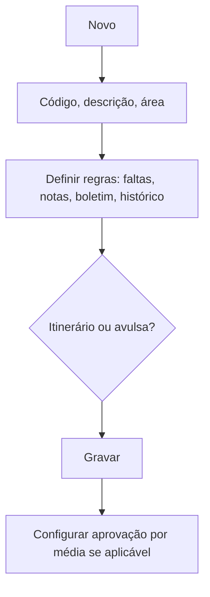

# Disciplinas

## Objetivo

Cadastrar as **disciplinas** da escola e definir como cada uma se comporta: se **controla
faltas**, se **lança notas**, se **imprime no boletim** e no **histórico**, se é uma disciplina
de **itinerário formativo** e se é **avulsa** (usada só para montagem de horário). Também é aqui
que se define quais disciplinas **aprovam com base na média**.

---

## Quem pode utilizar

Coordenação Pedagógica e Administrador.

---

## Como acessar

```
Tabelas
→ Disciplinas
```

A configuração de aprovação por média fica em **Disciplina — Aprova com Base na Média**.

---

## Quando utilizar

- Ao montar a estrutura pedagógica da escola.
- Ao criar uma nova disciplina ou ajustar suas regras (boletim, frequência, itinerário).

---

## Como utilizar

1. Abra **Disciplinas**.
2. Clique em **Novo**.
3. Informe **Código**, **Descrição**, **Descrição para o histórico** e a **Área de Conhecimento**.
4. Defina os comportamentos: **Controla Faltas**, **Lançamento de Notas**, **Imp. Boletim**,
   **Imp. Histórico**, **Itinerário** e se é **Avulsa**.
5. Clique em **Gravar**.

Para configurar quais disciplinas aprovam pela média, abra **Disciplina — Aprova com Base na
Média**, marque as disciplinas desejadas e clique em **Gravar Alterações**.

---

## Campos

| Campo | Descrição | Obrigatório | Observações |
|-------|-----------|-------------|-------------|
| Código | Código da disciplina | Sim | |
| Descrição | Nome da disciplina | Sim | |
| Descrição para o histórico | Nome no histórico escolar | Não | |
| Área de Conhecimento | Área (BNCC) | Não | |
| Controla Faltas | Se registra frequência | Não | |
| Lançamento de Notas | Se recebe notas | Não | |
| Imp. Boletim | Aparece no boletim | Não | |
| Imp. Histórico | Aparece no histórico | Não | |
| Itinerário | Usada para itinerário formativo | Não | "Essa disciplina será utilizada para Itinerário Formativo." |
| Avulsa | Usada só para montar horário | Não | "Essa disciplina é AVULSA..." |

---

## Botões

| Botão | O que faz |
|-------|-----------|
| **Novo** | Cadastra uma nova disciplina |
| **Pesquisar** | Busca disciplinas |
| **Opções** | Editar/excluir |
| **Gravar** | Salva a disciplina |
| **Gravar Alterações** (Aprova com Base na Média) | Salva as marcações de aprovação por média |
| **Confirmar/Cancelar Exclusão** | Confirma ou cancela a exclusão |

---

## Filtros e colunas

Colunas na lista: **Código**, **Descrição**, **Controla Faltas**, **Lanç. de Notas**,
**Imp. Boletim**, **Imp. Histórico**, **Itinerário**, **Avulso**.

---

## Resultados

- A disciplina fica disponível para **matérias**, **matrizes curriculares** e **oferta em turmas**.
- As regras marcadas afetam boletim, histórico, frequência e processamento de notas.

---

## Regras importantes

- **Código** e **Descrição** são obrigatórios.
- Disciplina **avulsa** serve para montar horário, mas normalmente não entra em boletim/notas.
- Disciplina de **itinerário** é usada na composição do Novo Ensino Médio.
- A aprovação **com base na média** é definida na tela específica e altera o resultado final do aluno.

---

## Mensagens do sistema

- *"Disciplina e Boletim alterados com sucesso!"*
- *"Erro na atualização"* / *"Erro ao gravar os dados."*

---

## Fluxo da funcionalidade



---

## Exemplos práticos

**Exemplo:** cadastrar "Matemática" com **Controla Faltas**, **Lançamento de Notas**,
**Imp. Boletim** e **Imp. Histórico** marcados; depois incluí-la na aprovação por média.

---

## Dicas

- Marque **Avulsa** apenas para disciplinas que existem só no horário (ex.: intervalo, tutoria).

---

## Erros comuns

- Disciplina não aparece no boletim → verifique se **Imp. Boletim** está marcado.

---

## FAQ

**Qual a diferença entre disciplina e matéria?**
A **disciplina** é a unidade principal; as **matérias** são subdivisões que compõem a nota da
disciplina (ver [Matérias](materias.md)).

---

## Prints

- [ ] Lista de disciplinas com as colunas de regras.
- [ ] Formulário de disciplina.
- [ ] Tela "Aprova com Base na Média".

---

## Histórico

| Data | Alteração |
|------|-----------|
| 30/07/2026 | Página criada. |
