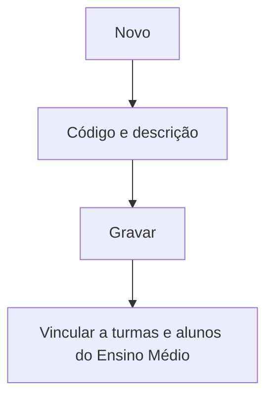

# Itinerário Formativo

## Objetivo

Cadastrar os **itinerários formativos** do Novo Ensino Médio — os conjuntos de disciplinas
eletivas/aprofundamento que o aluno escolhe além da formação geral básica. É um cadastro simples
que depois é vinculado a turmas e alunos.

---

## Quem pode utilizar

Coordenação Pedagógica e Administrador.

---

## Como acessar

```
Tabelas
→ Itinerário Formativo
```

---

## Quando utilizar

- Ao estruturar os itinerários oferecidos pela escola no Ensino Médio.

---

## Como utilizar

1. Abra **Itinerário Formativo**.
2. Clique em **Novo**.
3. Informe o **Código** e a **Descrição** do itinerário.
4. Clique em **Gravar**.

---

## Campos

| Campo | Descrição | Obrigatório |
|-------|-----------|-------------|
| Código | Código do itinerário | Sim |
| Descrição | Nome do itinerário | Sim |

---

## Botões

| Botão | O que faz |
|-------|-----------|
| **Novo** | Cadastra um novo itinerário |
| **Pesquisar** | Busca itinerários |
| **Opções** | Editar/excluir |
| **Gravar** | Salva o itinerário |
| **Confirmar/Cancelar Exclusão** | Confirma ou cancela a exclusão |

---

## Filtros e colunas

Colunas: **Código**, **Descrição**.

---

## Resultados

- O itinerário fica disponível para ser vinculado a turmas (que **exigem itinerário formativo**),
  à matrícula do aluno e às telas de **Itinerário da Turma / do Aluno**.

---

## Regras importantes

- **Código** e **Descrição** são obrigatórios.
- As disciplinas do itinerário são as marcadas como **"Itinerário"** no [cadastro de disciplinas](disciplinas.md).

---

## Fluxo da funcionalidade



---

## Exemplos práticos

**Exemplo:** cadastrar o itinerário "Ciências da Natureza e Matemática".

---

## Dicas

- Combine este cadastro com as disciplinas marcadas como itinerário para montar a oferta.

---

## FAQ

**Onde o aluno escolhe o itinerário?**
Na matrícula (aba Matrícula) e nas telas de Itinerário da Turma/do Aluno.

---

## Prints

- [ ] Lista de itinerários.
- [ ] Formulário do itinerário.

---

## Histórico

| Data | Alteração |
|------|-----------|
| 30/07/2026 | Página criada. |
