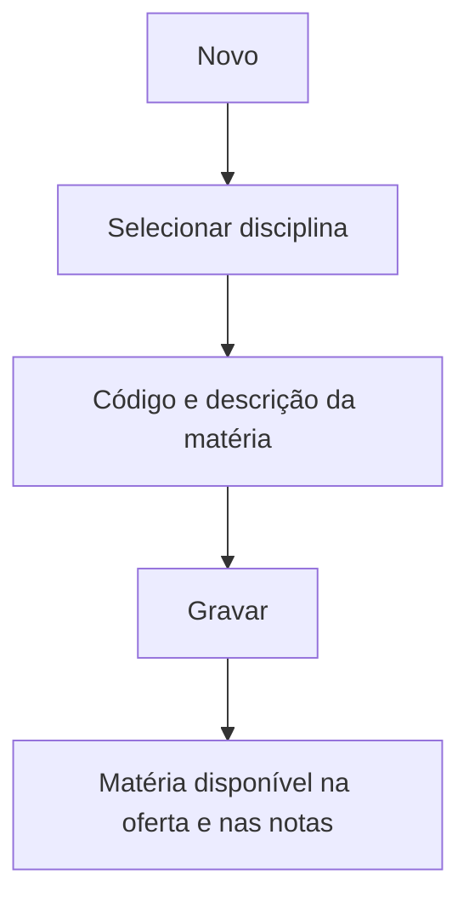

# Matérias

## Objetivo

Cadastrar as **matérias** que compõem uma **disciplina**. As matérias permitem subdividir uma
disciplina (por exemplo, "Português" com as matérias "Gramática" e "Literatura") para lançamento
e composição de notas.

---

## Como acessar

```
Tabelas
→ Matérias por Disciplina
```

---

## Quando utilizar

- Quando uma disciplina precisa ser avaliada por partes (matérias).

---

## Como utilizar

1. Abra **Matérias**.
2. Clique em **Novo**.
3. Selecione a **Disciplina**.
4. Informe o **Código da Matéria** e a **Descrição da Matéria**.
5. Clique em **Gravar**.

---

## Campos

| Campo | Descrição | Obrigatório |
|-------|-----------|-------------|
| Disciplina | Disciplina à qual a matéria pertence | Sim |
| Código da Matéria | Código | Sim |
| Descrição da Matéria | Nome da matéria | Sim |

---

## Botões

| Botão | O que faz |
|-------|-----------|
| **Novo** | Cadastra uma nova matéria |
| **Pesquisar** | Busca matérias |
| **Opções** | Editar/excluir |
| **Gravar** | Salva a matéria |
| **Confirmar/Cancelar Exclusão** | Confirma ou cancela a exclusão |

---

## Filtros e colunas

Colunas: **Disciplina**, **Matéria** (descrição).

---

## Resultados

- A matéria fica vinculada à disciplina e disponível para a oferta e o lançamento de notas.

---

## Regras importantes

- Toda matéria pertence a uma **disciplina**.
- A forma como as matérias compõem a nota da disciplina depende das configurações de avaliação/fórmulas.

---

## Fluxo da funcionalidade



---

## Exemplos práticos

**Exemplo:** para a disciplina "Português", cadastrar as matérias "Gramática", "Literatura" e "Redação".

---

## Dicas

- Só crie matérias quando a escola realmente avalia a disciplina por partes.

---

## FAQ

**Preciso de matérias em toda disciplina?**
Não. Muitas disciplinas têm nota única, sem matérias.

---

## Prints

- [ ] Lista de matérias por disciplina.
- [ ] Formulário de matéria.

---

## Histórico

| Data | Alteração |
|------|-----------|
| 30/07/2026 | Página criada. |
