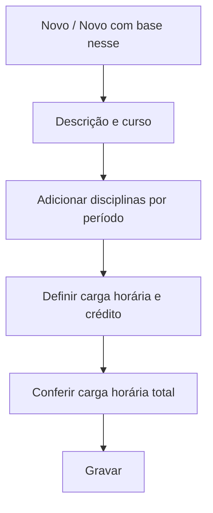

# Matrizes Curriculares

## Objetivo

Montar a **grade curricular** de um curso: quais **disciplinas** são cursadas em cada **período**
(ano/semestre/série), com a **carga horária** e os **créditos** de cada uma. A matriz é a base
para a oferta de disciplinas nas turmas e para o histórico escolar.

---

## Quem pode utilizar

Coordenação Pedagógica e Administrador.

---

## Como acessar

```
Tabelas
→ Matrizes Curriculares
```

---

## Quando utilizar

- Ao estruturar um curso que **exige matriz curricular**.
- Ao criar uma nova versão de matriz (por mudança de grade/legislação).

---

## Como utilizar

1. Abra **Matrizes Curriculares**.
2. Clique em **Novo** (ou **Novo Com Base Nesse** para partir de uma existente).
3. Informe a **Descrição da Matriz** e o **Curso**.
4. Para cada **Período**, inclua as **Disciplinas** com sua **Carga Horária** e **Crédito**.
5. Confira a **Carga Horária Total**.
6. Clique em **Gravar**.

---

## Campos

| Campo | Descrição | Obrigatório | Observações |
|-------|-----------|-------------|-------------|
| Descrição da Matriz | Nome/versão da matriz | Sim | |
| Curso | Curso da matriz | Sim | |
| Período | Ano/semestre/série | Sim | |
| Disciplina | Disciplina incluída no período | Sim | |
| Carga Horária | Carga horária da disciplina | Sim | |
| Crédito | Créditos da disciplina | Não | |
| Carga Horária Total | Soma da carga horária | — | Calculada |
| Sequência | Ordem/sequência da matriz | Não | |

---

## Botões

| Botão | O que faz |
|-------|-----------|
| **Novo** | Cria uma nova matriz |
| **Novo Com Base Nesse** | Duplica uma matriz existente como ponto de partida |
| **Pesquisar** | Busca matrizes |
| **Opções** | Editar/excluir |
| **Gravar** | Salva a matriz |
| **Confirmar/Cancelar Exclusão** | Confirma ou cancela a exclusão |

---

## Filtros e colunas

Colunas: **Descrição**, **Curso**, **Sequência**, **Carga Horária Total**.

---

## Resultados

- A matriz fica associada ao curso e disponível para montar a oferta das turmas.

---

## Regras importantes

- A matriz depende de **curso** e **disciplinas** já cadastrados.
- A **carga horária total** é a soma das disciplinas por período — confira antes de gravar.

---

## Fluxo da funcionalidade



---

## Exemplos práticos

**Exemplo:** montar a matriz do "Ensino Médio 2026" com as disciplinas de cada série (1º, 2º e
3º ano) e suas cargas horárias.

---

## Dicas

- Use **Novo Com Base Nesse** para criar uma nova versão de matriz sem redigitar tudo.

---

## FAQ

**Posso ter mais de uma matriz por curso?**
Sim, por exemplo uma por ano de ingresso ou versão de grade.

---

## Prints

- [ ] Lista de matrizes.
- [ ] Montagem de disciplinas por período.

---

## Histórico

| Data | Alteração |
|------|-----------|
| 30/07/2026 | Página criada. |
