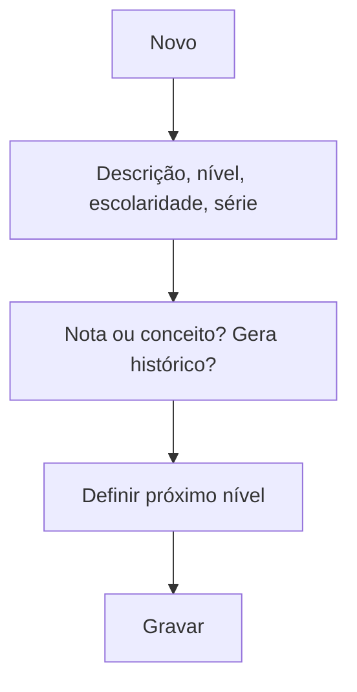

# Nível / Sequência

## Objetivo

Definir os **níveis/séries** da escola (por exemplo, 1º ano, 2º ano...) e a **sequência de
progressão** entre eles — qual é o próximo nível após a aprovação. Também define se o nível
**gera histórico**, se usa **nota** ou **conceito**, e sua posição nas estatísticas.

---

## Quem pode utilizar

Coordenação Pedagógica e Administrador.

---

## Como acessar

```
Tabelas
→ Nível / Sequência
```

---

## Quando utilizar

- Ao estruturar as séries/níveis da escola.
- Ao definir a progressão automática (próximo nível) usada na promoção de alunos.

---

## Como utilizar

1. Abra **Nível / Sequência**.
2. Clique em **Novo** (ou **Novo Com Base Nesse**).
3. Informe **Descrição**, **Nível**, **Escolaridade**, **Série**, **Ano/Módulo/Período**.
4. Defina se usa **Nota** ou **Conceito** e se **Gera Histórico**.
5. Indique o **Próximo Nível/Escolaridade** (deve ser criado previamente).
6. Informe a **Sequência para a estatística**.
7. Clique em **Gravar**.

---

## Campos

| Campo | Descrição | Obrigatório | Observações |
|-------|-----------|-------------|-------------|
| Descrição | Nome do nível | Sim | |
| Nível | Nível | Sim | |
| Escolaridade | Escolaridade correspondente | Sim | |
| Série | Série | Não | |
| Ano / Módulo / Período | Referência temporal | Não | |
| Nota / Conceito | Forma de avaliação | Não | |
| Gera Histórico | Se compõe o histórico escolar | Não | |
| Próximo Nível/Escolaridade | Próximo nível na progressão | Não | Deve existir previamente |
| Sequência para a estatística | Posição nas estatísticas | Não | |
| Curso Livre | Marca nível de curso livre | Não | |

---

## Botões

| Botão | O que faz |
|-------|-----------|
| **Novo** | Cria um novo nível |
| **Novo Com Base Nesse** | Duplica um nível como ponto de partida |
| **Pesquisar** | Busca níveis |
| **Opções** | Editar/excluir |
| **Gravar** | Salva o nível |
| **Confirmar/Cancelar Exclusão** | Confirma ou cancela a exclusão |

---

## Filtros e colunas

Colunas: **Descrição**, **Escolaridade**, **Nível**, **Sequência**.

---

## Resultados

- Os níveis ficam disponíveis para as **turmas** e para a **progressão** dos alunos.

---

## Regras importantes

- O **Próximo Nível** precisa ser **criado previamente** para configurar a progressão.
- A escolha entre **Nota** e **Conceito** afeta o boletim e o processamento.

---

## Fluxo da funcionalidade



---

## Exemplos práticos

**Exemplo:** cadastrar "1º Ano — Ensino Médio" apontando o próximo nível como "2º Ano — Ensino Médio".

---

## Dicas

- Cadastre os níveis **do último para o primeiro** ou ajuste o "próximo nível" depois, já que ele
  precisa existir para ser referenciado.

---

## FAQ

**O que "Gera Histórico" faz?**
Indica se o nível compõe o histórico escolar do aluno.

---

## Prints

- [ ] Lista de níveis.
- [ ] Formulário com o próximo nível.

---

## Histórico

| Data | Alteração |
|------|-----------|
| 30/07/2026 | Página criada. |
