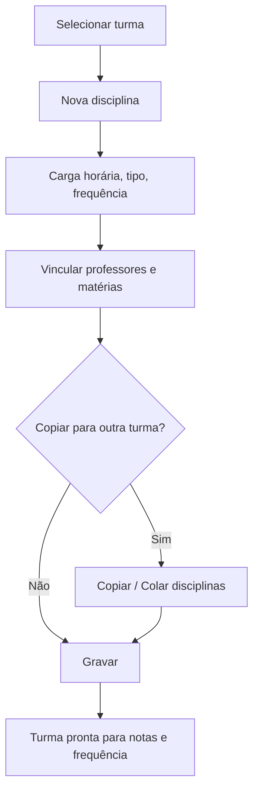

# Oferta de Disciplina

## Objetivo

Definir **quais disciplinas são ofertadas em cada turma**, com suas **matérias**, **carga
horária**, **tipo**, **controle de frequência** e os **professores** responsáveis. É o que
conecta a estrutura (disciplinas/matriz) à turma real, habilitando o lançamento de notas e
frequência.

---

## Como acessar

```
Tabelas
→ Oferta de Disciplina
```

---

## Quando utilizar

- Depois de criar a turma, para montar a grade de disciplinas e professores dela.
- Para copiar a oferta de uma turma para outra (agiliza a montagem).

---

## Como utilizar

1. Abra **Oferta de Disciplina**.
2. Selecione a **Turma**.
3. Clique em **Nova Disciplina** e escolha a **Disciplina**; informe **Carga Horária**, **Tipo**,
   **Controle de Frequência** e a **Ordem**.
4. Vincule o(s) **Professor(a)(es)** e, se houver, as **Matérias** da disciplina.
5. Repita para as demais disciplinas da turma.
6. Para reaproveitar, use **Copiar disciplinas** em uma turma e **Colar disciplinas** em outra.
7. Marque **Disciplina Concluída** quando aplicável.
8. Clique em **Gravar**.

---

## Campos

| Campo | Descrição | Obrigatório | Observações |
|-------|-----------|-------------|-------------|
| Turma | Turma que receberá a oferta | Sim | |
| Disciplina | Disciplina ofertada | Sim | |
| Carga Horária / CHR Total | Carga horária | Sim | Total exibido por turma |
| Tipo | Tipo da disciplina na turma | Não | |
| Controle de Frequência | Se a disciplina controla faltas na turma | Não | |
| Ord (Ordem) | Ordem da disciplina | Não | |
| Professor(a) | Professor responsável | Não | Pode haver mais de um |
| Matérias | Matérias da disciplina | Condicional | Quando a disciplina tem matérias |
| Disciplina Concluída | Marca a disciplina como concluída | Não | |

---

## Botões

| Botão | O que faz |
|-------|-----------|
| **Nova Disciplina** | Adiciona uma disciplina à oferta da turma |
| **Alterar Disciplina** | Edita a disciplina ofertada |
| **Copiar disciplinas** | Copia a lista de disciplinas da turma |
| **Colar disciplinas** | Cola a lista copiada em outra turma |
| **Gravar** | Salva a oferta |
| **Confirmar/Cancelar Exclusão** | Confirma ou cancela a exclusão |

---

## Filtros e colunas

Colunas: **Código**, **Descrição da Turma**, **Disciplinas**, **Matérias**, **Professores**, **CHR Total**.

---

## Resultados

- A turma passa a ter suas disciplinas, matérias e professores definidos.
- Habilita o **lançamento de notas** e a **frequência** por disciplina.

---

## Regras importantes

- A oferta depende de **turma**, **disciplinas** e **professores** já cadastrados.
- Disciplinas com **matérias** precisam ter o **cálculo informado** — o sistema avisa se faltar.
- O **Controle de Frequência** na oferta determina se aquela disciplina registra faltas na turma.

---

## Mensagens do sistema

**Sucesso**
- *"Lista copiada com sucesso."* / *"Lista colada com sucesso."*

**Erro / Atenção**
- *"Existem matérias com cálculo não informado."*
- *"Erro ao gravar os dados."*

---

## Fluxo da funcionalidade



---

## Exemplos práticos

**Exemplo:** na turma "3º Ano A", adicionar Matemática (80h, com frequência, Prof. Ana),
Português (80h, Prof. Bruno) e assim por diante; depois **copiar** essa oferta para a "3º Ano B".

---

## Dicas

- Use **Copiar/Colar disciplinas** para montar turmas paralelas rapidamente.
- Confira o **cálculo das matérias** antes de gravar para evitar o alerta.

---

## Erros comuns

- **"Existem matérias com cálculo não informado."** → informe como as matérias compõem a nota da disciplina.

---

## FAQ

**Por que uma disciplina não aparece para lançar nota?**
Ela precisa estar **ofertada** na turma e com **lançamento de notas** habilitado no [cadastro de disciplinas](disciplinas.md).

---

## Prints

- [ ] Oferta de disciplinas de uma turma.
- [ ] Vínculo de professores e matérias.
- [ ] Copiar/Colar disciplinas.

---

## Histórico

| Data | Alteração |
|------|-----------|
| 30/07/2026 | Página criada. |
