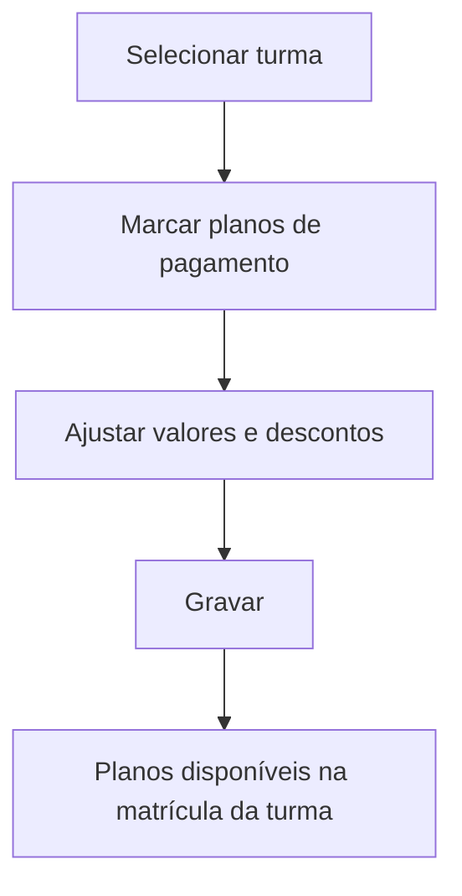

# Plano de Pagamento por Turma

## Objetivo

Vincular os **planos de pagamento** disponíveis a uma **turma**, definindo os valores que serão
oferecidos na matrícula dos alunos daquela turma (valor líquido, valor e desconto da 1ª parcela,
percentual de desconto). É a ponte entre a estrutura acadêmica (turma) e o financeiro (planos).

---

## Quem pode utilizar

Secretaria, Financeiro e Administrador.

---

## Como acessar

```
Tabelas
→ Plano de Pagamento por Turma
```

---

## Quando utilizar

- Ao definir quais planos de pagamento valem para cada turma.
- Ao ajustar valores/descontos oferecidos por turma.

---

## Como utilizar

1. Abra **Plano de Pagamento por Turma**.
2. Selecione a **turma**.
3. Marque os **planos de pagamento** que estarão disponíveis (use **Selecionar Todos** se quiser todos).
4. Confira/ajuste **Valor Líquido**, **Valor 1ª Parcela**, **Desc. 1ª Parcela** e **% Desconto**.
5. Use **Exibir somente selecionados** para revisar a lista final.
6. Clique em **Gravar**.

---

## Campos e colunas

| Campo/Coluna | Descrição |
|--------------|-----------|
| Código | Código do plano |
| Descrição | Nome do plano de pagamento |
| Valor Líquido | Valor líquido do plano |
| Valor 1ª Parcela | Valor da primeira parcela |
| Desc. 1ª Parcela | Desconto na primeira parcela |
| % Desconto | Percentual de desconto |

---

## Botões

| Botão | O que faz |
|-------|-----------|
| **Selecionar Todos** | Marca todos os planos |
| **Exibir somente selecionados** | Filtra a lista para os planos marcados |
| **Opções** | Ações da linha |
| **Gravar** | Salva os planos vinculados à turma |

---

## Resultados

- Os planos marcados passam a ser oferecidos na **matrícula** dos alunos daquela turma.

---

## Regras importantes

- Os **planos de pagamento** precisam existir no cadastro financeiro (ver Tabelas Financeiras — Plano de Pagamento).
- Os valores definidos aqui são a base do que aparece na aba **Matrícula** do aluno.

---

## Fluxo da funcionalidade



---

## Exemplos práticos

**Exemplo:** para a turma "1º Ano A", disponibilizar os planos "12x" e "À vista", com desconto de
10% no plano à vista.

---

## Dicas

- Use **Exibir somente selecionados** para conferir rapidamente o que ficou vinculado.

---

## FAQ

**Onde o aluno escolhe o plano?**
Na aba **Matrícula** do [Cadastro de Alunos](../cadastro/alunos.md), entre os planos vinculados à turma.

---

## Prints

- [ ] Lista de planos por turma.
- [ ] Seleção e valores.

---

## Histórico

| Data | Alteração |
|------|-----------|
| 30/07/2026 | Página criada. |
