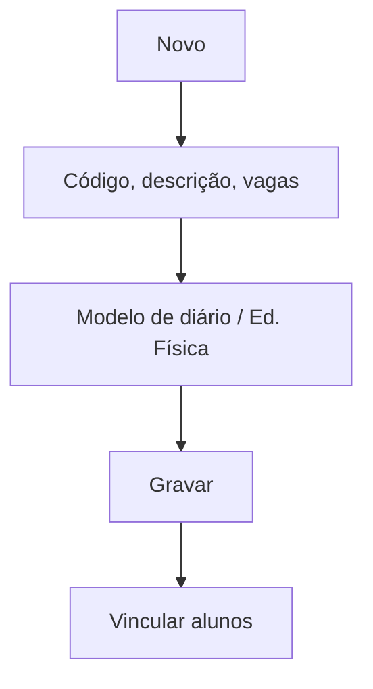

# Turma Auxiliar

## Objetivo

Criar **turmas auxiliares** — agrupamentos paralelos à turma regular usados para reforço,
optativas, Educação Física agrupada ou outras atividades. O vínculo dos alunos a essas turmas é
feito em [Alunos — Turmas Auxiliares](../cadastro/turmas-auxiliares.md).

---

## Quem pode utilizar

Coordenação, Secretaria e Administrador.

---

## Como acessar

```
Tabelas
→ Turma Auxiliar
```

---

## Quando utilizar

- Para criar agrupamentos que não correspondem à turma regular (reforço, optativas, Ed. Física).

---

## Como utilizar

1. Abra **Turma Auxiliar**.
2. Clique em **Novo** (ou **Novo Com Base Nesse**).
3. Informe **Código**, **Descrição** e **Vagas**.
4. Defina o **Modelo de Diário de Classe Padrão** e se é **Turma de Educação Física**.
5. Marque **Turma Encerrada** quando a turma auxiliar não for mais usada.
6. Clique em **Gravar**.

---

## Campos

| Campo | Descrição | Obrigatório | Observações |
|-------|-----------|-------------|-------------|
| Código | Código da turma auxiliar | Sim | |
| Descrição | Nome da turma auxiliar | Sim | |
| Vagas | Número de vagas | Não | |
| Modelo de Diário de Classe Padrão | Modelo de diário | Não | |
| Turma Educação Física | Marca turma de Ed. Física | Não | |
| Turma Encerrada | Encerra a turma auxiliar | Não | |

---

## Botões

| Botão | O que faz |
|-------|-----------|
| **Novo** | Cria uma nova turma auxiliar |
| **Novo Com Base Nesse** | Duplica uma turma auxiliar |
| **Pesquisar** | Busca turmas auxiliares |
| **Opções** | Editar/excluir |
| **Gravar** | Salva a turma auxiliar |
| **Confirmar/Cancelar Exclusão** | Confirma ou cancela a exclusão |

---

## Filtros e colunas

Colunas: **Código**, **Descrição**, **Encerrada**.

---

## Resultados

- A turma auxiliar fica disponível para vincular alunos em [Alunos — Turmas Auxiliares](../cadastro/turmas-auxiliares.md).

---

## Regras importantes

- **Código** e **Descrição** são obrigatórios.
- Turmas **encerradas** deixam de receber novos vínculos.

---

## Fluxo da funcionalidade



---

## Exemplos práticos

**Exemplo:** criar a turma auxiliar "Ed. Física — Masculino Tarde" com modelo de diário próprio.

---

## Dicas

- Use **Turma Educação Física** para agrupar alunos de várias turmas na mesma aula.

---

## FAQ

**Qual a diferença para a turma regular?**
A turma auxiliar não substitui a matrícula; é um agrupamento paralelo para atividades específicas.

---

## Prints

- [ ] Lista de turmas auxiliares.
- [ ] Formulário da turma auxiliar.

---

## Histórico

| Data | Alteração |
|------|-----------|
| 30/07/2026 | Página criada. |
