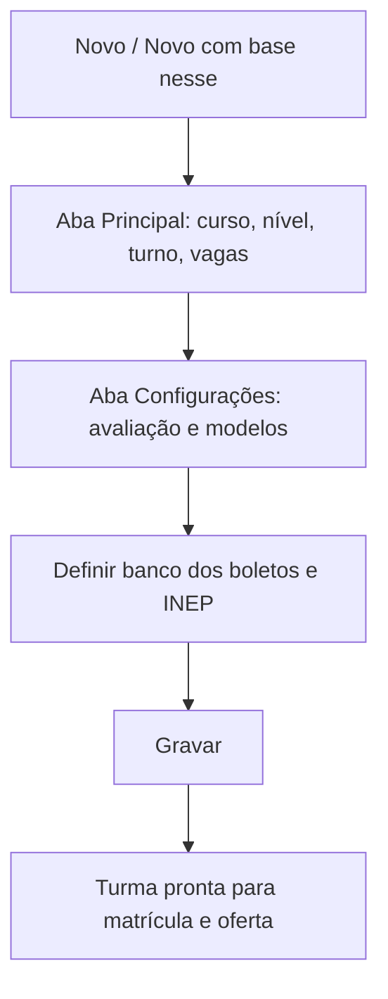

# Turmas

## Objetivo

Criar e configurar as **turmas** da escola — o agrupamento onde o aluno é matriculado. A turma
define curso, nível/série, turno, vagas, professor principal, forma de avaliação, os **modelos**
de boletim/diário/histórico, o **banco dos boletos** e opções de catraca eletrônica.

---

## Quem pode utilizar

Coordenação, Secretaria e Administrador.

---

## Como acessar

```
Tabelas
→ Turmas
```

---

## Quando utilizar

- Ao abrir as turmas do ano letivo.
- Ao ajustar vagas, professor, modelos de impressão ou o banco de cobrança de uma turma.

---

## Como utilizar

1. Abra **Turmas**.
2. Clique em **Novo** (ou **Novo Com Base Nesse** para partir de uma turma existente).
3. Na aba **Principal**, informe **Código**, **Descrição**, **Curso**, **Nível/Escolaridade**,
   **Turno**, **Vagas Previstas** e o **Professor Principal**.
4. Na aba **Configurações**, defina a **Avaliação** (Global ou Detalhado por Disciplina), os
   **Modelos** (Boletim, Diário de Classe, Histórico, Agenda APP), o **Banco para os Boletos**,
   o **Código INEP**, e as opções de **catraca eletrônica** e **itinerário formativo**.
5. Clique em **Gravar**.

---

## Campos (principais)

| Campo | Descrição | Obrigatório | Observações |
|-------|-----------|-------------|-------------|
| Código | Código da turma | Sim | |
| Descrição | Nome da turma | Sim | |
| Curso | Curso da turma | Sim | |
| Nível/Escolaridade | Série/nível | Sim | |
| Turno | Turno | Sim | |
| Vagas Previstas | Total de vagas | Não | Base para "vagas ocupadas" |
| Professor Principal | Professor responsável | Não | |
| Avaliação | Global ou Detalhado por Disciplina | Sim | Global = 1 professor lança |
| Modelo de Boletim / Diário / Histórico | Modelos de impressão | Não | |
| Modelo Agenda APP | Modelo da agenda no app | Não | |
| Banco para os Boletos | Banco usado na geração de boletos | Não | Ligado ao [cadastro de Bancos](../bancario/bancos.md) |
| Código INEP | Código da turma no INEP | Não | Dado oficial |
| Exige Itinerário Formativo | Turma do Novo Ensino Médio | Não | |
| Eletrônica (Catraca/Totem) — Dia/Horário | Regras de catraca | Não | |
| Turma Final de Curso | Marca turma concluinte | Não | |
| Turma Encerrada | Encerra a turma | Não | |

---

## Botões

| Botão | O que faz |
|-------|-----------|
| **Novo** | Cria uma nova turma |
| **Novo Com Base Nesse** | Duplica uma turma como ponto de partida |
| **Pesquisar** | Busca turmas |
| **Opções** | Editar/excluir/alunos registrados |
| **Gravar** | Salva a turma |
| **Confirmar/Cancelar Exclusão** | Confirma ou cancela a exclusão |

---

## Filtros e colunas

Colunas: **Código**, **Descrição**, **Nível**, **Vagas Ocup(adas)**.

---

## Resultados

- A turma fica disponível para **matrícula de alunos**, **oferta de disciplinas**, **notas**,
  **frequência** e **geração de boletos**.

---

## Regras importantes

- **Código**, **Descrição**, **Curso**, **Nível** e **Turno** são essenciais.
- A **forma de avaliação** (Global x Detalhado por Disciplina) define como os professores lançam notas.
- O **Banco para os Boletos** é usado quando a geração usa "o banco do cadastro da TURMA"
  (ver [Geração de Boletos](../financeiro/geracao-boletos.md)).
- Turmas **encerradas** não recebem novas matrículas.

---

## Fluxo da funcionalidade



---

## Exemplos práticos

**Exemplo:** criar "3º Ano A — Manhã", curso Ensino Médio, 40 vagas, avaliação **Detalhado por
Disciplina**, modelo de boletim padrão e banco X para os boletos.

---

## Dicas

- Use **Novo Com Base Nesse** para abrir turmas do novo ano reaproveitando as configurações.
- Defina o **banco dos boletos** já na turma para agilizar a geração de boletos por turma.

---

## Erros comuns

- Boletos gerados no banco errado → confira o **Banco para os Boletos** na turma.

---

## FAQ

**Qual a diferença entre avaliação Global e Detalhada?**
Na **Global**, um único professor lança a nota da turma; na **Detalhada por Disciplina**, cada
professor lança sua disciplina.

**Como vinculo os professores das disciplinas?**
Em [Oferta de Disciplina](oferta-disciplina.md).

---

## Prints

- [ ] Lista de turmas.
- [ ] Aba Principal.
- [ ] Aba Configurações (avaliação, modelos, banco).

---

## Histórico

| Data | Alteração |
|------|-----------|
| 30/07/2026 | Página criada. Observação: o combo de **Banco para os Boletos** foi ajustado recentemente (jul/2026). |
