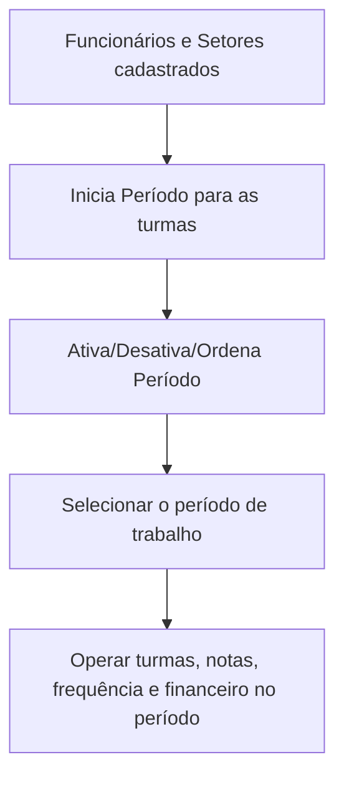

# Módulo Administrativo

## Objetivo

O módulo **Administrativo** cuida da estrutura interna da escola: o cadastro de **funcionários**
(professores e colaboradores), os **setores**, e a gestão dos **períodos letivos** — iniciar um
novo período, ativar/desativar/ordenar períodos e trocar o período de trabalho atual.

## Quem pode utilizar

Administrador e, conforme a permissão, a Coordenação/Secretaria.

## Como acessar

As telas ficam nos grupos **Administrativo** e no seletor de **Períodos** do sistema.

## Mapa do módulo

| Tela | Para que serve | Documentação |
|------|----------------|--------------|
| Funcionários | Cadastrar professores e colaboradores | [Abrir](funcionarios.md) |
| Setor | Cadastrar os setores da escola | [Abrir](setor.md) |
| Inicia Período | Iniciar um novo período letivo para as turmas | [Abrir](inicia-periodo.md) |
| Ativa/Desativa/Ordena Período | Controlar quais períodos ficam ativos e sua ordem | [Abrir](ativa-desativa-ordena-periodo.md) |
| Períodos (seletor) | Trocar o período/ano de trabalho atual | [Abrir](periodos.md) |

## Sobre períodos letivos

O Harpia trabalha sempre dentro de um **Ano Base / Período** (exibido no topo do sistema, ex.:
"ANO BASE 2025 PERÍODO: 1"). Quase tudo — turmas, notas, frequência, financeiro — é vinculado ao
período ativo. Por isso, iniciar e selecionar o período correto é essencial.

## Fluxo geral

---

## Histórico

| Data | Alteração |
|------|-----------|
| 30/07/2026 | Página criada. |
