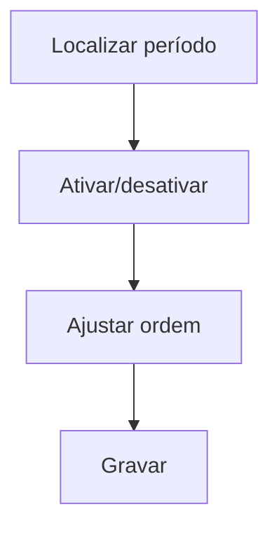

# Ativa / Desativa / Ordena Período

## Objetivo

Controlar quais **períodos letivos** ficam **ativos** no sistema e definir a sua **ordem** de
exibição. É o que determina quais períodos aparecem para seleção e como são apresentados.

---

## Como acessar

```
Administrativo
→ Ativa/Desativa/Ordena Período
```

---

## Quando utilizar

- Para ativar/desativar um período (ex.: encerrar um período antigo).
- Para ajustar a ordem em que os períodos aparecem.

---

## Como utilizar

1. Abra **Ativa/Desativa/Ordena Período**.
2. Localize o período pela **Descrição**, **Ano** e **Sequencial**.
3. Marque/desmarque **Ativo** para ativar ou desativar.
4. Ajuste a **Ordem** de exibição.
5. Salve as alterações.

---

## Campos e colunas

| Campo/Coluna | Descrição |
|--------------|-----------|
| Ano | Ano do período |
| Sequencial | Número do período |
| Descrição | Descrição do período |
| Ativo | Indica se o período está ativo |
| Ordem | Ordem de exibição |

---

## Botões

| Botão | O que faz |
|-------|-----------|
| **Opções** | Ações do período |
| **Gravar** | Salva ativação/ordem |

---

## Resultados

- Apenas os períodos **ativos** ficam disponíveis para seleção; a **ordem** define a apresentação.

---

## Regras importantes

- Desativar um período o remove da seleção de trabalho, sem apagar os dados.
- A **ordem** organiza a lista de períodos exibida ao usuário.

---

## Fluxo da funcionalidade



---

## Exemplos práticos

**Exemplo:** desativar o período "2024 — 2" e deixar ativos apenas os períodos de 2025 e 2026.

---

## Dicas

- Mantenha ativos só os períodos em uso para simplificar a seleção no dia a dia.

---

## FAQ

**Desativar apaga notas/financeiro do período?**
Não; apenas o retira da seleção. Os dados permanecem para consulta.

---

## Prints

- [ ] Lista de períodos com Ativo/Ordem.

---

## Histórico

| Data | Alteração |
|------|-----------|
| 30/07/2026 | Página criada. |
