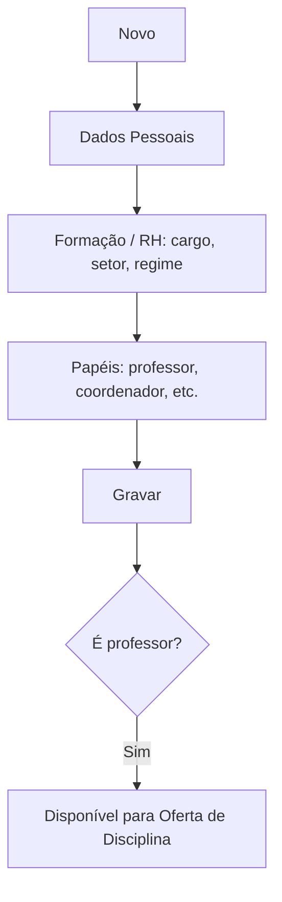

# Funcionários

## Objetivo

Cadastrar e manter os **funcionários** da escola — professores e colaboradores administrativos —
com dados pessoais, cargo, setor, formação e as **permissões de atuação** (professor, coordenador,
atendimento de visitantes, integrações com apps). É a base para vincular professores às turmas e
para o controle de acesso.

---

## Como acessar

```
Administrativo
→ Funcionários
```

O relatório correspondente fica em **Relatórios → Funcionários**.

---

## Quando utilizar

- Ao admitir um novo colaborador ou professor.
- Ao atualizar dados, cargo, setor ou permissões de um funcionário.

---

## Como utilizar

1. Abra **Funcionários**.
2. Clique em **Novo**.
3. Na aba **Dados Pessoais**, informe **Nome**, **Apelido/Operador**, **CPF**, **RG**,
   **Data de Nascimento**, contatos e **Data de Admissão**.
4. Na aba **Formação / RH**, informe **Cargo**, **Função**, **Setor**, **Regime de Trabalho**,
   **Grau de Instrução**, **Titulação** e a **Carga Horária (CHR)**.
5. Defina os papéis/permissões: **Professor**, **Coordenador**, **Administrativo**,
   **Agenda/Atende Visitantes** e as autorizações de app/OS.
6. Clique em **Gravar**.

---

## Campos (principais)

| Campo | Descrição | Obrigatório | Observações |
|-------|-----------|-------------|-------------|
| Nome | Nome do funcionário | Sim | |
| Apelido / Operador | Nome de operador no sistema | Não | |
| Número do CPF | CPF | Sim | Validado |
| Número do RG / Órgão Expedidor | Documento | Não | |
| Data de Nascimento | Nascimento | Sim | Idade validada |
| Data de Admissão / Demissão | Vínculo | Sim / Não | Demissão ≥ admissão |
| Cargo / Função | Cargo e função | Não | |
| Setor | Setor do funcionário | Não | Ver [Setor](setor.md) |
| Regime de Trabalho / CHR | Jornada | Não | |
| Grau de Instrução / Titulação / Graduação | Formação | Não | |
| Professor | Marca como professor | Não | Habilita vínculo a turmas |
| Coordenador / Administrativo | Papéis | Não | |
| Permite ser selecionado na tarefa Professores por Turma | Disponível para oferta | Não | |
| Agenda/Atende Visitantes | Atendimento | Não | |
| Autorizações App MaisEscola / OS | Integrações | Não | |
| Ativado | Situação do funcionário | Não | Demitido não pode ser ativado |

---

## Botões

| Botão | O que faz |
|-------|-----------|
| **Novo** | Cadastra um novo funcionário |
| **Pesquisar** | Busca funcionários |
| **Impressão** | Emite a lista/ficha de funcionários |
| **Gravar** | Salva o funcionário |
| **Opções** | Editar/ativar/desativar |

---

## Filtros e colunas

Colunas: **Matrícula**, **Nome**, **Apelido/Operador**, **Cargo**, **Função**, **Professor**,
**Coordenador**, **Administrativo**, **Ativado**.

---

## Resultados

- O funcionário fica cadastrado e, se marcado como **Professor**, disponível para vincular a
  disciplinas em [Oferta de Disciplina](../academico/oferta-disciplina.md).

---

## Regras importantes

- **CPF** válido e **Data de Nascimento** válida são obrigatórios.
- **A Data de Demissão não pode ser menor que a de Admissão.**
- **Não é possível ativar um funcionário demitido.**
- O sistema alerta para idades incoerentes (**menor de 18** / **maior de 85 anos**).

---

## Mensagens do sistema

- *"CPF inválido"* / *"E-mail inválido"* / *"Data de Nascimento Inválida!"*
- *"Data de Demissão não pode ser menor que a Data de Adimissão"*
- *"Não é possível ativar um funcionário demitido"*
- *"Usuário menor de 18 anos!"* / *"Usuário com idade superior a 85 anos!"*

---

## Fluxo da funcionalidade



---

## Exemplos práticos

**Exemplo:** cadastrar uma professora com cargo "Docente", setor "Pedagógico", marcada como
**Professor** e habilitada para seleção em turmas.

---

## Dicas

- Marque **Professor** e a permissão de seleção por turma para o funcionário aparecer na oferta.
- Use o **Apelido/Operador** padronizado — ele identifica o funcionário nas operações do sistema.

---

## Erros comuns

- **"Data de Demissão não pode ser menor que a de Admissão"** → corrija as datas.
- **Professor não aparece na turma** → verifique se está como **Professor** e habilitado.

---

## FAQ

**Funcionário é o mesmo que usuário do sistema?**
Não. O funcionário é o cadastro de RH; o acesso ao sistema é o [Usuário](../gerenciador/usuarios.md)
(módulo Gerenciador), que pode estar vinculado ao funcionário.

---

## Prints

- [ ] Lista de funcionários.
- [ ] Aba Dados Pessoais.
- [ ] Aba Formação/RH e permissões.

---

## Histórico

| Data | Alteração |
|------|-----------|
| 30/07/2026 | Página criada. |
