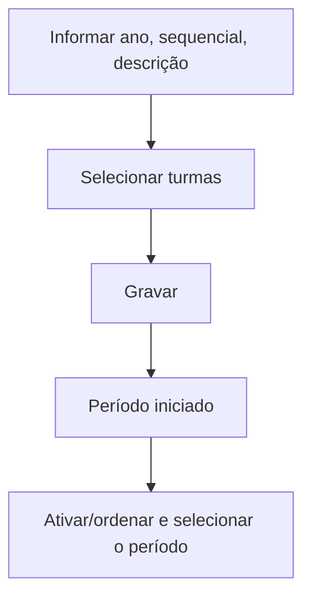

# Inicia Período

## Objetivo

**Iniciar um novo período letivo** para as turmas — o processo que abre o período (ano/semestre)
e prepara as turmas para operar nele. É um passo administrativo feito na virada de período.

---

## Como acessar

```
Administrativo
→ Inicia Período
```

---

## Quando utilizar

- Na virada para um novo período letivo (novo ano/semestre).

---

## Como utilizar

1. Abra **Inicia Período**.
2. Informe o **Ano**, o **Sequencial** (número do período) e a **Descrição**.
3. Selecione as **Turmas** que farão parte do novo período (use **Selecionar Todos** ou
   **Inverter Seleção** para agilizar).
4. Clique em **Gravar**.
5. Aguarde a confirmação *"Período iniciado com sucesso"*.

---

## Campos e colunas

| Campo/Coluna | Descrição |
|--------------|-----------|
| Ano | Ano do novo período |
| Sequencial | Número do período (1, 2...) |
| Descrição | Descrição do período |
| Turma | Turmas a incluir no período |

---

## Botões

| Botão | O que faz |
|-------|-----------|
| **Selecionar Todos** | Marca todas as turmas |
| **Inverter Seleção** | Inverte a seleção atual |
| **Gravar** | Inicia o período com as turmas selecionadas |

---

## Resultados

- O novo período é criado e as turmas selecionadas passam a operar nele.

---

## Regras importantes

- **Ano**, **Sequencial** e **Descrição** são obrigatórios.
- Após iniciar, ajuste a ativação/ordem em [Ativa/Desativa/Ordena Período](ativa-desativa-ordena-periodo.md).

---

## Mensagens do sistema

- *"Período iniciado com sucesso"*
- *"Selecione o ano"* / *"Selecione o sequencial"* / *"Preencha a descrição"*

---

## Fluxo da funcionalidade



---

## Exemplos práticos

**Exemplo:** iniciar o "Ano 2026 — Período 1", incluindo todas as turmas do novo ano letivo.

---

## Dicas

- Confira a lista de **turmas** antes de gravar — elas comporão o novo período.

---

## Erros comuns

- **"Selecione o ano / sequencial" / "Preencha a descrição"** → complete os campos antes de gravar.

---

## FAQ

**Isso apaga o período anterior?**
Não; cria um novo período. Os anteriores continuam disponíveis para consulta.

---

## Prints

- [ ] Preenchimento de ano/sequencial/descrição.
- [ ] Seleção de turmas.

---

## Histórico

| Data | Alteração |
|------|-----------|
| 30/07/2026 | Página criada. |
