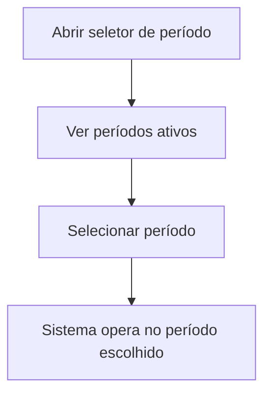

# Períodos (Seleção do Período de Trabalho)

## Objetivo

**Selecionar o período/ano de trabalho atual** — o contexto em que o usuário opera o sistema.
Tudo o que é feito (turmas, notas, frequência, financeiro) acontece dentro do período selecionado,
exibido no topo do sistema (ex.: "ANO BASE 2025 PERÍODO: 1").

---

## Quem pode utilizar

Todos os usuários (dentro dos períodos ativos e das suas permissões).

---

## Como acessar

No **topo do sistema**, clique sobre o indicador de período (ex.: "ANO BASE 2025 PERÍODO: 1") para
abrir o seletor. Também disponível em **Períodos**.

---

## Quando utilizar

- Sempre que precisar trabalhar em um período diferente do atual (ex.: consultar o ano anterior).

---

## Como utilizar

1. Abra o seletor de **Períodos**.
2. Veja **Períodos Ativos** (ou **Todos os Períodos**).
3. Clique em **Selecionar** no período desejado.
4. O sistema passa a operar naquele período (o indicador no topo é atualizado).

---

## Campos e opções

| Opção | Descrição |
|-------|-----------|
| Períodos Ativos | Lista apenas os períodos ativos |
| Todos os Períodos | Lista todos os períodos |
| Selecionar | Define o período de trabalho |

---

## Resultados

- Todo o sistema passa a refletir o período selecionado (turmas, notas, financeiro, etc.).

---

## Regras importantes

- Só aparecem para seleção os períodos **ativos** (ver [Ativa/Desativa/Ordena Período](ativa-desativa-ordena-periodo.md)).
- **Confirme sempre o período no topo** antes de lançar dados — lançar no período errado é uma causa comum de erro.

---

## Fluxo da funcionalidade

---

## Exemplos práticos

**Exemplo:** trocar para "2024 — Período 2" para consultar notas do ano anterior e depois voltar
para o período atual.

---

## Dicas

- Antes de lançar notas/frequência/financeiro, **confira o período no topo** da tela.

---

## FAQ

**Por que meus lançamentos não aparecem?**
Você pode estar em outro **período**. Verifique o indicador no topo e selecione o período correto.

---

## Prints

- [ ] Indicador de período no topo.
- [ ] Seletor de períodos.

---

## Histórico

| Data | Alteração |
|------|-----------|
| 30/07/2026 | Página criada. |
