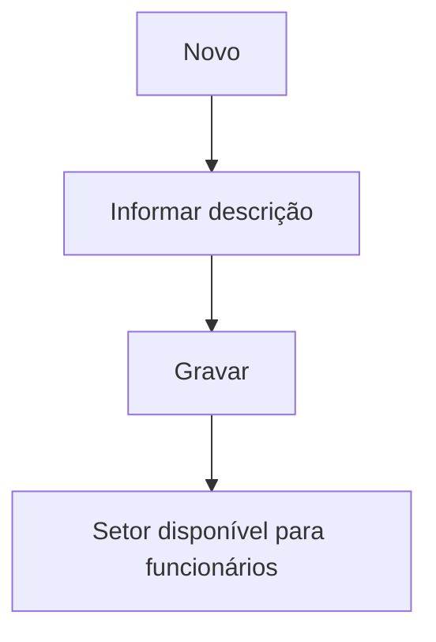

# Setor

## Objetivo

Cadastrar os **setores** da escola (ex.: Pedagógico, Administrativo, Financeiro, Limpeza) usados
para organizar os [funcionários](funcionarios.md) e apoiar relatórios internos.

---

## Como acessar

```
Administrativo
→ Setor
```

---

## Quando utilizar

- Ao estruturar os setores para classificar os funcionários.

---

## Como utilizar

1. Abra **Setor**.
2. Clique em **Novo**.
3. Informe a **Descrição** do setor.
4. Clique em **Gravar**.

---

## Campos

| Campo | Descrição | Obrigatório |
|-------|-----------|-------------|
| Setor / Descrição | Nome do setor | Sim |

---

## Botões

| Botão | O que faz |
|-------|-----------|
| **Novo** | Cadastra um novo setor |
| **Pesquisar** | Busca setores |
| **Gravar** | Salva o setor |
| **Opções** | Editar/excluir |

---

## Resultados

- O setor fica disponível para vincular aos funcionários.

---

## Regras importantes

- **A descrição é obrigatória.**

---

## Mensagens do sistema

- *"Descrição é obrigatória."* / *"Preencha a descrição"*

---

## Fluxo da funcionalidade



---

## Exemplos práticos

**Exemplo:** cadastrar os setores "Pedagógico", "Secretaria" e "Financeiro".

---

## Dicas

- Mantenha poucos setores bem definidos para facilitar os relatórios de RH.

---

## FAQ

**Onde uso o setor?**
No cadastro de [Funcionários](funcionarios.md).

---

## Prints

- [ ] Lista de setores.
- [ ] Formulário.

---

## Histórico

| Data | Alteração |
|------|-----------|
| 30/07/2026 | Página criada. |
