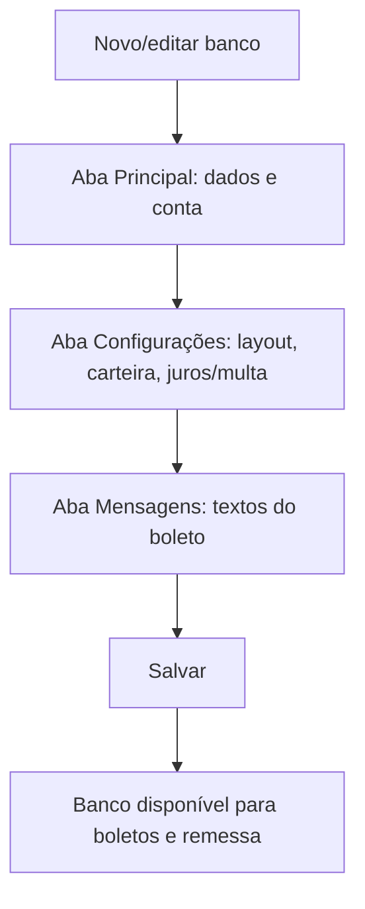

# Cadastro de Bancos

## Objetivo

Cadastrar e configurar os **bancos** usados pela escola para emitir boletos e gerar o arquivo de
remessa. É aqui que ficam os dados da conta (agência, cedente, carteira), o layout CNAB, os
percentuais de juros e multa e as mensagens que aparecem no boleto.

---

## Como acessar

```
Bancário
→ Bancos
```

---

## Quando utilizar

- Ao começar a trabalhar com um novo banco.
- Ao ajustar dados de cobrança (carteira, cedente, layout, juros/multa, mensagens do boleto).

---

## Como utilizar

1. Abra **Bancos**.
2. Cadastre um novo banco ou edite um existente.
3. Na aba **Principal**, preencha os dados de identificação e da conta.
4. Na aba **Configurações**, defina o layout (**CNAB 240**/**CNAB 400**), carteira, sequência de
   remessa, percentuais de juros/multa e opções de impressão do boleto.
5. Na aba **Mensagens**, escreva as mensagens que sairão no boleto.
6. Salve o cadastro.

*(Print sugerido: aba Principal e aba Configurações do cadastro de banco.)*

---

## Campos

**Aba Principal**

| Campo | Descrição | Obrigatório | Observações |
|-------|-----------|-------------|-------------|
| Código | Código do banco | Sim | |
| Nome do Banco | Nome do banco | Sim | |
| CNPJ / CPF | Documento do banco/cedente | Sim | Validado na remessa |
| Agência | Agência | Sim | |
| Agência/CC/Ced | Agência/conta/cedente | Condicional | |
| Nome do Cedente | Nome do cedente (a escola) | Sim | |
| Nº do Cedente / Conta Corrente / Convênio | Identificação junto ao banco | Sim | |
| Local de Pagamento | Texto de local de pagamento no boleto | Não | |
| Fonte Bancária | Fonte financeira vinculada | Não | |

**Aba Configurações**

| Campo | Descrição | Observações |
|-------|-----------|-------------|
| CNAB 240 / CNAB 400 | Layout do arquivo de remessa | Escolha conforme o banco |
| Carteira | Carteira de cobrança | |
| Variação / Unidade | Variação/unidade da carteira | |
| Seq. Remessa / Sequência | Sequência do arquivo de remessa | |
| Percentual de Juros | Juros aplicados | |
| Percentual de Multa | Multa aplicada | |
| Dias p/ Devolução | Dias para devolução/protesto | |
| Calcular valor bruto / líquido da boleta | Forma de cálculo do valor | |
| Gerar Arquivo de Remessa / Automático | Habilita/gera remessa | |
| Emite Carnê de Pagamento | Emite carnê | |
| Imprimir Linha Digitável / Código de Barra | Opções de impressão do boleto | |
| Imprimir o Valor do Desconto | Mostra desconto no boleto | |

**Aba Mensagens**

| Campo | Descrição |
|-------|-----------|
| Mensagem 01 a 04 | Textos exibidos no boleto |

---

## Botões

| Botão | O que faz |
|-------|-----------|
| **Gravar / Salvar** | Salva o cadastro do banco |
| **Cancelar** | Fecha sem salvar |

---

## Resultados

- O banco fica disponível para uso na [Geração de Boletos](../financeiro/geracao-boletos.md) e
  no [Arquivo de Remessa](../financeiro/arquivo-remessa.md).

---

## Regras importantes

- O **CNPJ/CPF** e os parâmetros de cobrança (carteira, cedente, NOSSO NÚMERO) precisam estar
  corretos, ou a **geração da remessa falha**.
- O layout (**CNAB 240/400**) deve ser o exigido pelo banco.
- O banco cadastrado também pode ser vinculado a uma **turma** (ver observação abaixo).

---

## Relação com o cadastro de Turmas

No cadastro de **Turmas** existe um campo para selecionar o **banco** que será usado para os
boletos daquela turma. Na [Geração de Boletos](../financeiro/geracao-boletos.md), a opção
**"Considerando o banco do cadastro da TURMA"** usa justamente esse banco. Mantenha o cadastro
do banco correto para que a geração e a remessa funcionem.

---

## Mensagens do sistema

**Erro**
- *"Campo Nome é obrigatório!"*
- Na remessa: *"CNPJ do banco inválido/não cadastrado. Verifique!"*, *"Parâmetro NOSSO NÚMERO não encontrado. Verifique!"*

---

## Fluxo da funcionalidade



---

## Exemplos práticos

**Exemplo — novo banco de cobrança:** Cadastre o banco com CNPJ, agência, cedente e conta na
aba **Principal**; escolha **CNAB 240** e a carteira na aba **Configurações**; escreva as
mensagens do boleto; salve. Vincule esse banco às turmas desejadas.

---

## Dicas

- Confirme com o banco o **layout (240/400)** e a **carteira** antes de configurar.
- Preencha as **mensagens** do boleto (instruções de pagamento, juros/multa) para o pagador.

---

## Erros comuns

- **Remessa não gera / CNPJ inválido** → revise o CNPJ e os parâmetros da aba Configurações.

---

## FAQ

**Posso ter mais de um banco?**
Sim. Cada turma pode usar um banco diferente.

**Onde o boleto usa esses dados?**
Na geração do boleto e no arquivo de remessa.

---

## Prints

- [ ] Aba Principal.
- [ ] Aba Configurações.
- [ ] Aba Mensagens.

---

## Histórico

| Data | Alteração |
|------|-----------|
| 30/07/2026 | Página criada. Inclui ajustes de campos bancários e o combo de bancos no cadastro de Turmas. |
