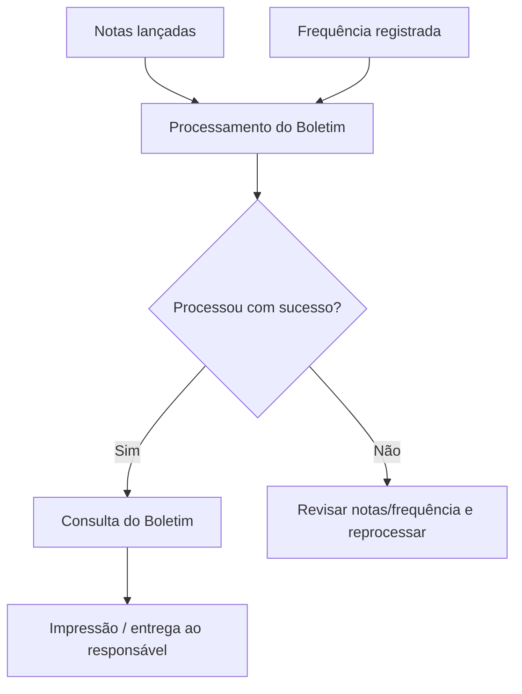

# Módulo Boletim

## Objetivo

O módulo **Boletim** transforma as **notas** e a **frequência** lançadas em um **boletim** pronto
para consulta e impressão. Ele tem duas etapas: o **processamento** (que calcula/consolida os
resultados de cada aluno conforme as regras da escola) e a **consulta** (que exibe o boletim já
processado).

## Como acessar

As telas ficam no grupo **Boletim** do menu lateral.

## Mapa do módulo

| Tela | Para que serve | Documentação |
|------|----------------|--------------|
| Processamento do Boletim | Calcular/consolidar o boletim das turmas | [Abrir](processamento.md) |
| Consulta do Boletim | Visualizar/imprimir o boletim de um aluno | [Abrir](consulta.md) |

> Existe também o **Processamento Auxiliar**, com o mesmo funcionamento do processamento
> principal, voltado às **turmas auxiliares**.

## Pré-requisitos

Para o boletim sair correto, antes é preciso ter:

- [Notas](../notas/README.md) lançadas.
- [Frequência](../frequencia/README.md) registrada.
- Turma configurada (modelo de boletim, forma de avaliação) em [Turmas](../academico/turmas.md).
- Regras definidas em **Configurações de Avaliações/Boletim** (módulo Configurações).

## Fluxo geral

---

## Histórico

| Data | Alteração |
|------|-----------|
| 30/07/2026 | Página criada. |
