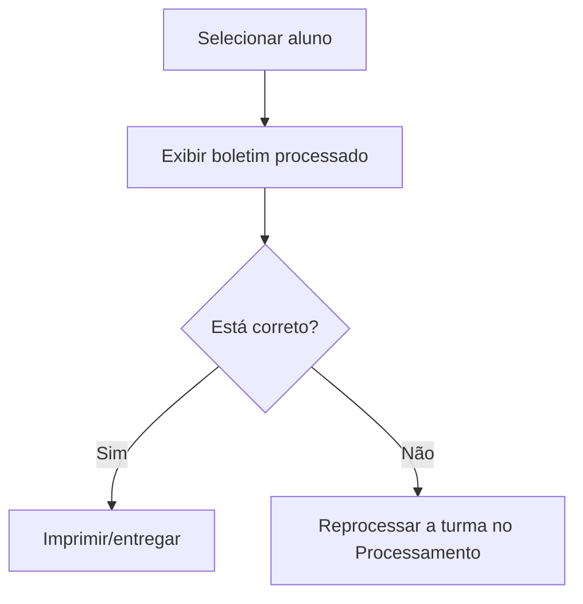

# Consulta do Boletim

## Objetivo

Visualizar o **boletim já processado** de um aluno, com as notas e a frequência consolidadas, e
imprimi-lo/entregá-lo ao responsável.

---

## Quem pode utilizar

Professores, Coordenação, Secretaria e Administrador.

---

## Como acessar

```
Boletim
→ Consulta do Boletim
```

---

## Quando utilizar

- Para conferir o boletim de um aluno após o [processamento](processamento.md).
- Para imprimir/entregar o boletim.

---

## Como utilizar

1. Abra **Consulta do Boletim**.
2. Selecione/pesquise o **Aluno** (e a turma, quando solicitado).
3. O boletim processado é exibido na tela.
4. Use a opção de impressão para gerar o documento.

---

## Campos

| Campo | Descrição | Obrigatório |
|-------|-----------|-------------|
| Aluno | Aluno cujo boletim será consultado | Sim |

---

## Resultados

- Exibe o boletim consolidado do aluno, pronto para impressão.

---

## Regras importantes

- O boletim só aparece se a turma do aluno já foi **processada** (ver [Processamento](processamento.md)).
- O conteúdo reflete o **último processamento** — se estiver desatualizado, reprocessse a turma.

---

## Mensagens do sistema

- *"Erro ao buscar boletim."*

---

## Fluxo da funcionalidade



---

## Exemplos práticos

**Exemplo:** um responsável pede o boletim do 1º bimestre — pesquisar o aluno e imprimir o
boletim já processado.

---

## Dicas

- Se o boletim não aparecer ou estiver defasado, verifique se a turma foi **processada** após as últimas notas.

---

## Erros comuns

- **"Erro ao buscar boletim."** → confira se a turma/avaliação foi processada.

---

## FAQ

**Por que o boletim não mostra a última nota?**
Porque a turma precisa ser **reprocessada** após a alteração.

---

## Prints

- [ ] Consulta do boletim de um aluno.
- [ ] Boletim para impressão.

---

## Histórico

| Data | Alteração |
|------|-----------|
| 30/07/2026 | Página criada. |
