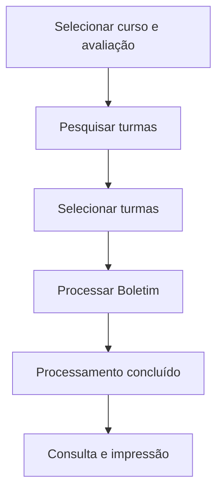

# Processamento do Boletim

## Objetivo

**Calcular e consolidar** o boletim das turmas: a partir das notas e da frequência já lançadas, o
sistema aplica as regras de avaliação e gera o resultado de cada aluno por avaliação/etapa. É um
processo que pode ser executado quantas vezes for necessário (reprocessamento).

---

## Como acessar

```
Boletim
→ Processamento do Boletim
```

Para turmas auxiliares, use **Boletim → Processamento Auxiliar** (mesmo funcionamento).

---

## Quando utilizar

- Ao fechar uma avaliação/etapa, para gerar os boletins.
- Sempre que ajustar notas/frequência e precisar **reprocessar**.

---

## Como utilizar

1. Abra **Processamento do Boletim** e aguarde o carregamento. No topo aparecem o **período** e a
   origem das faltas (*lançadas no boletim* ou *frequência diária*, no Processamento Auxiliar).
2. Em **Filtros**, escolha a **Avaliação** e o **Curso**. As turmas do curso são listadas
   automaticamente; **Pesquisar** atualiza a lista.
3. Marque as turmas: clique na caixa ou em qualquer ponto da linha. A caixa do cabeçalho marca todas.
   Se alguma turma falhou no último processamento, use **Selecionar as N com falha**.
4. Na barra inferior, escolha **Processar no** *Navegador* (o cálculo é feito neste computador) ou
   *Servidor*. A escolha fica salva para o seu usuário.
5. Clique em **Processar Boletim**. Antes de calcular, o sistema **confere a oferta de disciplinas da turma**
   e inclui no boletim o que estiver faltando para os alunos **matriculados** (ver *Regras importantes*).
   O quadro de acompanhamento mostra o progresso geral, e a coluna **Situação** mostra a etapa de cada turma. **Mantenha a tela aberta até o fim**: fechar ou recarregar
   interrompe as turmas que ainda não foram enviadas (o navegador avisa antes de sair).
6. Ao terminar, confira a coluna **Situação**: *Concluída* (com o número de alunos) ou *Falhou* — nesse
   caso, clique em **Ver detalhe**, corrija o motivo e processe a turma de novo.

---

## Campos e colunas

| Campo/Coluna | Descrição |
|--------------|-----------|
| Avaliação | Etapa avaliativa a processar |
| Curso | Curso das turmas |
| Turma | Código e descrição da turma |
| Situação | *Não processada*, *Processada*, etapa em andamento, *Concluída* ou *Falhou* (com o motivo) |
| Último processamento | Data e hora, avaliação e usuário do último processamento com sucesso |
| Processar no | *Navegador* ou *Servidor* — onde o cálculo é feito |

---

## Botões

| Botão | O que faz |
|-------|-----------|
| **Pesquisar** | Atualiza a lista de turmas do curso |
| Caixa do cabeçalho da tabela | Marca ou desmarca todas as turmas |
| **Selecionar as N com falha** | Marca só as turmas cuja última tentativa falhou |
| **Ver detalhe** | Mostra etapa, data, mensagem e código técnico da falha |
| **Processar Boletim** | Processa as turmas marcadas |

---

## Resultados

- Os boletins das turmas ficam **processados** e disponíveis para [consulta](consulta.md) e impressão.
- A coluna **Último processamento** registra quando e por quem foi processado.

---

## Regras importantes

- É obrigatório selecionar **Curso** e **Avaliação**.
- O processamento usa as **notas e a frequência já lançadas** — lance tudo antes de processar.
- O boletim pode ser **reprocessado** a qualquer momento após ajustes.
- Antes de processar, o sistema **confere a configuração** do período (layout do boletim, fórmulas,
  fórmula de frequência). Se faltar algo, **nada é gravado** e a mensagem indica o que corrigir.
- Cada aluno também é conferido antes de o boletim dele ser refeito. Se houver problema (por exemplo,
  disciplina sem a configuração **Aprova por média**), o aluno é listado como **não processado** e o
  boletim anterior dele **permanece como estava**.
- A coluna **Último Processamento** só é atualizada nas turmas em que **todos os alunos** foram
  processados com sucesso.
- **Disciplinas que faltam no boletim:** ao processar, o sistema compara o boletim de cada aluno com a
  **oferta de disciplinas da turma** e **inclui** as disciplinas (e matérias) que estiverem faltando, sem nota
  e sem falta lançadas. Isso resolve o caso do aluno que foi matriculado sem o boletim ter sido montado.
  - Só inclui para alunos com situação **MATRICULADO**. Aluno registrado, cancelado, transferido ou trancado
    não recebe disciplina nova — se ele não tiver nenhuma disciplina, a turma continua apresentando falha.
  - **Nada é apagado.** Disciplina que o aluno tem a mais do que a oferta — optativa, adaptação, dependência
    ou outra complementar — permanece como está.
  - Adaptação e dependência **não substituem** a disciplina regular da grade: se o aluno tem só a dependência
    de uma disciplina que está na oferta, a disciplina regular é incluída.
  - A inclusão é registrada na mensagem ao fim do processamento: *"N disciplina(s) da oferta faltavam e foram
    incluídas em X aluno(s) matriculado(s)"*.
- A marcação de **"não fez a prova"** lançada pelo professor é **preservada** pelo processamento.
- Em disciplinas com **matérias**, a nota da disciplina é a soma ou a média (conforme a oferta) **apenas
  das matérias com nota lançada**.
- Fórmulas podem usar **AND**, **OR** e **NOT** (maiúsculas ou minúsculas).
- O sistema **não arredonda** notas automaticamente nas regras de aprovação. Se a escola arredonda,
  isso deve estar na fórmula, por exemplo `ROUND(média, 2)` — veja
  [Fórmulas de Secretaria › Arredondamento](../configuracoes/formulas-secretaria.md#arredondamento).

---

## Mensagens do sistema

**Sucesso**
- *"Processamento concluído — Boletins processados para N aluno(s)."*

**Erro / Atenção**
- *"Selecione um curso."*
- *"Selecione uma avaliação."*
- *"Parâmetros não cadastrados: ..."* — algum parâmetro da secretaria (NOTMAX, VALSEMLA, INIAPV,
  QTDAVA, NOTVER, PERFAL) não existe no período; ele é considerado **0**. Cadastre em
  **Configurações > Secretaria**.
- *"Configuração incompleta: ..."* — o processamento **não foi iniciado**. A mensagem diz o que falta:
  avaliação não encontrada, coluna **Precisa** ausente no layout, fórmula ausente para alguma avaliação
  ou fórmula de frequência ausente.
- *"N turma(s) com falha"* — as turmas aparecem em vermelho na tabela, com o motivo na coluna
  **Situação**; **Ver detalhe** mostra a mensagem completa. Corrija o motivo e **processe novamente a
  turma** (use **Selecionar as N com falha**). A falha fica registrada e continua visível ao reabrir a tela.
- *"N aviso(s) no processamento"* — o processamento terminou, mas alguma fórmula tem erro de sintaxe,
  condição de IF inválida, parênteses desbalanceados, divisão por zero ou nota sem conceito
  correspondente. O resultado dessas fórmulas foi considerado **0**: revise em **Configurações >
  Fórmulas** e reprocesse.
- *"N disciplina(s) da oferta faltavam e foram incluídas em X aluno(s) matriculado(s)."* — aviso informativo:
  o boletim desses alunos estava incompleto em relação à oferta da turma e foi completado antes do cálculo.
- *"Aluno sem disciplinas no boletim"* — o aluno não tem nenhuma disciplina e **não está matriculado**
  (registrado, cancelado, transferido…), por isso não foi completado automaticamente. Matricule o aluno ou
  ajuste a oferta/boletim dele e processe a turma de novo.
- *"Nenhum aluno encontrado nas turmas selecionadas."*
- *"Não foi possível carregar os dados da tela."* — recarregue a página.

---

## Fluxo da funcionalidade



---

## Exemplos práticos

**Exemplo:** ao fim do 1º Bimestre, selecionar o curso "Ensino Fundamental", avaliação
"1º Bimestre", marcar todas as turmas e **Processar Boletim**.

---

## Dicas

- Reprocessse a turma sempre que corrigir uma nota — o boletim só reflete o **último processamento**.
- Confira **Último processamento** para saber se a turma já foi processada após a última correção.

---

## Erros comuns

- **"Selecione um curso." / "Selecione uma avaliação."** → escolha os dois antes de pesquisar/processar.
- Boletim desatualizado → **reprocessse** depois de alterar notas/frequência.
- **Disciplina sem "Aprova por média"** → configure a disciplina no período e reprocesse a turma.
- **Fórmula com erro** → use o botão de teste em **Configurações > Fórmulas**: ele agora mostra o
  problema encontrado.
- **Processamento Auxiliar: "a turma não tem lançamentos de frequência diária"** → lance a frequência
  diária da turma antes de processar.

---

## FAQ

**Preciso processar toda vez que mudo uma nota?**
Sim, para a mudança aparecer no boletim é preciso reprocessar a turma.

**Qual a diferença do Processamento Auxiliar?**
Funciona igual, mas para as **turmas auxiliares**.

---

## Prints

- [ ] Seleção de curso/avaliação e lista de turmas.
- [ ] Mensagem de processamento concluído.

---

## Histórico

| Data | Alteração |
|------|-----------|
| 30/07/2026 | Página criada. |
| 06/11/2026 | Inclusão automática das disciplinas da oferta que faltam no boletim dos alunos matriculados. |
| 06/11/2026 | Tela reformulada: lista de turmas automática, coluna Situação, seleção pela linha e das turmas com falha, escolha de navegador/servidor, acompanhamento do processamento e barra de ações fixa. |
| 31/10/2026 | Validação da configuração e dos alunos antes de processar; lista de alunos não processados; avisos de fórmula; "Último Processamento" só com sucesso; preservação do "não fez a prova"; média de matérias só com notas lançadas; AND/OR/NOT nas fórmulas. |
