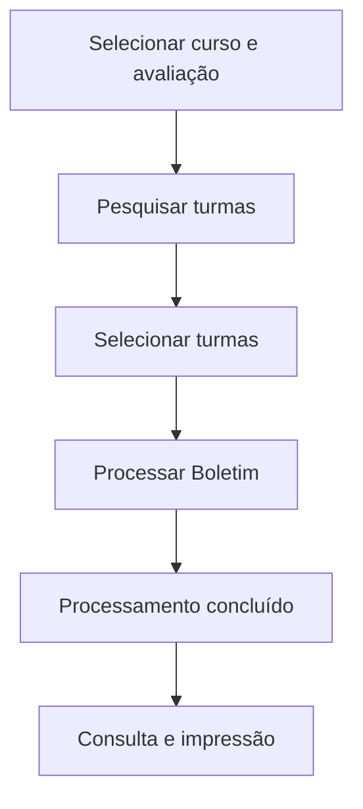

# Processamento do Boletim

## Objetivo

**Calcular e consolidar** o boletim das turmas: a partir das notas e da frequência já lançadas, o
sistema aplica as regras de avaliação e gera o resultado de cada aluno por avaliação/etapa. É um
processo que pode ser executado quantas vezes for necessário (reprocessamento).

---

## Quem pode utilizar

Coordenação, Secretaria e Administrador.

---

## Como acessar

```
Boletim
→ Processamento do Boletim
```

Para turmas auxiliares, use **Boletim → Processamento Auxiliar** (mesmo funcionamento).

---

## Quando utilizar

- Ao fechar uma avaliação/etapa, para gerar os boletins.
- Sempre que ajustar notas/frequência e precisar **reprocessar**.

---

## Como utilizar

1. Abra **Processamento do Boletim**.
2. Selecione o **Curso** e a **Avaliação** (etapa a processar).
3. Clique em **Pesquisar** para listar as **turmas**.
4. Selecione as turmas desejadas (ou use **Selecionar Todos**).
5. Clique em **Processar Boletim**.
6. Aguarde a mensagem *"Processamento de Boletins Concluído!"*.
7. Confira a coluna **Último Processamento** (data, hora e usuário).

---

## Campos e colunas

| Campo/Coluna | Descrição |
|--------------|-----------|
| Curso | Curso a processar |
| Avaliação | Etapa avaliativa |
| Turma / Descrição | Turmas do curso |
| Último Processamento | Data, Hora e Usuário do último processamento |

---

## Botões

| Botão | O que faz |
|-------|-----------|
| **Pesquisar** | Lista as turmas do curso |
| **Selecionar Todos** | Marca todas as turmas |
| **Processar Boletim** | Executa o processamento das turmas selecionadas |

---

## Resultados

- Os boletins das turmas ficam **processados** e disponíveis para [consulta](consulta.md) e impressão.
- A coluna **Último Processamento** registra quando e por quem foi processado.

---

## Regras importantes

- É obrigatório selecionar **Curso** e **Avaliação**.
- O processamento usa as **notas e a frequência já lançadas** — lance tudo antes de processar.
- O boletim pode ser **reprocessado** a qualquer momento após ajustes.

---

## Mensagens do sistema

**Sucesso**
- *"Processamento de Boletins Concluído!"*

**Erro / Atenção**
- *"Selecione um curso."*
- *"Selecione uma avaliação."*

---

## Fluxo da funcionalidade



---

## Exemplos práticos

**Exemplo:** ao fim do 1º Bimestre, selecionar o curso "Ensino Fundamental", avaliação
"1º Bimestre", marcar todas as turmas e **Processar Boletim**.

---

## Dicas

- Reprocessse a turma sempre que corrigir uma nota — o boletim só reflete o **último processamento**.
- Confira **Último Processamento** para saber se a turma já foi processada após a última correção.

---

## Erros comuns

- **"Selecione um curso." / "Selecione uma avaliação."** → escolha os dois antes de pesquisar/processar.
- Boletim desatualizado → **reprocessse** depois de alterar notas/frequência.

---

## FAQ

**Preciso processar toda vez que mudo uma nota?**
Sim, para a mudança aparecer no boletim é preciso reprocessar a turma.

**Qual a diferença do Processamento Auxiliar?**
Funciona igual, mas para as **turmas auxiliares**.

---

## Prints

- [ ] Seleção de curso/avaliação e lista de turmas.
- [ ] Mensagem de processamento concluído.

---

## Histórico

| Data | Alteração |
|------|-----------|
| 30/07/2026 | Página criada. |
