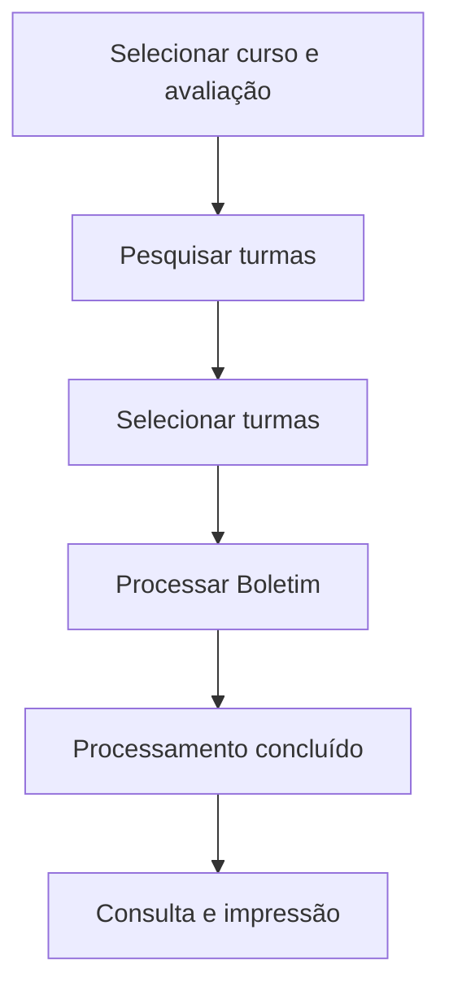

# Processamento do Boletim

## Objetivo

**Calcular e consolidar** o boletim das turmas: a partir das notas e da frequência já lançadas, o
sistema aplica as regras de avaliação e gera o resultado de cada aluno por avaliação/etapa. É um
processo que pode ser executado quantas vezes for necessário (reprocessamento).

---

## Como acessar

```
Boletim
→ Processamento do Boletim
```

Para turmas auxiliares, use **Boletim → Processamento Auxiliar** (mesmo funcionamento).

---

## Quando utilizar

- Ao fechar uma avaliação/etapa, para gerar os boletins.
- Sempre que ajustar notas/frequência e precisar **reprocessar**.

---

## Como utilizar

1. Abra **Processamento do Boletim** e aguarde o carregamento da tela (enquanto carrega, os botões
   **Pesquisar** e **Processar Boletim** ficam desabilitados).
2. Selecione o **Curso** e a **Avaliação** (etapa a processar).
3. Clique em **Pesquisar** para listar as **turmas**.
4. Selecione as turmas desejadas (ou use **Selecionar Todos**).
5. Clique em **Processar Boletim** e acompanhe a barra de progresso.
6. Aguarde a mensagem final:
   - *"Processamento de Boletins Concluído! (N alunos)"* — tudo certo; ou
   - *"X de N alunos não foram processados"* — veja [Mensagens do sistema](#mensagens-do-sistema).
7. Confira a coluna **Último Processamento** (data, hora e usuário).

---

## Campos e colunas

| Campo/Coluna | Descrição |
|--------------|-----------|
| Curso | Curso a processar |
| Avaliação | Etapa avaliativa |
| Turma / Descrição | Turmas do curso |
| Último Processamento | Data, Hora e Usuário do último processamento |

---

## Botões

| Botão | O que faz |
|-------|-----------|
| **Pesquisar** | Lista as turmas do curso |
| **Selecionar Todos** | Marca todas as turmas |
| **Processar Boletim** | Executa o processamento das turmas selecionadas |

---

## Resultados

- Os boletins das turmas ficam **processados** e disponíveis para [consulta](consulta.md) e impressão.
- A coluna **Último Processamento** registra quando e por quem foi processado.

---

## Regras importantes

- É obrigatório selecionar **Curso** e **Avaliação**.
- O processamento usa as **notas e a frequência já lançadas** — lance tudo antes de processar.
- O boletim pode ser **reprocessado** a qualquer momento após ajustes.
- Antes de processar, o sistema **confere a configuração** do período (layout do boletim, fórmulas,
  fórmula de frequência). Se faltar algo, **nada é gravado** e a mensagem indica o que corrigir.
- Cada aluno também é conferido antes de o boletim dele ser refeito. Se houver problema (por exemplo,
  disciplina sem a configuração **Aprova por média**), o aluno é listado como **não processado** e o
  boletim anterior dele **permanece como estava**.
- A coluna **Último Processamento** só é atualizada nas turmas em que **todos os alunos** foram
  processados com sucesso.
- A marcação de **"não fez a prova"** lançada pelo professor é **preservada** pelo processamento.
- Em disciplinas com **matérias**, a nota da disciplina é a soma ou a média (conforme a oferta) **apenas
  das matérias com nota lançada**.
- Fórmulas podem usar **AND**, **OR** e **NOT** (maiúsculas ou minúsculas).
- O sistema **não arredonda** notas automaticamente nas regras de aprovação. Se a escola arredonda,
  isso deve estar na fórmula, por exemplo `ROUND(média, 2)` — veja
  [Fórmulas de Secretaria › Arredondamento](../configuracoes/formulas-secretaria.md#arredondamento).

---

## Mensagens do sistema

**Sucesso**
- *"Processamento de Boletins Concluído! (N alunos)"* — a tela recarrega em seguida.

**Erro / Atenção**
- *"Selecione um curso."*
- *"Selecione uma avaliação."*
- *"Parâmetros não cadastrados: ..."* — algum parâmetro da secretaria (NOTMAX, VALSEMLA, INIAPV,
  QTDAVA, NOTVER, PERFAL) não existe no período; ele é considerado **0**. Cadastre em
  **Configurações > Secretaria**.
- *"Configuração incompleta: ..."* — o processamento **não foi iniciado**. A mensagem diz o que falta:
  avaliação não encontrada, coluna **Precisa** ausente no layout, fórmula ausente para alguma avaliação
  ou fórmula de frequência ausente.
- *"X de N alunos não foram processados"* — lista matrícula, turma e motivo (até 10; a lista completa
  fica no console do navegador). Corrija o motivo e **processe novamente a turma**. O boletim anterior
  desses alunos não foi apagado.
- *"N problema(s) nas fórmulas"* — o processamento terminou, mas alguma fórmula tem erro de sintaxe,
  condição de IF inválida, parênteses desbalanceados, divisão por zero ou nota sem conceito
  correspondente. O resultado dessas fórmulas foi considerado **0**: revise em **Configurações >
  Fórmulas** e reprocesse. Neste caso a tela não recarrega, para a mensagem ficar visível.
- *"Nenhum aluno encontrado nas turmas selecionadas."*
- *"Não foi possível carregar os dados da tela."* — recarregue a página.

---

## Fluxo da funcionalidade



---

## Exemplos práticos

**Exemplo:** ao fim do 1º Bimestre, selecionar o curso "Ensino Fundamental", avaliação
"1º Bimestre", marcar todas as turmas e **Processar Boletim**.

---

## Dicas

- Reprocessse a turma sempre que corrigir uma nota — o boletim só reflete o **último processamento**.
- Confira **Último Processamento** para saber se a turma já foi processada após a última correção.

---

## Erros comuns

- **"Selecione um curso." / "Selecione uma avaliação."** → escolha os dois antes de pesquisar/processar.
- Boletim desatualizado → **reprocessse** depois de alterar notas/frequência.
- **Disciplina sem "Aprova por média"** → configure a disciplina no período e reprocesse a turma.
- **Fórmula com erro** → use o botão de teste em **Configurações > Fórmulas**: ele agora mostra o
  problema encontrado.
- **Processamento Auxiliar: "a turma não tem lançamentos de frequência diária"** → lance a frequência
  diária da turma antes de processar.

---

## FAQ

**Preciso processar toda vez que mudo uma nota?**
Sim, para a mudança aparecer no boletim é preciso reprocessar a turma.

**Qual a diferença do Processamento Auxiliar?**
Funciona igual, mas para as **turmas auxiliares**.

---

## Prints

- [ ] Seleção de curso/avaliação e lista de turmas.
- [ ] Mensagem de processamento concluído.

---

## Histórico

| Data | Alteração |
|------|-----------|
| 30/07/2026 | Página criada. |
| 31/10/2026 | Validação da configuração e dos alunos antes de processar; lista de alunos não processados; avisos de fórmula; "Último Processamento" só com sucesso; preservação do "não fez a prova"; média de matérias só com notas lançadas; AND/OR/NOT nas fórmulas. |
