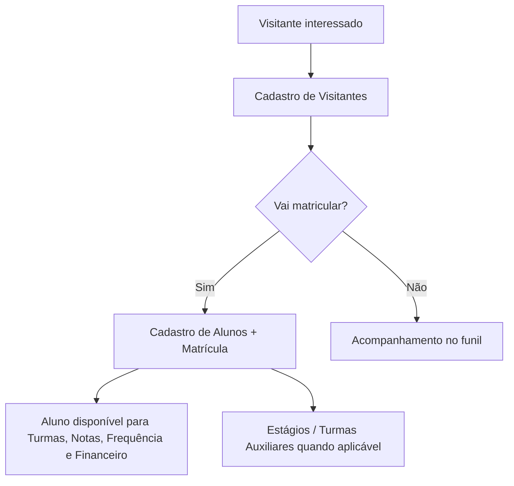

# Módulo Cadastro

## Objetivo

O módulo **Cadastro** reúne o registro das pessoas e informações de base da escola: **alunos**
(com matrícula, responsáveis, documentos e dados clínicos), **visitantes**, **endereços**,
**estágios** e a lista de **formados**. É o ponto de partida da jornada no sistema — quase todos
os demais módulos dependem de um aluno cadastrado.

## Quem pode utilizar

Principalmente a **Secretaria**, além de **Administrador**. Algumas informações financeiras da
matrícula podem exigir permissão do **Financeiro**. As opções visíveis dependem do perfil.

## Como acessar

As telas ficam no grupo **Cadastro** do menu lateral.

## Mapa do módulo

| Tela | Para que serve | Documentação |
|------|----------------|--------------|
| Alunos | Cadastro completo do aluno (dados, matrícula, responsáveis, documentos) | [Abrir](alunos.md) |
| Alunos — Estágios | Registrar estágios vinculados a um aluno | [Abrir](alunos-estagios.md) |
| Alunos — Turmas Auxiliares | Vincular alunos a turmas auxiliares | [Abrir](turmas-auxiliares.md) |
| Endereços | Cadastro de logradouros/bairros reutilizáveis | [Abrir](enderecos.md) |
| Estágios | Cadastro de convênios e vagas de estágio | [Abrir](estagios.md) |
| Formados | Marcar alunos como formados | [Abrir](formados.md) |
| Visitantes | Registro de visitantes/interessados (funil de matrícula) | [Abrir](visitantes.md) |

## Fluxo geral do módulo

---

## Histórico

| Data | Alteração |
|------|-----------|
| 30/07/2026 | Página criada. |
