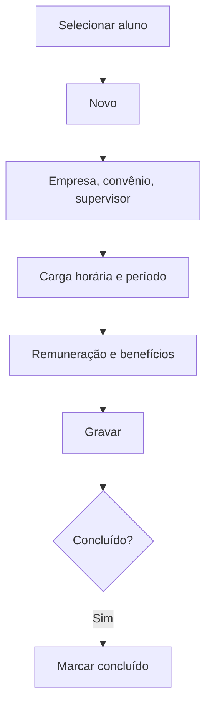

# Alunos — Estágios

## Objetivo

Vincular um **aluno** a um **estágio/convênio** já cadastrado, registrando empresa, período,
carga horária, supervisor, remuneração e benefícios. Complementa o cadastro de
[Estágios](estagios.md).

---

## Quem pode utilizar

Secretaria e Administrador (coordenação de estágios, conforme a escola).

---

## Como acessar

```
Cadastro
→ Alunos — Estágios
```

---

## Quando utilizar

- Quando um aluno inicia um estágio.
- Para acompanhar/concluir estágios em andamento.

---

## Como utilizar

1. Abra **Alunos — Estágios**.
2. Pesquise/selecione o **Aluno** (Matrícula).
3. Clique em **Novo**.
4. Informe **Empresa/Órgão**, **Convênio**, **Agente Integrador**, **Supervisor**, **Disciplina**,
   **Carga Horária**, **Data Inicial** e **Data Final**, **Remuneração** e benefícios
   (**Vale Transporte**, **Vale Refeição**).
5. Marque **Concluído** quando o estágio terminar.
6. Clique em **Gravar**.

---

## Campos

| Campo | Descrição | Obrigatório | Observações |
|-------|-----------|-------------|-------------|
| Aluno / Matrícula | Aluno estagiário | Sim | |
| Empresa/Órgão | Local do estágio | Sim | |
| Convênio / Código Convênio | Convênio vinculado | Sim | Cadastrado em Estágios |
| Agente Integrador | Agente integrador | Não | |
| Supervisor | Supervisor do estágio | Não | |
| Disciplina | Disciplina relacionada | Não | |
| Carga Horária (CHR) | Carga horária | Sim | |
| Data Inicial / Data Final | Período do estágio | Sim | |
| Remuneração | Valor da bolsa | Não | |
| Vale Transporte / Vale Refeição | Benefícios | Não | |
| Detalhamento / Observação | Informações adicionais | Não | |
| Concluído | Marca o estágio como concluído | Não | |

---

## Botões

| Botão | O que faz |
|-------|-----------|
| **Novo** | Novo vínculo de estágio para o aluno |
| **Pesquisar** | Busca vínculos |
| **Gravar** | Salva o registro |
| **Confirmar/Cancelar Exclusão** | Confirma ou cancela a exclusão |

---

## Filtros e colunas

Colunas: **Matrícula**, **Aluno**, **Curso**, **Descrição**.

---

## Resultados

- O estágio fica registrado no histórico do aluno.

---

## Regras importantes

- O aluno precisa estar cadastrado e o convênio precisa existir em [Estágios](estagios.md).
- Datas de início e fim devem ser coerentes.

---

## Fluxo da funcionalidade



---

## Exemplos práticos

**Exemplo:** vincular o aluno João ao convênio "Empresa X", 20h semanais, de 03/2026 a 08/2026, com vale transporte.

---

## Dicas

- Registre a **carga horária** correta — ela costuma compor a comprovação do estágio.

---

## FAQ

**Onde cadastro a empresa/convênio?**
Em [Estágios](estagios.md), antes de vincular o aluno.

---

## Prints

- [ ] Seleção do aluno.
- [ ] Formulário do estágio do aluno.

---

## Histórico

| Data | Alteração |
|------|-----------|
| 30/07/2026 | Página criada. |
