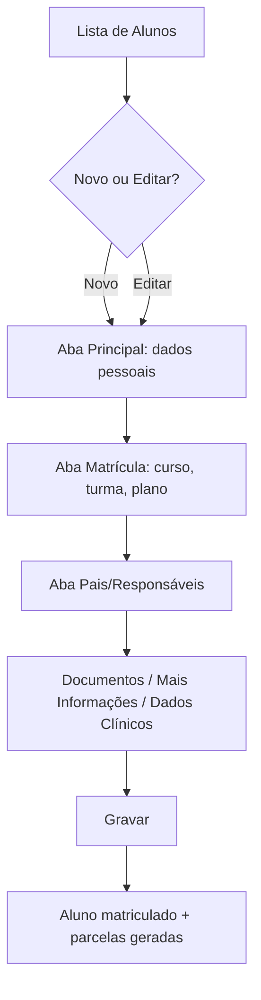

# Cadastro de Alunos

## Objetivo

Registrar e manter **todas as informações de um aluno**: dados pessoais, matrícula (curso,
turma, plano de pagamento), pais e responsáveis, documentos, dados clínicos e informações
complementares. É o cadastro central do sistema — a partir dele o aluno passa a existir para os
módulos de turmas, notas, frequência, boletim e financeiro.

---

## Como acessar

```
Cadastro
→ Alunos
```

---

## Quando utilizar

- Para matricular um **novo aluno**.
- Para **consultar** ou **atualizar** os dados de um aluno já cadastrado.
- Para registrar responsáveis, documentos, nome social ou dados clínicos.

---

## Como utilizar

1. Abra **Cadastro → Alunos**. O sistema mostra a **lista de alunos**.
2. Para localizar, use os filtros **Nome do Aluno**, **Turma do Aluno** e **Situação do Aluno**
   e clique em **Pesquisar**.
3. Para um novo aluno, clique em **Novo**; para editar, use **Opções → Editar** na linha do aluno.
4. Preencha as informações navegando pelas **abas** do formulário (ver seção Abas).
5. Clique em **Gravar** para salvar.

*(Print sugerido: lista de alunos com filtros e botão Novo.)*

---

## Abas do formulário

O cadastro é organizado em abas. As principais são:

### Principal (dados pessoais)

Dados de identificação do aluno: **Data de Nascimento**, **Sexo**, **Estado Civil**,
**Cor/Raça**, **Religião**, **Nacionalidade**, **Natural** e **Local de Nascimento**,
**RG**, **Órgão/UF**, **CPF**, contatos (**DDD**, **Celular**, **Outros Fones**, **E-mail**) e **Obs**.

### Matrícula

Dados acadêmicos e financeiros da matrícula: **Curso**, **Turma**, **Turno**,
**Nível/Sequência**, **Itinerário Formativo**, **Origem**, **Convênio**, **Plano de Pagamento**,
**Local de Pagamento**, **Dia p/ Vencimento** e os valores (**Valor Total**, **Líquido**,
**1ª Parcela**, **Desconto 1ª parcela**, **Desconto nas demais parcelas**).

### Pais/Responsáveis

Dados do **Pai**, da **Mãe** e do **Responsável**: nome, contatos, estado civil, profissão,
se **moram juntos**, e a definição de **Responsável Acadêmico** e **Responsável Financeiro**.
Aqui também é possível cadastrar o **Nome Social** e alterar o nome do aluno.

### Documentos

Dados de registro civil: **Nº do Registro**, **Livro**, **Folha**, **Data de Deferimento** e
demais documentos exigidos na matrícula.

### Mais Informações

Marcações especiais que afetam impressões e processamento:
**Aluno CONCLUINTE**, **Aluno OUVINTE**, **Matrícula ESPECIAL**, **Matrícula condicional**,
**Isento de Educação Física**, **Saída livre (catraca eletrônica)**, além de **ID INEP**, **NIS**,
**Lei/Alínea**, **Nº Cartão RFID** e **Validade da Carteirinha**.

### Valores Complementares

Valores adicionais/específicos vinculados ao aluno e ao plano de pagamento, com opção de
**Gravar** e **Voltar ao Cadastro do Aluno**.

---

## Campos principais (aba Matrícula)

| Campo | Descrição | Obrigatório | Exemplo | Observações |
|-------|-----------|-------------|---------|-------------|
| Curso | Curso do aluno | Sim | Ensino Fundamental | |
| Turma | Turma de matrícula | Sim | 5º Ano A | |
| Turno | Turno | Sim | Manhã | |
| Plano de Pagamento | Condição financeira | Sim | 12x | |
| Convênio | Convênio/desconto | Não | — | |
| Dia p/ Vencimento | Dia de vencimento das parcelas | Sim | 10 | |
| Valor Total (R$) | Valor total do curso | — | 5.400,00 | Calculado |
| 1ª Parcela de (R$) | Valor da 1ª parcela | Não | 450,00 | |
| Desconto 1ª parcela (R$) | Desconto na 1ª parcela | Não | 0,00 | |
| Desconto nas demais parcelas (R$) | Desconto nas demais | Não | 50,00 | Não pode ser maior que a mensalidade |

---

## Botões

| Botão | O que faz |
|-------|-----------|
| **Novo** | Inicia o cadastro de um novo aluno |
| **Pesquisar** | Aplica os filtros e lista os alunos |
| **Opções** | Ações da linha (editar, documentos, situação, excluir) |
| **Gravar** | Salva o cadastro |
| **Confirmar/Cancelar Exclusão** | Confirma ou cancela a exclusão de um registro |
| **Cancelar** | Fecha sem salvar |

---

## Filtros (lista de alunos)

| Filtro | O que faz |
|--------|-----------|
| Nome do Aluno | Busca por nome |
| Turma do Aluno | Filtra por turma |
| Situação do Aluno | Filtra por situação (matriculado, trancado, etc.) |

Colunas da lista: **Matrícula**, **Nome**, **Turma**, **Plano Pagto**, **Dia Vencto**, **Situação**.

---

## Resultados

- O aluno passa a existir no sistema, com **número de matrícula**.
- A matrícula gera as **parcelas** do plano de pagamento, usadas no Financeiro.
- O aluno fica disponível para turmas, notas, frequência e boletim.

---

## Regras importantes

- **Curso é obrigatório** na matrícula.
- **O desconto de uma parcela não pode ser maior que o valor da mensalidade.**
- Pai, mãe ou responsável com idade incoerente são bloqueados (ex.: *"Mãe menor de 10 anos"*).
- Marcações da aba **Mais Informações** alteram o que é impresso e processado (ver descrições).
- Alterar o **nome do aluno** é uma ação específica e registrada (não pode ficar vazio).

---

## Mensagens do sistema

**Sucesso**
- *"Nome alterado com sucesso."*

**Erro / Atenção**
- *"Curso é obrigatório!"*
- *"Nome do Aluno não pode ser vazio."* / *"Erro ao atualizar Nome do Aluno."*
- *"Mãe menor de 10 anos"* / *"Pai menor de 10 anos"* / *"Responsável menor de 10 anos"*
- *"Nenhum responsável acadêmico encontrado."* / *"Nenhum responsável financeiro encontrado."*
- *"Erro ao gravar os dados."* / *"Erro ao carregar alunos."*
- *"As seguintes parcelas têm desconto maior que o valor da mensalidade: ..."*

---

## Fluxo da funcionalidade



---

## Exemplos práticos

**Exemplo — matrícula nova:** Clique em **Novo**, preencha a aba **Principal** com os dados do
aluno, vá para **Matrícula**, escolha **Curso**, **Turma**, **Plano de Pagamento** e **Dia p/
Vencimento**; informe os responsáveis em **Pais/Responsáveis**; grave. As parcelas do plano são
geradas automaticamente.

---

## Dicas

- Defina corretamente **Responsável Financeiro** — é quem sairá nos boletos e recibos.
- Use a aba **Mais Informações** com atenção: marcar **CONCLUINTE/OUVINTE/ESPECIAL** muda
  boletim, diário e boletos.

---

## Erros comuns

- **"Curso é obrigatório!"** → selecione o curso na aba Matrícula antes de gravar.
- **Desconto maior que a mensalidade** → ajuste o valor do desconto das parcelas.

---

## FAQ

**Como troco a turma de um aluno já matriculado?**
Use a função [Troca de Turma do Aluno](../secretaria/troca-turma.md) (módulo Secretaria/Outras Atividades).

**Onde defino quem recebe o boleto?**
No **Responsável Financeiro**, na aba Pais/Responsáveis.

**O que é "Matrícula ESPECIAL"?**
Um tipo de matrícula que **não processa boletim**; use para casos específicos previstos pela escola.

---

## Prints

- [ ] Lista de alunos com filtros.
- [ ] Aba Principal.
- [ ] Aba Matrícula.
- [ ] Aba Pais/Responsáveis.
- [ ] Aba Mais Informações.

---

## Histórico

| Data | Alteração |
|------|-----------|
| 30/07/2026 | Página criada. |
