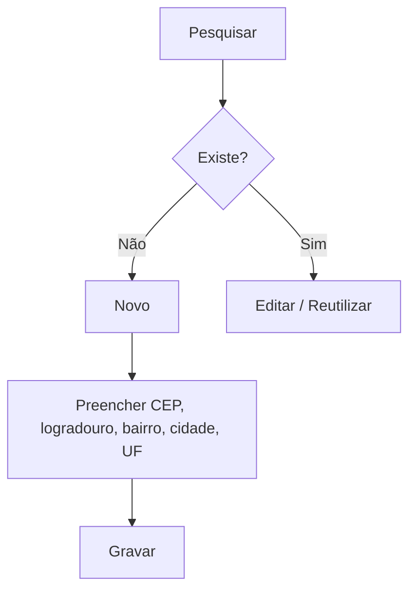

# Endereços

## Objetivo

Manter um cadastro de **endereços** (logradouros, bairros, CEP, cidade e UF) que pode ser
reutilizado nos demais cadastros do sistema, evitando digitar o mesmo endereço várias vezes.

---

## Quem pode utilizar

Secretaria e Administrador.

---

## Como acessar

```
Cadastro
→ Endereços
```

---

## Quando utilizar

- Ao padronizar endereços usados com frequência (bairros/logradouros da região).
- Para corrigir ou completar dados de endereço reutilizáveis.

---

## Como utilizar

1. Abra **Endereços**.
2. Use **Pesquisar** para localizar um endereço existente (por **Logradouro**).
3. Clique em **Novo** para cadastrar.
4. Preencha **CEP**, **Logradouro**, **Bairro**, **Cidade** e **UF**.
5. Clique em **Gravar**.

---

## Campos

| Campo | Descrição | Obrigatório | Exemplo |
|-------|-----------|-------------|---------|
| CEP | CEP do endereço | Sim | 01001-000 |
| Logradouro | Rua/avenida | Sim | Rua das Flores |
| Bairro | Bairro | Sim | Centro |
| Cidade | Cidade | Sim | São Paulo |
| UF | Estado | Sim | SP |

---

## Botões

| Botão | O que faz |
|-------|-----------|
| **Novo** | Cadastra um novo endereço |
| **Pesquisar** | Busca endereços |
| **Opções** | Editar/excluir |
| **Gravar** | Salva o endereço |
| **Confirmar/Cancelar Exclusão** | Confirma ou cancela a exclusão |

---

## Resultados

- O endereço fica disponível para uso nos cadastros que utilizam endereços.

---

## Regras importantes

- Endereços em uso por cadastros podem não ser excluíveis.

---

## Fluxo da funcionalidade



---

## Exemplos práticos

**Exemplo:** cadastrar a "Rua das Flores, Centro" uma vez e reutilizá-la em vários alunos do mesmo bairro.

---

## Dicas

- Padronize a grafia dos logradouros para facilitar a busca.

---

## FAQ

**Preciso cadastrar endereço aqui antes de matricular?**
Não é obrigatório, mas ajuda a padronizar endereços recorrentes.

---

## Prints

- [ ] Lista de endereços.
- [ ] Formulário de endereço.

---

## Histórico

| Data | Alteração |
|------|-----------|
| 30/07/2026 | Página criada. |
