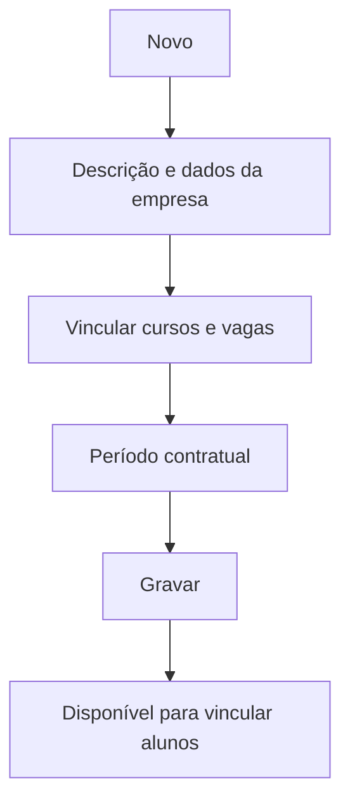

# Estágios (Convênios e Vagas)

## Objetivo

Cadastrar os **convênios/empresas de estágio** e as **vagas ofertadas** por curso. É a base
usada depois para vincular alunos aos estágios em [Alunos — Estágios](alunos-estagios.md).

---

## Quem pode utilizar

Secretaria e Administrador (e coordenação de estágios, conforme a escola).

---

## Como acessar

```
Cadastro
→ Estágios
```

---

## Quando utilizar

- Ao firmar um convênio de estágio com uma empresa/órgão.
- Para definir as vagas ofertadas e o período contratual.

---

## Como utilizar

1. Abra **Estágios**.
2. Clique em **Novo**.
3. Preencha a **Descrição**, os dados da empresa/convênio (**Nome**, **E-mail**, **Telefone**),
   os **Cursos** relacionados, as **Vagas Ofertadas** e o **Período Contratual (Início/Final)**.
4. Clique em **Gravar**.

---

## Campos

| Campo | Descrição | Obrigatório | Observações |
|-------|-----------|-------------|-------------|
| Descrição | Identificação do convênio/estágio | Sim | |
| Nome | Nome da empresa/convênio | Sim | |
| E-mail | E-mail de contato | Não | |
| Telefone | Telefone de contato | Não | |
| Curso(s) | Cursos vinculados | Sim | |
| Vagas Ofertadas | Nº de vagas | Sim | Deve ser um número válido |
| Período Contratual Início | Início do contrato | Sim | |
| Período Contratual Final | Fim do contrato | Sim | Não pode ser menor que o início |
| Convênios | Convênio vinculado | Não | |

---

## Botões

| Botão | O que faz |
|-------|-----------|
| **Novo** | Cadastra um novo convênio de estágio |
| **Pesquisar** | Busca estágios cadastrados |
| **Gravar** | Salva o registro |
| **Confirmar/Cancelar Exclusão** | Confirma ou cancela a exclusão |

---

## Filtros e colunas

Colunas: **Descrição**, **Convênio**, **Período Inicial**, **Período Final**.

---

## Resultados

- O convênio/estágio fica disponível para vincular alunos em [Alunos — Estágios](alunos-estagios.md).

---

## Regras importantes

- **Vagas Ofertadas** é obrigatório e precisa ser válido.
- **A Data do Período Final não pode ser menor que a do Período Inicial.**
- **Curso é obrigatório** e não pode ser duplicado no mesmo período.

---

## Mensagens do sistema

- *"Vagas Ofertadas é obrigatório!"* / *"Vagas Ofertadas é inválido"*
- *"Curso é obrigatório!"* / *"Curso já cadastrado"* / *"Curso já cadastrada no Período"*
- *"Data do Período Final não pode ser menor que a Data do Período Inicial"*

---

## Fluxo da funcionalidade



---

## Exemplos práticos

**Exemplo:** cadastrar o convênio "Empresa X — Estágio Administrativo", 5 vagas, curso Ensino
Médio, contrato de 01/2026 a 12/2026.

---

## Dicas

- Mantenha o período contratual atualizado para controlar as vagas disponíveis.

---

## Erros comuns

- **"Curso já cadastrado no Período"** → o curso já está vinculado; edite o registro existente.

---

## FAQ

**Como coloco um aluno neste estágio?**
Use [Alunos — Estágios](alunos-estagios.md).

---

## Prints

- [ ] Lista de estágios.
- [ ] Formulário de convênio/vagas.

---

## Histórico

| Data | Alteração |
|------|-----------|
| 30/07/2026 | Página criada. |
