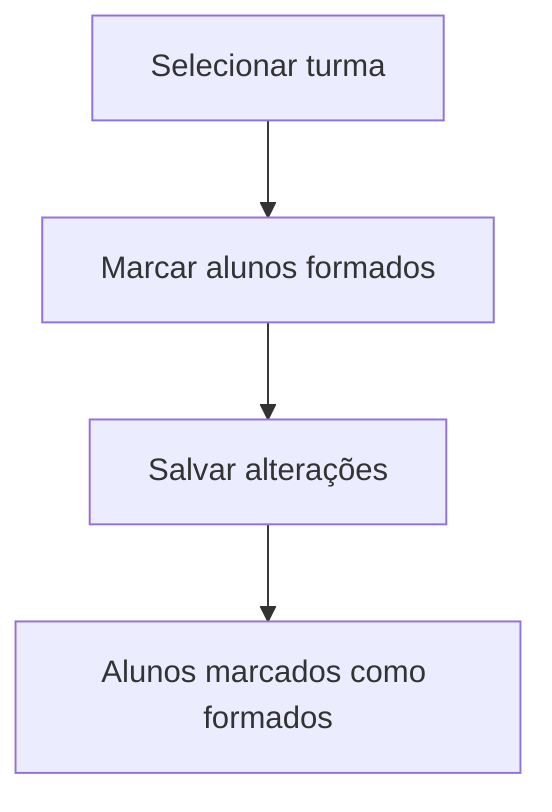

# Formados

## Objetivo

Marcar, em lote, os alunos de uma turma como **formados**. É usado ao final do ciclo escolar
para registrar quem concluiu.

---

## Como acessar

```
Cadastro
→ Formados
```

---

## Quando utilizar

- Ao encerrar o ano/curso, para marcar os concluintes de uma turma.

---

## Como utilizar

1. Abra **Formados**.
2. Selecione a **Turma**.
3. Na lista de **Alunos**, marque quem está **Formado**.
4. Clique em **Salvar alterações**.

---

## Campos e colunas

| Coluna | Descrição |
|--------|-----------|
| Matrícula | Matrícula do aluno |
| Alunos | Nome do aluno |
| Turma | Turma selecionada |
| Formado | Marcação de formado (sim/não) |

---

## Botões

| Botão | O que faz |
|-------|-----------|
| **Opções** | Ações da linha |
| **Salvar alterações** | Grava as marcações de formado |

---

## Resultados

- Os alunos marcados passam à condição de **formados**.

---

## Regras importantes

- A marcação de formado pode afetar a situação do aluno e a emissão de documentos de conclusão.

---

## Fluxo da funcionalidade



---

## Exemplos práticos

**Exemplo:** ao fim do 3º ano, abrir a turma, marcar todos os concluintes como **Formado** e salvar.

---

## Dicas

- Confira a lista antes de salvar; a marcação vale para todos os selecionados.

---

## FAQ

**Posso desmarcar depois?**
Sim, reabrindo a turma e ajustando a marcação.

---

## Prints

- [ ] Lista de alunos com a marcação de formado.

---

## Histórico

| Data | Alteração |
|------|-----------|
| 30/07/2026 | Página criada. |
