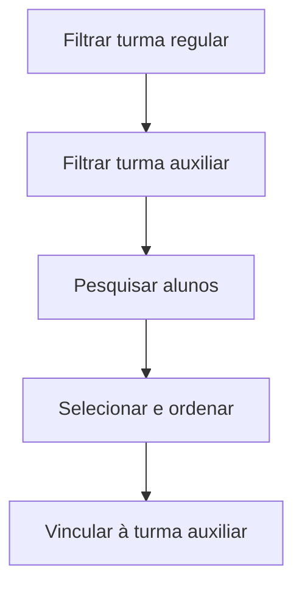

# Alunos — Turmas Auxiliares

## Objetivo

Vincular alunos de uma **turma regular** a uma **turma auxiliar** (por exemplo, reforço,
optativas, atividades extras ou agrupamentos especiais), definindo a ordem dos alunos.

---

## Como acessar

```
Cadastro
→ Alunos — Turmas Auxiliares
```

---

## Quando utilizar

- Para montar turmas auxiliares a partir dos alunos de turmas regulares.
- Para ajustar quem participa de uma atividade/agrupamento paralelo.

---

## Como utilizar

1. Abra **Alunos — Turmas Auxiliares**.
2. Use **Filtrar Turma Regular** para escolher a turma de origem dos alunos.
3. Use **Filtrar Turma Auxiliar** para escolher a turma auxiliar de destino.
4. Clique em **Pesquisar** para listar os alunos.
5. Selecione os alunos e defina a **Ordem**, se aplicável.
6. Vincule os alunos à turma auxiliar e salve.

---

## Campos e colunas

| Campo/Coluna | Descrição |
|--------------|-----------|
| Filtrar Turma Regular | Turma de origem dos alunos |
| Filtrar Turma Auxiliar | Turma auxiliar de destino |
| Matrícula | Matrícula do aluno |
| Nome | Nome do aluno |
| Turma | Turma do aluno |
| Situação | Situação do aluno |
| Ordem | Ordem do aluno na turma auxiliar |

---

## Botões

| Botão | O que faz |
|-------|-----------|
| **Pesquisar** | Lista os alunos conforme os filtros |
| **Opções** | Ações da linha (vincular/desvincular) |

---

## Resultados

- Os alunos ficam vinculados à turma auxiliar escolhida.

---

## Regras importantes

- É preciso ter turmas **regular** e **auxiliar** cadastradas para fazer o vínculo.

---

## Fluxo da funcionalidade



---

## Exemplos práticos

**Exemplo:** montar a turma auxiliar "Reforço de Matemática" com alunos das turmas 6ºA e 6ºB.

---

## Dicas

- A **Ordem** ajuda a organizar listas e chamadas da turma auxiliar.

---

## FAQ

**O que é uma turma auxiliar?**
Um agrupamento paralelo à turma regular (reforço, optativa, atividade), sem trocar a matrícula do aluno.

---

## Prints

- [ ] Filtros de turma regular e auxiliar.
- [ ] Lista de alunos vinculados.

---

## Histórico

| Data | Alteração |
|------|-----------|
| 30/07/2026 | Página criada. |
