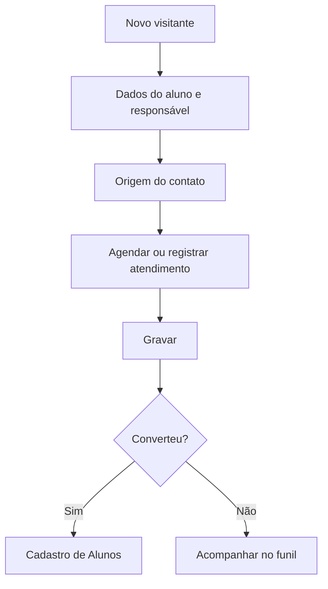

# Visitantes

## Objetivo

Registrar **visitantes e interessados** que procuram a escola — o funil de captação antes da
matrícula. Permite agendar e registrar atendimentos, indicar a origem do contato (como a pessoa
conheceu a escola) e acompanhar quem foi ou não atendido.

---

## Como acessar

```
Cadastro
→ Visitantes
```

---

## Quando utilizar

- Quando um responsável/interessado entra em contato ou visita a escola.
- Para agendar um atendimento e depois registrar que foi realizado.
- Para acompanhar o funil de matrículas por origem do contato.

---

## Como utilizar

1. Abra **Visitantes**.
2. Clique em **Novo**.
3. Preencha os dados do **Aluno** e do **Responsável** (nome, contatos, CPF do responsável),
   **Curso**, **Nível/Escolaridade**, **Turno**, **Escola Anterior** e a **origem do contato**
   (Indicação, Internet, Jornal, Outdoor, Outros).
4. Informe a **data de agendamento** e/ou a **data de atendimento**.
5. Clique em **Gravar**.
6. Use **Imprimir** para gerar o comprovante/ficha do visitante.

---

## Campos

| Campo | Descrição | Obrigatório | Observações |
|-------|-----------|-------------|-------------|
| Nome do Aluno | Nome do interessado | Sim | |
| Nome do Responsável | Responsável pelo interessado | Sim | |
| CPF do Responsável | CPF do responsável | Não | |
| DDD / Celular / Outros Fones | Contatos | Não | |
| Email | E-mail de contato | Não | |
| Curso | Curso de interesse | Não | |
| Nível/Escolaridade | Nível pretendido | Não | |
| Turno | Turno de interesse | Não | |
| Escola Anterior | Escola de origem | Não | |
| Origem (Indicação/Internet/Jornal/Outdoor/Outros) | Como conheceu a escola | Não | Para análise do funil |
| Data de Agendamento | Data agendada | Condicional | Agendamento ou atendimento |
| Data de Atendimento | Data do atendimento | Condicional | Não pode ser futura |
| Observação | Anotações | Não | |

---

## Botões

| Botão | O que faz |
|-------|-----------|
| **Novo** | Registra um novo visitante |
| **Pesquisar** | Busca visitantes |
| **Imprimir** | Emite a ficha/comprovante do visitante |
| **Opções** | Editar/excluir |
| **Gravar** | Salva o registro |
| **Confirmar/Cancelar Exclusão** | Confirma ou cancela a exclusão |

---

## Filtros e colunas

Filtros: **Somente Atendidos**, **Somente Não Atendidos**.
Colunas: **Ano/Sequencial**, **Aluno**, **Responsável**, **Nível/Escolaridade**, **Turno**,
**Agendado**, **Atendido**.

---

## Resultados

- O visitante fica registrado no funil, com status de **agendado/atendido**.
- Serve de base para converter o interessado em [aluno matriculado](alunos.md).

---

## Regras importantes

- **É preciso informar a Data de Agendamento ou a Data de Atendimento.**
- **A data de atendimento não pode ser futura.**

---

## Mensagens do sistema

- *"Preencha a Data de Agendamento ou a Data de Atendimento!"*
- *"A data de atendimento não pode ser futura!"*
- *"Erro ao gerar comprovante"*

---

## Fluxo da funcionalidade



---

## Exemplos práticos

**Exemplo:** registrar uma mãe que veio conhecer a escola por **Indicação**, agendar visita para
a semana seguinte e, após o atendimento, marcar a **data de atendimento**.

---

## Dicas

- Preencha a **origem** sempre — é o que permite medir de onde vêm as matrículas.
- Use os filtros **Atendidos / Não Atendidos** para trabalhar a lista de retorno.

---

## Erros comuns

- **"Preencha a Data de Agendamento ou a Data de Atendimento!"** → informe ao menos uma das datas.

---

## FAQ

**Visitante vira aluno automaticamente?**
Não. Após a decisão de matrícula, cadastre o aluno em [Cadastro de Alunos](alunos.md).

---

## Prints

- [ ] Lista de visitantes com filtros Atendidos/Não Atendidos.
- [ ] Formulário do visitante.
- [ ] Ficha/comprovante impresso.

---

## Histórico

| Data | Alteração |
|------|-----------|
| 30/07/2026 | Página criada. |
