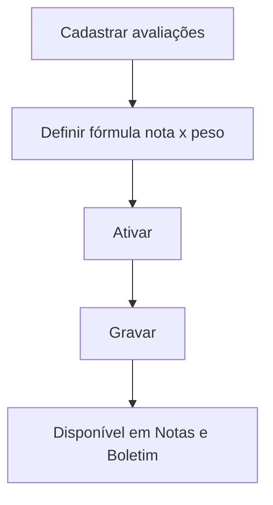

# Configurações de Avaliações

## Objetivo

Definir as **etapas avaliativas** (avaliações/bimestres/recuperações) e como elas compõem a nota,
incluindo a **Fórmula Nota x Peso**. É a base que as telas de [Notas](../notas/README.md) e o
[Boletim](../boletim/README.md) usam para calcular o resultado do aluno.

---

## Quem pode utilizar

Administrador e Coordenação.

---

## Como acessar

```
Configurações
→ Configurações de Avaliações
```

---

## Quando utilizar

- Ao estruturar o sistema de avaliação da escola (etapas, pesos).

---

## Como utilizar

1. Abra **Configurações de Avaliações**.
2. Cadastre cada avaliação com **Código** e **Descrição**.
3. Defina a **Fórmula Nota x Peso** (como as avaliações compõem a média).
4. Marque **Ativado** para as avaliações em uso.
5. Clique em **Gravar**.

---

## Campos

| Campo | Descrição | Obrigatório |
|-------|-----------|-------------|
| Código | Código da avaliação | Sim |
| Descrição | Nome (ex.: 1º Bimestre) | Sim |
| Fórmula Nota x Peso | Composição da média | Não |
| Ativado | Avaliação em uso | Não |

---

## Botões

| Botão | O que faz |
|-------|-----------|
| **Gravar** | Salva a configuração de avaliações |

---

## Resultados

- As etapas avaliativas ficam disponíveis para lançamento de notas e para o boletim.

---

## Regras importantes

- A **fórmula/pesos** definem a média — mudanças afetam boletins já processados (reprocessse).
- Só avaliações **ativadas** ficam disponíveis para lançamento.

---

## Fluxo da funcionalidade



---

## Exemplos práticos

**Exemplo:** definir 4 bimestres com peso igual e uma recuperação final.

---

## Dicas

- Após alterar pesos, **reprocessse o boletim** das turmas afetadas.

---

## FAQ

**Onde essas avaliações aparecem?**
Nas telas de [Notas](../notas/README.md) (seleção de avaliação) e no boletim.

---

## Prints

- [ ] Lista de avaliações.
- [ ] Fórmula Nota x Peso.

---

## Histórico

| Data | Alteração |
|------|-----------|
| 30/07/2026 | Página criada. |
