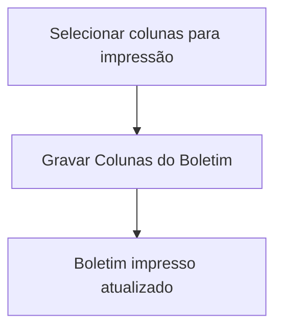

# Configurações do Boletim

## Objetivo

Definir **quais colunas e informações** aparecem no **boletim impresso** — o layout do documento
que é entregue ao responsável. Controla o que é exibido (notas por etapa, faltas, médias,
recuperação, etc.) na impressão.

---

## Quem pode utilizar

Administrador e Coordenação.

---

## Como acessar

```
Configurações
→ Configurações do Boletim
```

---

## Quando utilizar

- Ao ajustar o formato do boletim impresso da escola.

---

## Como utilizar

1. Abra **Configurações do Boletim**.
2. Em **Para Impressão**, selecione as **colunas** que devem aparecer no boletim.
3. Clique em **Gravar Colunas do Boletim**.

---

## Campos e opções

| Opção | Descrição |
|-------|-----------|
| Para Impressão | Colunas/itens exibidos no boletim impresso |

---

## Botões

| Botão | O que faz |
|-------|-----------|
| **Gravar Colunas do Boletim** | Salva o layout de colunas do boletim |

---

## Resultados

- O boletim impresso passa a exibir as colunas selecionadas.

---

## Regras importantes

- Afeta a **impressão** do boletim; combine com o **modelo de boletim** da [Turma](../academico/turmas.md).
- Após alterar, confira uma [Consulta do Boletim](../boletim/consulta.md) para validar o layout.

---

## Fluxo da funcionalidade



---

## Exemplos práticos

**Exemplo:** exibir no boletim as 4 etapas, a média final e a coluna de faltas, ocultando colunas não usadas.

---

## Dicas

- Menos colunas = boletim mais legível. Exiba só o necessário.

---

## FAQ

**Cada turma pode ter um boletim diferente?**
O **modelo** é definido na turma; estas configurações controlam as colunas exibidas.

---

## Prints

- [ ] Seleção de colunas.
- [ ] Boletim impresso resultante.

---

## Histórico

| Data | Alteração |
|------|-----------|
| 30/07/2026 | Página criada. |
