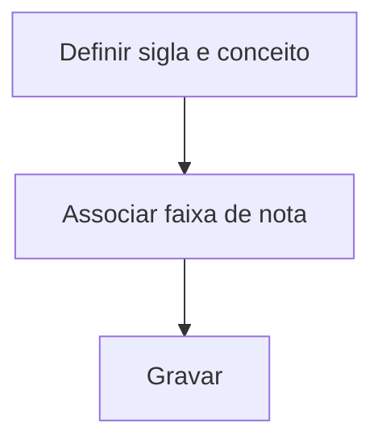

# Configurações de Conceitos

## Objetivo

Definir os **conceitos** usados em vez de (ou junto com) notas numéricas — a relação entre uma
**sigla/conceito** (ex.: A, B, C ou Ótimo, Bom) e a **faixa de nota** correspondente. Usado em
turmas que avaliam por conceito.

---

## Como acessar

```
Configurações
→ Configurações de Conceitos
```

---

## Quando utilizar

- Ao configurar avaliação por conceito (Educação Infantil, séries iniciais, etc.).

---

## Como utilizar

1. Abra **Configurações de Conceitos**.
2. Para cada conceito, informe a **Sigla**, a **descrição do Conceito** e a **Nota** (faixa)
   correspondente.
3. Clique em **Gravar**.

---

## Campos

| Campo | Descrição | Obrigatório |
|-------|-----------|-------------|
| Sigla | Sigla do conceito (ex.: A) | Sim |
| Conceito | Descrição do conceito | Sim |
| Nota | Faixa de nota correspondente | Sim |

---

## Botões

| Botão | O que faz |
|-------|-----------|
| **Gravar** | Salva os conceitos |

---

## Resultados

- Os conceitos ficam disponíveis para lançamento e impressão no boletim.

---

## Regras importantes

- A relação **conceito ↔ nota** deve cobrir as faixas sem sobreposição.

---

## Fluxo da funcionalidade



---

## Exemplos práticos

**Exemplo:** A = 9,0–10,0; B = 7,0–8,9; C = 5,0–6,9; D = abaixo de 5,0.

---

## Dicas

- Garanta que as faixas sejam contínuas para não deixar notas sem conceito.

---

## FAQ

**Onde o conceito aparece?**
No lançamento de notas (coluna Conceitos) e no boletim das turmas que usam conceito.

---

## Prints

- [ ] Tabela de conceitos.

---

## Histórico

| Data | Alteração |
|------|-----------|
| 30/07/2026 | Página criada. |
