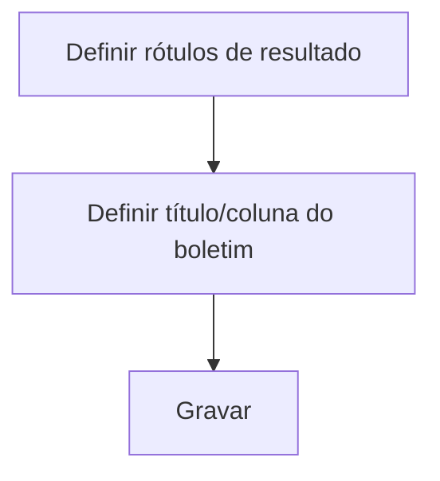

# Configurações de Convenções

## Objetivo

Definir os **rótulos e textos** das situações de resultado e do boletim — como o sistema chama
**Aprovado**, **Reprovado**, **Recuperação**, **Aprovado com Dependência**, etc., além do
**título do boletim** e do **rótulo da coluna de Disciplinas**. Padroniza a nomenclatura nos
documentos.

---

## Como acessar

```
Configurações
→ Configurações de Convenções
```

---

## Quando utilizar

- Ao ajustar a nomenclatura de resultados e os títulos que saem no boletim.

---

## Como utilizar

1. Abra **Configurações de Convenções**.
2. Informe os rótulos: **Aprovado**, **Reprovado**, **Recuperação**, **Aprovado com Dependência**,
   **Reprovado em série final de ciclo**.
3. Defina o **Título do Boletim (Para Impressão)** e o **Rótulo da coluna de Disciplinas no Boletim**.
4. Clique em **Gravar**.

---

## Campos

| Campo | Descrição |
|-------|-----------|
| Aprovado / Reprovado | Rótulos das situações finais |
| Recuperação | Rótulo da recuperação |
| Aprovado com Dependência | Rótulo de dependência |
| Reprovado em série final de ciclo | Rótulo específico de fim de ciclo |
| Título do Boletim (Para Impressão) | Título que sai no boletim |
| Rótulo da coluna de Disciplinas no Boletim | Cabeçalho da coluna |

---

## Botões

| Botão | O que faz |
|-------|-----------|
| **Gravar** | Salva as convenções |

---

## Resultados

- Os textos definidos passam a aparecer nos resultados e no boletim impresso.

---

## Regras importantes

- São **rótulos de exibição** — não alteram as regras de cálculo, apenas os nomes mostrados.

---

## Fluxo da funcionalidade



---

## Exemplos práticos

**Exemplo:** definir o título do boletim como "Boletim Escolar 2026" e o rótulo da coluna como "Componentes Curriculares".

---

## Dicas

- Padronize a nomenclatura conforme o vocabulário da escola e a legislação local.

---

## FAQ

**Mudar o rótulo muda a aprovação?**
Não; apenas o **texto** exibido. As regras vêm das fórmulas e configurações de avaliação.

---

## Prints

- [ ] Tela de convenções.

---

## Histórico

| Data | Alteração |
|------|-----------|
| 30/07/2026 | Página criada. |
