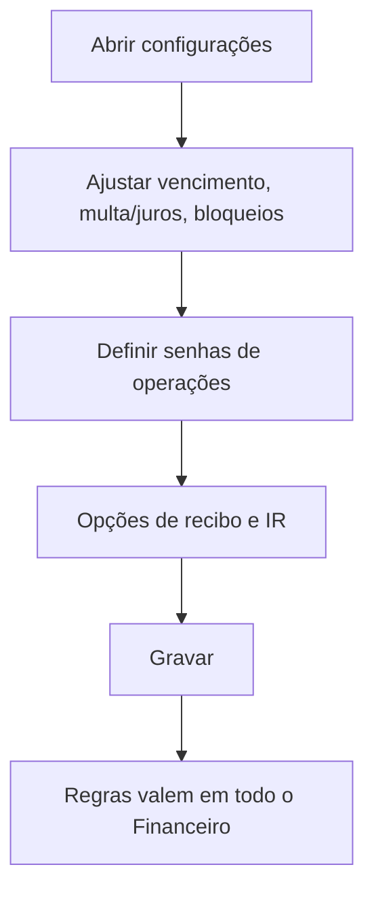

# Configurações do Financeiro

## Objetivo

Definir os **parâmetros e regras do módulo financeiro** — vencimentos padrão, multa/juros,
bloqueios (matrícula/pagamento com débito), impressão de recibos/carnês, senhas de operações
sensíveis e opções de imposto de renda. É onde se controla o comportamento de todo o Financeiro.

---

## Como acessar

```
Configurações
→ Configurações do Financeiro
```

---

## Quando utilizar

- Na implantação do financeiro e sempre que ajustar regras (multa/juros, bloqueios, senhas).

---

## Como utilizar

1. Abra **Configurações do Financeiro**.
2. Ajuste os parâmetros nas seções (**Global**, **Período**, **Senhas**, etc.):
   vencimento padrão, multa/juros, tolerâncias, bloqueios, impressão e imposto de renda.
3. Configure as **senhas** de operações sensíveis (ex.: alterar valor/desconto, estorno).
4. Clique em **Gravar**.

---

## Principais parâmetros

| Parâmetro | Descrição |
|-----------|-----------|
| Dia padrão para vencimento das Mensalidades | Dia base do vencimento |
| Cobrar multa de R$ + juros a.d. | Encargos por atraso |
| Tolerância para aplicação de multa e juros | Dias de carência |
| Tolerância para pagto no banco (Fator de Vencimento) | Carência no banco |
| Bloquear a matrícula de Alunos com Débito | Impede matricular inadimplente |
| Bloquear Pagamento com Débito Anterior | Impede pagar pulando parcelas |
| Bloquear alteração do Plano de Pagamento para Matriculados | Trava troca de plano |
| Confirmação Automática para Entrada de Cartão | Concilia cartão automaticamente |
| Considerar o banco vinculado no cadastro da TURMA | Usa o banco da turma nos boletos |
| Quantidade de Impressão de Recibos (Mensalidades/Outros) | Nº de vias do recibo |
| Imprimir CNPJ nos Recibos/Carnês | Exibe CNPJ nos documentos |
| Limite (dias) para Encerramento da Movimentação | Faixa máxima de encerramento |
| Permitir Pagto/Transf. Fonte para Data Retroativa | Libera lançamento retroativo |
| Considerar Valor Pago / Multa e Juros no cálculo do IR | Regras de imposto de renda |
| Senha Geral / Senhas de operações | Protege ações sensíveis (alterar valor, estorno, quitação) |

---

## Botões

| Botão | O que faz |
|-------|-----------|
| **Gravar** | Salva as configurações financeiras |
| **Liberar Visualização dos Campos de Senha** | Exibe/edita as senhas |

---

## Resultados

- As regras passam a valer em todas as telas do [Financeiro](../financeiro/README.md).

---

## Regras importantes

- **Bloqueios** (matrícula/pagamento com débito) mudam o que os operadores conseguem fazer.
- As **senhas** protegem operações sensíveis — defina-as e não compartilhe.
- Opções de **imposto de renda** afetam a declaração emitida ao responsável.

---

## Fluxo da funcionalidade



---

## Exemplos práticos

**Exemplo:** definir vencimento padrão dia 10, multa de 2% + juros ao dia, bloquear matrícula com
débito e exigir senha para estorno.

---

## Dicas

- Configure as **senhas** de estorno/alteração para evitar operações indevidas.
- Ative **"considerar o banco da turma"** se cada turma usa um banco diferente.

---

## FAQ

**Por que não consigo estornar sem senha?**
Porque há uma **senha** configurada para estorno aqui. Solicite ao administrador.

---

## Prints

- [ ] Seções de parâmetros (Global/Período/Senhas).

---

## Histórico

| Data | Alteração |
|------|-----------|
| 30/07/2026 | Página criada. |
