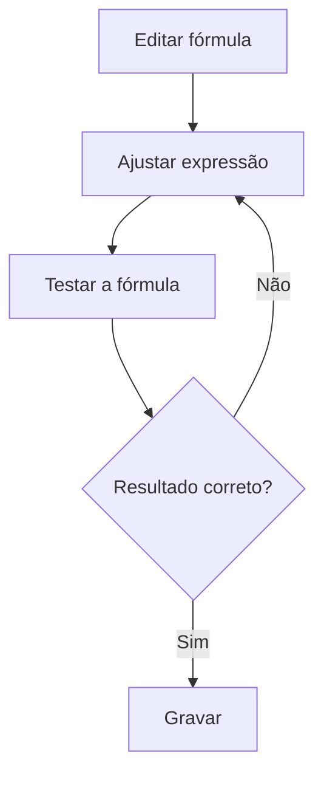

# Fórmulas de Secretaria (Notas)

## Objetivo

Editar as **fórmulas** que o sistema usa para o cálculo das **notas** (médias, recuperação, resultado final). As fórmulas permitem que a escola
personalize os cálculos conforme suas regras, com opção de **testar** o resultado antes de aplicar.

---

## Quem pode utilizar

Administrador (área sensível — as fórmulas afetam resultados em todo o sistema).

---

## Como acessar

```
Configurações → Fórmulas de Secretaria
```

---

## Quando utilizar

- Ao personalizar/ajustar as regras de cálculo da escola.

---

## Como utilizar

1. Abra a tela de fórmulas.
2. Selecione a fórmula e clique em **Editar**.
3. Ajuste a **Fórmula** (expressão de cálculo).
4. Clique em **Testar a Fórmula** e confira a **Resolução da Fórmula** e o **Resultado**.
5. Clique em **Gravar**.

---

## Campos

| Campo | Descrição |
|-------|-----------|
| Fórmula | Expressão de cálculo |
| Resolução da Fórmula | Detalhamento do cálculo no teste |
| Resultado | Valor obtido no teste |

---

## Botões

| Botão | O que faz |
|-------|-----------|
| **Editar** | Habilita a edição da fórmula |
| **Testar** / **Testar a Fórmula** | Executa a fórmula com dados de teste |
| **Gravar** | Salva a fórmula |

---

## Resultados

- A fórmula passa a ser usada nos cálculos de **Notas e Boletim**.

---

## Regras importantes

- **Sempre teste** antes de gravar — uma fórmula incorreta afeta resultados em massa.
- Após alterar, **reprocessse/recalcule** o que depende da fórmula (ex.: boletim, ficha financeira).

---

## Fluxo da funcionalidade



---

## Exemplos práticos

**Exemplo:** ajustar a fórmula e usar **Testar** com um caso conhecido para validar o resultado antes de aplicar.

---

## Dicas

- Guarde a fórmula anterior antes de mudar, para poder reverter se necessário.
- Use o **teste** com valores cujo resultado você já conhece.

---

## FAQ

**Onde essa fórmula é usada?**
Nos cálculos de [Notas e Boletim](../notas/README.md).

---

## Prints

- [ ] Edição da fórmula.
- [ ] Teste da fórmula (resolução e resultado).

---

## Histórico

| Data | Alteração |
|------|-----------|
| 30/07/2026 | Página criada. |
