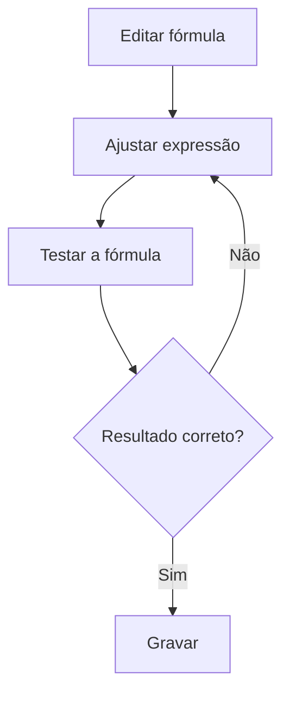

# Fórmulas de Secretaria (Notas)

## Objetivo

Editar as **fórmulas** que o sistema usa para o cálculo das **notas** (médias, recuperação, resultado final). As fórmulas permitem que a escola
personalize os cálculos conforme suas regras, com opção de **testar** o resultado antes de aplicar.

---

## Como acessar

```
Configurações → Fórmulas de Secretaria
```

---

## Quando utilizar

- Ao personalizar/ajustar as regras de cálculo da escola.

---

## Como utilizar

1. Abra a tela de fórmulas.
2. Selecione a fórmula e clique em **Editar**.
3. Ajuste a **Fórmula** (expressão de cálculo).
4. Clique em **Testar a Fórmula** e confira a **Resolução da Fórmula** e o **Resultado**.
5. Clique em **Gravar**.

---

## Campos

| Campo | Descrição |
|-------|-----------|
| Fórmula | Expressão de cálculo |
| Resolução da Fórmula | Detalhamento do cálculo no teste |
| Resultado | Valor obtido no teste |

---

## Variáveis, operadores e funções

| Item | Uso |
|------|-----|
| `NOTAB1` … `NOTAB6`, `NOTARI` | Notas das avaliações e da recuperação intermediária |
| `RECUPB1` … `RECUPB6` | Notas de recuperação de cada avaliação |
| `FEZPROVAB1` …, `FEZPROVARI` | Situação da prova (`'S'`, `'N'`, `'I'`, `'L'`) — compare com aspas: `FEZPROVAB2 == 'N'` |
| `VNUMAVAREL` | Quantidade de avaliações realizadas (número) |
| `VAPOIO1`, `VAPOIO2` | Resultado das variáveis de apoio 1 e 2 |
| `+ - * /` e parênteses | Operações aritméticas |
| `>`, `>=`, `<`, `<=`, `==`, `!=` | Comparações |
| `AND`, `OR`, `NOT` | Combinação de condições (maiúsculas ou minúsculas) |
| `IF(condição, valor se verdadeiro, valor se falso)` | Condição |
| `MAX(a, b, ...)`, `MIN(a, b, ...)` | Maior / menor valor |
| `ROUND(valor)` | Arredonda para inteiro (meio para cima): `ROUND(5.5)` = 6 |
| `ROUND(valor, casas)` | Arredonda para N casas decimais: `ROUND(5.75, 1)` = 5.8 |
| `CEIL(valor)`, `FLOOR(valor)` | Arredonda para cima / para baixo (inteiro) |

### Arredondamento

O sistema **não arredonda nada automaticamente**. Se a escola arredonda médias, o arredondamento
**deve estar escrito na fórmula**.

Isso importa principalmente nas comparações. Por limitação de cálculo do computador, uma média como
`(4 + 4.7 + 7.6 + 7.7) / 4` resulta em **5,9999…** (exibida como 6,00) e **não** passa em `>= 6`.

| Regra da escola | Como escrever |
|-----------------|---------------|
| Média com 2 casas | `ROUND((NOTAB1 + NOTAB2 + NOTAB3 + NOTAB4) / 4, 2)` |
| Média com 1 casa | `ROUND((NOTAB1 + NOTAB2 + NOTAB3 + NOTAB4) / 4, 1)` |
| Média arredondada de 0,5 em 0,5 | `ROUND(((NOTAB1 + NOTAB2 + NOTAB3 + NOTAB4) / 4) * 2) / 2` |
| Aprovação com média 6 | `IF(ROUND((NOTAB1 + NOTAB2 + NOTAB3 + NOTAB4) / 4, 2) >= 6, 1, 0)` |

---

## Botões

| Botão | O que faz |
|-------|-----------|
| **Editar** | Habilita a edição da fórmula |
| **Testar** / **Testar a Fórmula** | Executa a fórmula com dados de teste |
| **Gravar** | Salva a fórmula |

---

## Resultados

- A fórmula passa a ser usada nos cálculos de **Notas e Boletim**.

---

## Regras importantes

- **Sempre teste** antes de gravar — uma fórmula incorreta afeta resultados em massa.
- O **teste** mostra um aviso quando a fórmula tem problema (erro de sintaxe, condição de IF inválida,
  parênteses desbalanceados ou divisão por zero). Nesses casos o resultado é considerado **0**.
- O sistema **não arredonda** automaticamente: use `ROUND` na fórmula (veja [Arredondamento](#arredondamento)).
- Após alterar, **reprocessse/recalcule** o que depende da fórmula (ex.: boletim, ficha financeira).

---

## Fluxo da funcionalidade



---

## Exemplos práticos

**Exemplo:** ajustar a fórmula e usar **Testar** com um caso conhecido para validar o resultado antes de aplicar.

---

## Dicas

- Guarde a fórmula anterior antes de mudar, para poder reverter se necessário.
- Use o **teste** com valores cujo resultado você já conhece.

---

## FAQ

**Onde essa fórmula é usada?**
Nos cálculos de [Notas e Boletim](../notas/README.md).

---

## Prints

- [ ] Edição da fórmula.
- [ ] Teste da fórmula (resolução e resultado).

---

## Histórico

| Data | Alteração |
|------|-----------|
| 30/07/2026 | Página criada. |
| 31/10/2026 | Variáveis, operadores e funções; `ROUND(valor, casas)`; regra de arredondamento (somente na fórmula); avisos do teste; AND/OR/NOT. |
