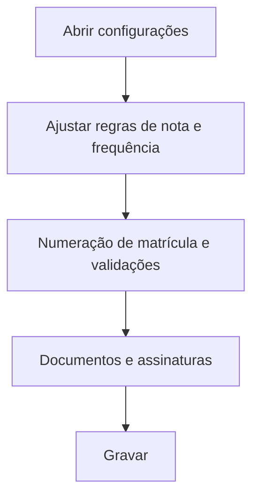

# Configurações de Secretaria

## Objetivo

Definir as **regras de secretaria e acadêmicas gerais** — parâmetros de matrícula e cadastro,
regras de aprovação/reprovação (nota máxima, nota vermelha, % de faltas), numeração de matrícula,
validações e opções de documentos/assinaturas. Controla como a secretaria e o acadêmico se comportam.

---

## Como acessar

```
Configurações
→ Configurações de Secretaria
```

---

## Quando utilizar

- Na implantação e ao ajustar regras de matrícula, aprovação e cadastro.

---

## Como utilizar

1. Abra **Configurações de Secretaria**.
2. Ajuste os parâmetros nas seções (**Global**, **Período**, **Assinaturas**, **Documentação**):
   nota máxima, nota vermelha, % de faltas, quantidade de avaliações, numeração de matrícula, validações.
3. Configure bloqueios e opções de documentos/assinaturas.
4. Clique em **Gravar**.

---

## Principais parâmetros

| Parâmetro | Descrição |
|-----------|-----------|
| Nota Máxima na Avaliação | Teto da nota (ex.: 10,00) |
| Nota vermelha abaixo de | Destaque de nota baixa no boletim |
| % Máximo de Faltas para não reprovar | Limite de frequência |
| Aprovar a partir da Avaliação | Etapa a partir da qual se calcula aprovação |
| Quantidade de Avaliações | Número de etapas avaliativas |
| Último Nº de Matrícula de Alunos | Controle da numeração de matrícula |
| Números para não considerar na ordem de classe | Exceções de numeração |
| Não Validar CPF do Aluno e do Responsável | Desliga a validação de CPF |
| Não Obrigar o preenchimento do E-mail | Torna e-mail opcional |
| DDD Padrão | DDD sugerido no cadastro |
| Bloquear NOVOS CADASTROS DE ALUNOS neste período | Trava novas matrículas no período |
| Imprimir Boletim para Alunos com Pendência de Documentos | Libera/impede impressão com pendência |
| Assinaturas | Configuração de assinaturas em documentos |

---

## Botões

| Botão | O que faz |
|-------|-----------|
| **Gravar** | Salva as configurações de secretaria |
| **Alterar / Remover** | Ajusta itens como assinaturas |

---

## Resultados

- As regras passam a valer nos cadastros, matrículas, aprovação e documentos.

---

## Regras importantes

- **% de faltas** e **nota máxima** impactam diretamente a aprovação e o boletim.
- Desligar **validação de CPF** ou **obrigatoriedade de e-mail** flexibiliza o cadastro (use com critério).
- **Bloquear novos cadastros no período** impede matrículas — lembre de reabrir quando necessário.

---

## Fluxo da funcionalidade



---

## Exemplos práticos

**Exemplo:** definir nota máxima 10, nota vermelha abaixo de 6, e % máximo de faltas de 25%.

---

## Dicas

- Revise **% de faltas** e **nota vermelha** conforme a legislação e o projeto pedagógico.

---

## FAQ

**Por que não consigo cadastrar aluno neste período?**
Pode estar marcado **"Bloquear NOVOS CADASTROS DE ALUNOS neste período"**. Desmarque para liberar.

---

## Prints

- [ ] Seções de parâmetros.
- [ ] Assinaturas/documentação.

---

## Histórico

| Data | Alteração |
|------|-----------|
| 30/07/2026 | Página criada. |
