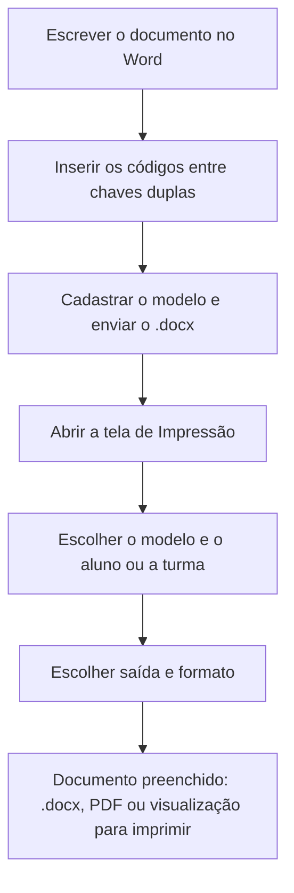

# Módulo Documentos Word

## Objetivo

O módulo **Documentos Word** permite que a escola use os **seus próprios documentos do Word**
(declarações, atestados, contratos, cartas) e mande o sistema **preenchê-los automaticamente**
com os dados de um aluno ou de uma turma inteira.

O sistema **não cria** o documento. Ele abre o arquivo `.docx` que a escola enviou, substitui os
códigos escritos entre chaves duplas (por exemplo `{{NOMEALUNO}}`) pelos dados reais e devolve o
mesmo documento já preenchido. Toda a formatação do modelo — fontes, margens, cabeçalho, rodapé,
tabelas e logotipo — é preservada.

## Como acessar

As telas ficam no grupo **Documentos Word** do menu lateral.

## Mapa do módulo

| Tela | Para que serve | Documentação |
|------|----------------|--------------|
| Modelos de Documentos | Cadastrar a descrição e enviar o arquivo `.docx` | [Abrir](modelos.md) |
| Campos Disponíveis | Consultar e copiar os códigos que podem ser usados no Word | [Abrir](campos.md) |
| Impressão | Escolher o modelo e o(s) aluno(s) e gerar o documento preenchido | [Abrir](impressao.md) |

## Conceitos

- **Modelo:** o arquivo `.docx` criado pela escola no Word, com os códigos no lugar dos dados
  que variam de aluno para aluno.
- **Campo:** um código como `{{NOMEALUNO}}`. Na hora da impressão, ele é trocado pelo dado real.
- **Catálogo de campos:** a lista de todos os códigos que o sistema sabe preencher. É a mesma
  para todas as escolas e pode ser consultada na tela **Campos Disponíveis**.

## Fluxo geral

## Ordem sugerida de uso

1. Consulte os [Campos Disponíveis](campos.md) e anote os códigos que vai usar.
2. Monte o documento no Word e salve como `.docx`.
3. Cadastre o modelo em [Modelos de Documentos](modelos.md).
4. Gere os documentos pela tela de [Impressão](impressao.md).

---

## Histórico

| Data | Alteração |
|------|-----------|
| 21/08/2026 | Página criada — novo módulo **Documentos Word**. |
