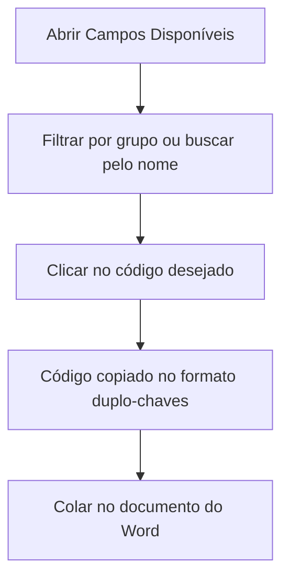

# Campos Disponíveis

## Objetivo

Consultar a lista de **códigos de campo** que o sistema sabe preencher nos documentos do Word.
Cada código representa uma informação do aluno, da turma, da escola ou do financeiro. É nesta
tela que se descobre, por exemplo, que o nome do aluno se escreve `{{NOMEALUNO}}`.

---

## Como acessar

```
Documentos Word
→ Campos Disponíveis
```

A tela também pode ser aberta pelo botão **Campos disponíveis** dentro da tela de
[Impressão](impressao.md).

---

## Quando utilizar

- Antes de escrever um modelo no Word, para saber quais informações estão disponíveis.
- Durante a montagem do documento, para copiar o código exato de um campo.
- Ao investigar por que um trecho do documento saiu em branco.

---

## Como utilizar

1. Abra **Campos Disponíveis**.
2. Use o campo de busca ou o filtro de **Grupo** para localizar a informação desejada.
3. **Clique no código** — ele é copiado para a área de transferência já no formato
   `{{CODIGO}}`, pronto para colar no Word.
4. Cole no documento (Ctrl + V) no ponto exato em que a informação deve aparecer.

*(Print sugerido: lista de campos com um código sendo copiado.)*

---

## Colunas

| Coluna | Descrição |
|--------|-----------|
| Código | O que deve ser escrito no Word, entre chaves duplas. Clique para copiar |
| Descrição | O que aquele campo significa |
| Grupo | A que assunto o campo pertence |
| Formato | Como o valor sai impresso (data, moeda, texto...) |

---

## Grupos de campos

| Grupo | O que reúne |
|-------|-------------|
| **ALUNO** | Dados pessoais do aluno e dos responsáveis: nome, matrícula, nascimento, documentos, endereço |
| **ACADEMICO** | Matrícula, turma, curso, nível/série, turno, situação |
| **FINANCEIRO** | Plano de pagamento, convênio e valores da mensalidade |
| **EMPRESA** | Dados da escola: nome, CNPJ, endereço, cidade/UF |
| **ESPECIAL** | Informações geradas na hora: data atual, data por extenso, usuário que emitiu |

---

## Formatos

O **formato** define como o dado sai impresso no documento:

| Formato | Como sai | Exemplo |
|---------|----------|---------|
| TEXTO | O texto como está cadastrado | `MARIA DA SILVA` |
| DATA | Data no padrão brasileiro | `15/03/2010` |
| DATAEXTENSO | Data escrita por extenso | `15 de março de 2010` |
| MOEDA | Valor em reais | `R$ 1.250,00` |
| NUMERO | Número | `7` |
| SEXO | Masculino / Feminino | `Feminino` |
| ESTADOCIVIL | Estado civil por extenso | `Casado(a)` |
| TURNO | Nome do turno | `Matutino` |
| SITUACAO | Situação da matrícula | `Matriculado` |
| SITUACAOFINAL | Resultado final | `Aprovado` |
| SIMNAO | Sim ou Não | `Sim` |

---

## Filtros

| Filtro | O que faz |
|--------|-----------|
| Código ou descrição | Busca pelo texto digitado, tanto no código quanto na descrição do campo |
| Grupo | Mostra apenas os campos de um assunto (Aluno, Acadêmico, Financeiro, Empresa, Especial) |

---

## Botões

| Botão | O que faz |
|-------|-----------|
| **Código** (clique) | Copia o código já no formato `{{CODIGO}}` |
| **Pesquisar** | Aplica os filtros |
| **Limpar** | Limpa os filtros e mostra a lista completa |

---

## Resultados

- O código fica na área de transferência, pronto para colar no Word.
- O sistema confirma a cópia com a mensagem *"{{CODIGO}} copiado. Cole no documento do Word."*

---

## Regras importantes

- O catálogo é **igual para todas as escolas** e é apenas de **consulta** — não é possível criar
  ou editar campos por esta tela.
- Se um campo de que você precisa não existir na lista, ele **não pode** ser usado no modelo:
  solicite a inclusão ao suporte.
- Os códigos devem ser escritos **exatamente** como aparecem aqui: maiúsculas, sem acento e sem
  espaços dentro das chaves.

---

## Mensagens do sistema

**Sucesso**
- *"{{CODIGO}} copiado. Cole no documento do Word."*

**Erro**
- *"Não foi possível carregar os campos disponíveis."*

---

## Fluxo da funcionalidade



---

## Exemplos práticos

**Exemplo — montar o cabeçalho de uma declaração**

Buscando por `nome`, a secretaria encontra e copia `{{NOMEALUNO}}`; buscando por `matrícula`,
copia `{{MATRICULA}}`. No grupo **ESPECIAL**, copia `{{DATAEXTENSO}}` para a data de emissão.
Colando os três no Word, a declaração fica pronta para qualquer aluno.

---

## Dicas

- Filtre pelo **Grupo** primeiro: a lista fica bem menor e é mais fácil achar o campo certo.
- **Sempre copie** em vez de digitar — a maior causa de campo em branco é erro de digitação.
- Um campo com formato **DATAEXTENSO** já sai escrito por extenso; não é preciso reescrever a
  data manualmente no modelo.

---

## Erros comuns

- **"Copiei mas não colou nada"** → alguns navegadores pedem permissão para acessar a área de
  transferência. Autorize e clique no código novamente.
- **O campo existe na lista mas saiu vazio no documento** → o dado provavelmente não está
  preenchido no cadastro daquele aluno. Confira no [Cadastro de Alunos](../cadastro/alunos.md).

---

## FAQ

**Posso criar um campo novo?**
Não por esta tela. Novos campos são incluídos pelo suporte no catálogo geral.

**Por que existem campos que não uso?**
O catálogo atende a todos os tipos de documento e a todas as escolas. Use apenas os que fizerem
sentido no seu modelo.

**Um campo pode ser usado mais de uma vez no mesmo documento?**
Sim, quantas vezes forem necessárias.

---

## Prints

- [ ] Tela de consulta com o filtro de grupo aberto.
- [ ] Mensagem de confirmação da cópia do código.

---

## Páginas relacionadas

- [Modelos de Documentos](modelos.md)
- [Impressão de Documentos](impressao.md)
- [Visão geral do módulo](README.md)

---

## Histórico

| Data | Alteração |
|------|-----------|
| 21/08/2026 | Página criada — nova tela **Campos Disponíveis**. |
