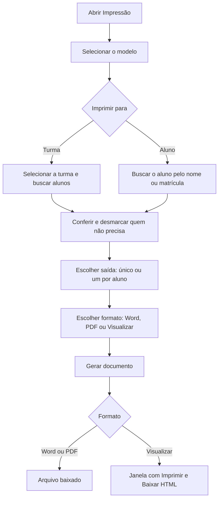

# Impressão de Documentos

## Objetivo

Gerar os documentos já **preenchidos com os dados dos alunos**, a partir de um modelo cadastrado.
É possível emitir para **um aluno** ou para **uma turma inteira**, escolhendo se o resultado será
um arquivo do Word, um PDF ou uma visualização pronta para mandar direto à impressora.

---

## Como acessar

```
Documentos Word
→ Impressão
```

Também é possível chegar aqui pelo cadastro: em **Cadastro → Alunos**, clique no botão
**Documentos do Word** na linha do aluno (ver [Alunos](../cadastro/alunos.md)). A tela abre já com
**Imprimir para: Aluno** e o aluno carregado; falta escolher o modelo.

---

## Quando utilizar

- Quando um aluno ou responsável pede uma declaração no balcão da secretaria.
- Quando é preciso emitir o mesmo documento para todos os alunos de uma turma (por exemplo,
  contratos de rematrícula ou comunicados individuais).
- Quando um ex-aluno pede uma declaração referente ao período em que estudou na escola.

---

## Como utilizar

1. Abra **Impressão**.
2. Em **Modelo**, escolha o documento que será emitido. O sistema já deixa marcado o **último
   modelo emitido com sucesso** pela escola — troque se precisar de outro.
3. Em **Imprimir para**, escolha:
   - **Turma** — o sistema carrega todos os alunos matriculados, já marcados;
   - **Aluno** — busca um aluno específico pelo nome ou pela matrícula.
4. Confira a lista de alunos e **desmarque** quem não deve receber o documento.
5. Em **Saída**, escolha entre **arquivo único** (todos os alunos no mesmo documento, um por
   página) ou **um arquivo por aluno**, entregue em um `.zip`.
6. Em **Formato**, escolha **Word (.docx)**, **PDF** ou **Visualizar / Imprimir**.
7. Clique em **Gerar documento** (ou **Visualizar**, quando o formato for visualização).

*(Print sugerido: tela de impressão com modelo e turma selecionados e a lista de alunos marcada.)*

### Quando o formato é "Visualizar / Imprimir"

O documento aparece já paginado dentro de uma janela, com dois botões:

- **Imprimir** — envia **apenas o documento** para a impressora, sem a tela do sistema em volta;
- **Baixar HTML** — salva a versão visualizada no computador.

*(Print sugerido: janela de visualização com os botões Imprimir e Baixar HTML.)*

---

## Campos

| Campo | Descrição | Obrigatório | Exemplo | Observações |
|-------|-----------|-------------|---------|-------------|
| Modelo | O modelo de documento a ser preenchido | Sim | Declaração de Matrícula | Lista os modelos cadastrados em [Modelos de Documentos](modelos.md) |
| Imprimir para | Define se a emissão é por turma ou por aluno | Sim | Turma | |
| Turma | Turma cujos alunos receberão o documento | Sim, no modo Turma | 3º Ano A | Traz somente os alunos **matriculados** |
| Aluno | Aluno específico | Sim, no modo Aluno | Maria da Silva | A busca traz alunos de **qualquer situação** |
| Alunos (lista) | Quem receberá o documento | Sim (ao menos um) | — | No modo Turma vêm todos marcados; desmarque quem não precisa |
| Saída | Um arquivo com todos ou um arquivo por aluno | Sim | Arquivo único | "Um por aluno" é entregue em `.zip` |
| Formato | Word, PDF ou visualização | Sim | PDF | |

---

## Botões

| Botão | O que faz |
|-------|-----------|
| **Campos disponíveis** | Abre a consulta de códigos de campo |
| **Buscar alunos** | Carrega os alunos da turma selecionada |
| **Gerar documento** | Gera e baixa o arquivo no formato escolhido |
| **Visualizar** | Abre o documento paginado na tela (formato Visualizar / Imprimir, saída única) |
| **Imprimir** | Dentro da visualização, envia o documento para a impressora |
| **Baixar HTML** | Dentro da visualização, salva o arquivo no computador |

---

## Filtros

| Filtro | O que faz |
|--------|-----------|
| Turma | Restringe a lista aos alunos matriculados na turma escolhida |
| Aluno (nome ou matrícula) | Localiza um aluno específico |

Na lista de alunos, as colunas exibidas são **Nº**, **Matrícula**, **Nome**, **Turma** e
**Situação**.

---

## Resultados

| Formato escolhido | O que acontece |
|-------------------|----------------|
| **Word (.docx)** | O arquivo é baixado e pode ser aberto e editado no Word |
| **PDF** | O arquivo é baixado pronto para arquivar ou enviar por e-mail |
| **Visualizar / Imprimir** | O documento abre em uma janela, pronto para impressão |
| Saída **um por aluno** | Um `.zip` é baixado, com um arquivo separado para cada aluno |

No modo **arquivo único**, cada aluno começa em uma **página nova**, e o cabeçalho e o rodapé do
modelo se repetem em todas elas.

---

## Regras importantes

- O **último modelo usado** é guardado **para a escola toda**, não por usuário: o que um
  colaborador emitiu por último aparece pré-selecionado para os demais. Ele só é gravado depois
  de um documento ser gerado com sucesso.
- É preciso **selecionar o modelo** e **ao menos um aluno** para gerar o documento.
- No modo **Turma**, entram apenas os alunos **matriculados** na turma.
- No modo **Aluno**, a busca traz alunos de **qualquer situação** — inclusive transferidos e
  cancelados —, porque declarações e históricos costumam ser pedidos justamente por quem já saiu.
- O aluno precisa ter **matrícula no período letivo selecionado**; caso contrário o sistema avisa
  e não gera o documento.
- Com a saída em **`.zip`**, o formato **Visualizar / Imprimir** não abre a janela de
  visualização: o sistema baixa um `.zip` com um arquivo por aluno.
- Campos sem valor no cadastro saem **em branco** no documento.

:::tip Qual formato escolher
Para **entregar no balcão**, use *Visualizar / Imprimir* — é o caminho mais curto até a impressora.
Para **enviar por e-mail ou arquivar**, use *PDF*. Para **ajustar o texto antes de imprimir**,
use *Word (.docx)*.
:::

:::note Fidelidade do layout
O PDF e a visualização são desenhados pelo sistema respeitando a formatação do modelo — fontes,
margens, tabelas, cabeçalho e rodapé. Em documentos com recursos de diagramação pouco comuns
pode haver pequena diferença em relação ao que o Word mostra. O arquivo **`.docx` continua sendo
a versão mais fiel**: quem precisa de layout exato imprime por ele.
:::

---

## Mensagens do sistema

**Sucesso**
- *"Pronto"* — com a confirmação de que o documento foi gerado.

**Alerta**
- *"Selecione o modelo do documento."*
- *"Selecione a turma."*
- *"Selecione ao menos um aluno."*
- *"Nenhum aluno matriculado nesta turma."*
- *"Este aluno não tem matrícula no período letivo selecionado."*
- *"Aguarde o documento terminar de carregar."*

**Erro**
- *"Não foi possível carregar os modelos e as turmas."*
- *"Não foi possível carregar os alunos."*
- *"Não foi possível carregar os dados do aluno."*

---

## Fluxo da funcionalidade



---

## Exemplos práticos

**Exemplo 1 — declaração no balcão**

O responsável pede uma declaração de matrícula. A atendente escolhe o modelo **Declaração de
Matrícula**, marca **Imprimir para: Aluno**, busca pelo nome, mantém **Saída: arquivo único**,
escolhe **Visualizar / Imprimir** e clica em **Imprimir**. A declaração sai na impressora em
poucos segundos.

**Exemplo 2 — contratos de uma turma inteira**

Para emitir o contrato de rematrícula do **3º Ano A**, a secretaria escolhe o modelo,
marca **Imprimir para: Turma**, seleciona a turma, define **Saída: um arquivo por aluno** e
**Formato: PDF**. O sistema entrega um `.zip` com um PDF por aluno, pronto para anexar no
e-mail de cada família.

---

## Dicas

- Faça sempre um **teste com um aluno** ao usar um modelo pela primeira vez, antes de gerar para
  a turma toda.
- Para turmas grandes, o **PDF em arquivo único** é mais prático de imprimir; o **`.zip` com um
  arquivo por aluno** é mais prático de enviar individualmente.
- Se a geração demorar em uma turma numerosa, aguarde — o sistema avisa quando o documento
  estiver pronto.

---

## Erros comuns

- **"Nenhum aluno matriculado nesta turma."** → confira se a turma e o período letivo estão
  corretos.
- **"Este aluno não tem matrícula no período letivo selecionado."** → troque o período letivo no
  topo do sistema para aquele em que o aluno estudou.
- **Trechos em branco no documento gerado** → o dado não está preenchido no cadastro do aluno, ou
  o código foi escrito errado no modelo. Ver [Modelos de Documentos](modelos.md).
- **O botão Imprimir não faz nada** → aguarde a visualização terminar de carregar; o sistema
  avisa com *"Aguarde o documento terminar de carregar."*

---

## FAQ

**Consigo emitir uma declaração para um aluno transferido?**
Sim. No modo **Aluno**, a busca traz alunos de qualquer situação.

**Dá para imprimir só alguns alunos da turma?**
Sim. Carregue a turma e **desmarque** quem não deve receber o documento.

**O documento gerado fica salvo no sistema?**
Não. O que fica guardado é o **modelo**. O documento preenchido é gerado no momento da emissão e
baixado para o seu computador.

**Posso editar o documento depois de gerado?**
Sim, se você escolher o formato **Word (.docx)**.

---

## Prints

- [ ] Tela de impressão com modelo e turma selecionados.
- [ ] Lista de alunos com a seleção por caixinhas.
- [ ] Opções de Saída e Formato.
- [ ] Janela de visualização com os botões Imprimir e Baixar HTML.

---

## Páginas relacionadas

- [Modelos de Documentos](modelos.md)
- [Campos Disponíveis](campos.md)
- [Visão geral do módulo](README.md)

---

## Histórico

| Data | Alteração |
|------|-----------|
| 21/08/2026 | Página criada — nova tela **Impressão de Documentos**. |
| 07/10/2026 | Entrada pelo botão **Documentos do Word** do cadastro de Alunos e **modelo pré-selecionado** (último emitido, compartilhado pela escola). |
