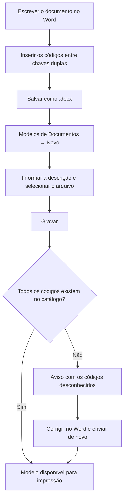

# Modelos de Documentos

## Objetivo

Cadastrar os **modelos de documentos do Word** que a escola quer preencher automaticamente com
os dados dos alunos. Cada modelo é um arquivo `.docx`, criado pela própria escola, com os
códigos de campo escritos entre chaves duplas.

---

## Como acessar

```
Documentos Word
→ Modelos de Documentos
```

---

## Quando utilizar

- Ao criar um novo documento padronizado da escola (declaração de matrícula, atestado de
  frequência, contrato, carta de transferência).
- Ao atualizar o texto ou o layout de um documento já existente.
- Ao conferir quais modelos já estão disponíveis para impressão.

---

## Como utilizar

### Antes de cadastrar: montar o documento no Word

1. Escreva o documento normalmente no Word, com o cabeçalho, o logotipo e a formatação da escola.
2. Nos pontos em que o texto muda de aluno para aluno, escreva o **código do campo** entre chaves
   duplas, exatamente como aparece na tela [Campos Disponíveis](campos.md):

   ```
   Declaramos que o(a) aluno(a) {{NOMEALUNO}}, matrícula {{MATRICULA}},
   está matriculado(a) na turma {{TURMADESCRICAO}} ({{TURNO}}).
   ```

3. Salve o arquivo no formato **`.docx`**.

*(Print sugerido: documento aberto no Word mostrando os códigos entre chaves.)*

### Cadastrar o modelo no sistema

1. Abra **Modelos de Documentos**.
2. Clique em **Novo**.
3. Informe a **Descrição** do modelo (o nome que aparecerá na tela de impressão).
4. Clique em **Selecionar arquivo** e escolha o `.docx` que você salvou.
5. Clique em **Gravar**.

*(Print sugerido: janela de cadastro com a descrição preenchida e o arquivo selecionado.)*

Ao gravar, o sistema **lê os códigos usados dentro do modelo** e avisa se algum deles não existe
no catálogo. Um código inexistente não impede a gravação, mas sairia **em branco** na impressão.

---

## Campos

| Campo | Descrição | Obrigatório | Exemplo | Observações |
|-------|-----------|-------------|---------|-------------|
| Descrição | Nome do modelo, usado para localizá-lo na impressão | Sim | Declaração de Matrícula | Use nomes claros — é o que aparece no dropdown da tela de impressão |
| Arquivo | O documento do Word que serve de modelo | Sim (no cadastro) | `declaracao_matricula.docx` | Somente `.docx`. Na alteração, o envio é opcional: sem novo arquivo, o modelo anterior é mantido |

Na lista, o sistema mostra ainda o **nome do arquivo** e o **tamanho** do modelo enviado.

---

## Botões

| Botão | O que faz |
|-------|-----------|
| **Novo** | Abre o cadastro de um novo modelo |
| **Pesquisar** | Busca modelos pela descrição |
| **Baixar** | Baixa o arquivo `.docx` original do modelo, para editar no Word |
| **Editar** | Altera a descrição e, se quiser, substitui o arquivo |
| **Excluir** | Remove o modelo |
| **Gravar** | Salva o modelo |
| **Cancelar** | Fecha sem gravar |

---

## Filtros

| Filtro | O que faz |
|--------|-----------|
| Descrição | Filtra a lista pelos modelos cuja descrição contenha o texto digitado |

---

## Resultados

- O modelo passa a aparecer no dropdown **Modelo** da tela de [Impressão](impressao.md).
- O arquivo enviado fica guardado no sistema — não é preciso manter uma cópia no computador,
  embora seja recomendável.

---

## Regras importantes

- O arquivo precisa estar no formato **`.docx`**. Formatos antigos (`.doc`) e outros
  (`.odt`, `.pdf`) não são aceitos.
- Os códigos devem ser escritos em **maiúsculas, sem acento e sem espaço** dentro das chaves:
  `{{NOMEALUNO}}` funciona; `{{Nome Aluno}}` e `{{nomealuno}}` não.
- Um **campo sem valor** no cadastro do aluno sai **vazio** no documento — nunca sai a palavra
  `null` nem o código entre chaves.
- Um **código que não existe no catálogo** sai vazio, e o sistema avisa disso no momento da
  gravação.
- Para trocar o texto de um documento, **edite o `.docx` no Word e envie novamente** — não é
  possível editar o conteúdo do documento dentro do sistema.

:::caution Imagens que mudam por aluno
Imagens fixas do modelo (logotipo, brasão, assinatura digitalizada) funcionam normalmente.
**Imagens dinâmicas** — como colar a foto do aluno dentro do documento — não estão disponíveis.
:::

---

## Mensagens do sistema

**Sucesso**
- *"Registro gravado com sucesso"*
- *"Registro excluído com sucesso"*

**Alerta**
- Aviso listando os **códigos não reconhecidos** encontrados no modelo enviado.

**Erro**
- *"Não foi possível carregar os modelos."*
- *"Não foi possível baixar o modelo."*
- *"Erro ao excluir o registro"*

**Confirmação**
- Confirmação antes de excluir um modelo.

---

## Fluxo da funcionalidade



---

## Exemplos práticos

**Exemplo — Declaração de Matrícula**

1. No Word, a secretaria escreve o texto da declaração com o timbre da escola e insere
   `{{NOMEALUNO}}`, `{{MATRICULA}}`, `{{TURMADESCRICAO}}` e `{{DATAEXTENSO}}`.
2. Salva como `declaracao_matricula.docx`.
3. No Harpia, cadastra o modelo com a descrição **"Declaração de Matrícula"**.
4. A partir daí, qualquer declaração é emitida em segundos pela tela de impressão.

---

## Dicas

- Cadastre uma **descrição objetiva** — quem emite o documento no balcão precisa achá-la rápido
  no dropdown.
- Antes de escrever o modelo, deixe a tela [Campos Disponíveis](campos.md) aberta em outra aba e
  copie os códigos de lá: evita erro de digitação.
- Faça um **teste com um aluno** logo depois de cadastrar, para conferir se todos os campos foram
  preenchidos como esperado.
- Use **Baixar** para recuperar o modelo original quando precisar fazer um ajuste — assim você
  sempre parte da última versão que está no sistema.

---

## Erros comuns

- **Um trecho saiu em branco no documento** → o código foi digitado errado ou não existe no
  catálogo. Confira na tela **Campos Disponíveis** e envie o modelo corrigido.
- **O código apareceu impresso no documento (`{{NOMEALUNO}}`)** → provavelmente as chaves foram
  quebradas pelo Word (por exemplo, uma correção automática dividiu o código em partes). Apague o
  trecho, digite tudo de uma vez e envie novamente.
- **O sistema não aceitou o arquivo** → verifique se ele está salvo como `.docx` e não como
  `.doc` ou `.pdf`.

---

## FAQ

**Preciso enviar um arquivo novo sempre que alterar a descrição?**
Não. Na alteração, o arquivo é opcional — se você não selecionar nenhum, o modelo anterior é
mantido.

**Posso ter vários modelos do mesmo tipo?**
Sim. É comum ter, por exemplo, uma declaração para o Ensino Fundamental e outra para o Médio.

**Os códigos funcionam no cabeçalho e no rodapé?**
Sim. Funcionam no corpo do texto, dentro de tabelas, no cabeçalho e no rodapé.

**Quem pode excluir um modelo?**
Depende do perfil de acesso: a exclusão só aparece para quem tem a permissão **Deletar** na
tarefa. Ver [Perfil](../gerenciador/perfil.md).

---

## Prints

- [ ] Documento aberto no Word mostrando os códigos entre chaves.
- [ ] Lista de modelos cadastrados.
- [ ] Janela de cadastro com descrição e arquivo selecionado.
- [ ] Aviso de códigos não reconhecidos.

---

## Páginas relacionadas

- [Campos Disponíveis](campos.md)
- [Impressão de Documentos](impressao.md)
- [Visão geral do módulo](README.md)

---

## Histórico

| Data | Alteração |
|------|-----------|
| 21/08/2026 | Página criada — nova tela **Modelos de Documentos**. |
