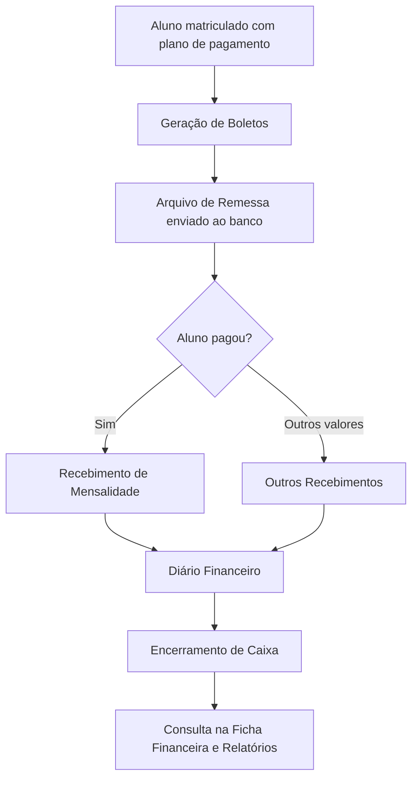

# Módulo Financeiro

## Objetivo

O módulo **Financeiro** concentra tudo o que envolve dinheiro na escola: cobrança de
mensalidades, recebimentos, emissão de boletos, envio de arquivos ao banco, contas a pagar,
controle de caixa e a ficha financeira de cada aluno.

## Como acessar

Todas as telas abaixo ficam no grupo **Financeiro** (e no grupo **Bancário**, no caso do
cadastro de bancos) do menu lateral.

## Mapa do módulo

| Tela | Para que serve | Documentação |
|------|----------------|--------------|
| Recebimento de Mensalidade | Receber (baixar) parcelas de mensalidade do aluno | [Abrir](recebimento-mensalidade.md) |
| Outros Recebimentos | Receber valores que não são mensalidade (taxas, materiais, eventos) | [Abrir](outros-recebimentos.md) |
| Contas a Pagar | Registrar e pagar despesas da escola | [Abrir](contas-a-pagar.md) |
| Geração de Boletos | Gerar boletos das mensalidades para os alunos | [Abrir](geracao-boletos.md) |
| Arquivo de Remessa (CNAB) | Gerar o arquivo que é enviado ao banco | [Abrir](arquivo-remessa.md) |
| Ficha Financeira | Consultar a situação financeira completa de um aluno | [Abrir](ficha-financeira.md) |
| Recibo de Recebimento | Estrutura, numeração e impressão do recibo dos recebimentos | [Abrir](recibo.md) |
| Zerar Mensalidades | Limpar valores/dados bancários de mensalidades em lote | [Abrir](zerar-mensalidades.md) |
| Valores Complementares | Acréscimos/deduções nas parcelas do aluno | [Abrir](valores-complementares.md) |
| Baixa Automática | Baixar mensalidades pelo arquivo de retorno do banco | [Abrir](baixa-automatica.md) |
| Inadimplentes — Observações | Gerir inadimplência e tratativas de cobrança | [Abrir](inadimplentes-observacao.md) |
| Abastecimento de Caixa | Registrar o fundo de troco do caixa | [Abrir](abastecimento-caixa.md) |
| Sangria | Retirar valores do caixa (com recibo) | [Abrir](sangria.md) |
| Transferência de Fonte | Mover valores entre fontes (caixa/banco) | [Abrir](transferencia-fonte.md) |
| Ajusta Saldo Final do Dia | Conciliar o saldo de fechamento de uma fonte | [Abrir](ajusta-saldo-final-dia.md) |
| Ajusta Diário Financeiro | Corrigir lançamentos do diário | [Abrir](ajusta-diario-financeiro.md) |
| Encerramento de Caixa | Fechar ou reabrir o caixa de um dia/usuário (única tela que grava o fechamento) | [Abrir](encerramento-caixa.md) |
| Consulta de Caixas | Ver caixas abertos/fechados e ir direto a encerrar/abrir | [Abrir](consulta-de-caixas.md) |
| Encerramento de Movimentação | Encerrar a movimentação de um período | [Abrir](encerramento-movimentacao.md) |
| Entrada de Cartão | Conciliar o crédito dos pagamentos em cartão | [Abrir](entrada-cartao.md) |
| Fatura de Cartão - Abertas | Quitar a fatura do cartão institucional | [Abrir](fatura-cartao.md) |
| Fatura de Cartão - Quitadas | Consultar/estornar faturas quitadas | [Abrir](fatura-cartao-quitada.md) |
| Cadastro de Bancos | Configurar os bancos usados para boletos e remessa | [Abrir](../bancario/bancos.md) |

## Conceitos importantes do módulo

- **Parcela / Mensalidade:** cada aluno tem parcelas mensais geradas a partir do seu plano de pagamento.
- **Baixa / Recebimento:** registrar que uma parcela foi paga.
- **Estorno:** cancelar um recebimento já registrado, devolvendo a parcela à condição de "em aberto".
- **Diário Financeiro:** o registro cronológico de todas as movimentações de caixa do dia.
- **Encerramento de Caixa:** o fechamento do movimento de um dia. Depois de encerrado, o sistema
  **bloqueia** novos lançamentos naquela data. Só é gravado na tela [Encerramento de Caixa](encerramento-caixa.md).
- **Caixa aberto / fechado:** um dia tem caixa quando o operador teve movimentação nele; fica *aberto* até ser encerrado.
- **Fonte / Conta:** de onde entra ou sai o dinheiro (caixa, banco, etc.).
- **[Recibo](recibo.md):** comprovante impresso de um recebimento, com número sequencial próprio.

## Regras gerais do módulo

- O sistema **bloqueia lançamentos em datas com o caixa já encerrado**. Ao tentar, aparece a
  mensagem *"O Caixa está encerrado para a data..."*.
- **Aviso de caixa pendente:** nas telas Sangria, Abastecimento, Ajusta Saldo Final do Dia, Contas a Pagar, Outros Recebimentos, Ficha Financeira, Entrada de Cartão e Fatura de Cartão (abertas e quitadas), o sistema confere o **seu caixa** ao abrir a tela. Se houver **caixa aberto de data anterior** ou o **caixa de hoje já estiver encerrado**, aparece um aviso amarelo e os botões de gravar ficam **desabilitados** até regularizar em [Encerramento de Caixa](encerramento-caixa.md) (use a [Consulta de Caixas](consulta-de-caixas.md) para achar o dia). Ao gravar, o **caixa de hoje** também precisa estar aberto: *"O caixa de hoje (dd/MM/aaaa) está encerrado! Não é permitido lançar valores."*
- **Campos de período:** muitos filtros usam um calendário de período — escolha a data inicial e a final; os botões **Limpar**, **Hoje** e **Confirmar** apagam, selecionam hoje e aplicam o período.
- Registros que já possuem pagamentos **não podem ser simplesmente excluídos** — é preciso
  estornar primeiro.
- Todo recebimento gera um **[número de recibo](recibo.md)**, que também é registrado no estorno.

## Fluxo geral do dia a dia financeiro

---

## Histórico

| Data | Alteração |
|------|-----------|
| 30/07/2026 | Página criada com o mapa do módulo. |
| 31/07/2026 | Adicionada a página **Recibo de Recebimento** ao mapa e aos conceitos. |
