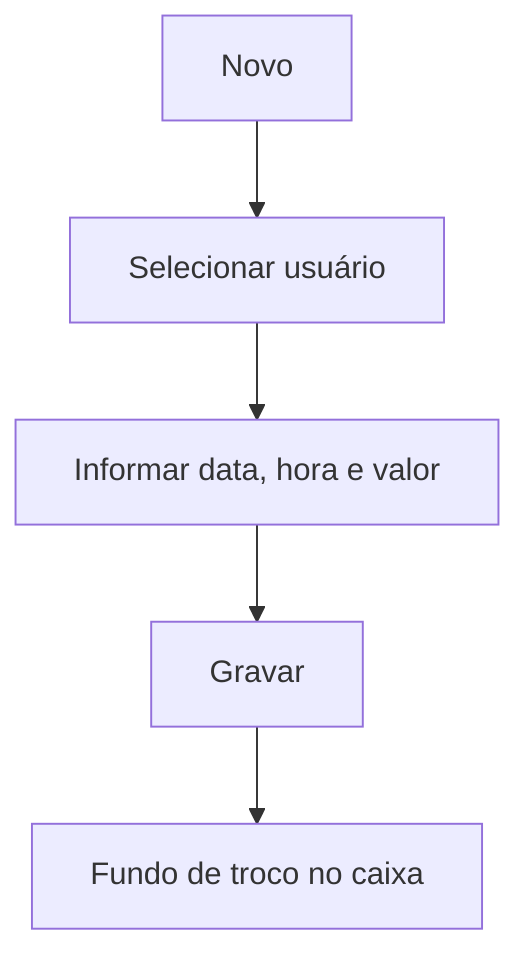

# Abastecimento de Caixa

## Objetivo

Registrar o **abastecimento (fundo de troco) do caixa** — o valor colocado no caixa de um usuário
para iniciar as operações do dia. É o ponto de partida do movimento de caixa.

---

## Como acessar

```
Financeiro
→ Abastecimento de Caixa
```

---

## Quando utilizar

- No início do expediente, para lançar o fundo de troco do operador.

---

## Como utilizar

1. Abra **Abastecimento de Caixa**.
2. Clique em **Novo**.
3. Selecione o **Usuário** (operador do caixa).
4. Informe a **Data**, a **Hora** e o **Valor (R$)**.
5. Clique em **Gravar**.

---

## Campos

| Campo | Descrição | Obrigatório |
|-------|-----------|-------------|
| Usuário | Operador que recebe o abastecimento | Sim |
| Data | Data do abastecimento | Sim |
| Hora | Hora | Não |
| Valor (R$) | Valor abastecido | Sim |

---

## Botões

| Botão | O que faz |
|-------|-----------|
| **Novo** | Novo abastecimento |
| **Pesquisar** | Busca abastecimentos por período/usuário |
| **Gravar** | Salva o abastecimento |
| **Opções** | Editar/excluir |
| **Confirmar/Cancelar Exclusão** | Confirma ou cancela a exclusão |

---

## Filtros e colunas

Filtros: **Data Início**, **Data Final**, **Usuário**. Colunas: **Data**, **Hora**, **Valor**,
**Abastecido Por**, **Abastecido Em**.

---

## Resultados

- O caixa do usuário passa a ter o valor de abertura, compondo o saldo do dia.

---

## Regras importantes

- **Usuário**, **Data** e **Valor** são obrigatórios.
- O abastecimento **não fecha nem abre** caixa por si só: o fechamento é feito apenas no [Encerramento de Caixa](encerramento-caixa.md).
- Com **caixa aberto de data anterior** ou **caixa de hoje encerrado**, o botão **Novo** fica desabilitado.
- O abastecimento compõe o saldo do caixa considerado na [Sangria](sangria.md) e no
  [Encerramento de Caixa](encerramento-caixa.md).

---

:::caution Aviso de caixa pendente
Ao abrir esta tela, o sistema confere o **seu caixa**. Se houver **caixa aberto de data anterior**
e/ou o **caixa de hoje já estiver encerrado**, aparece um **aviso amarelo** logo abaixo do título
(fecha no **X**), por exemplo: *"Existe caixa aberto de data(s) anterior(es) (dd/mm/aaaa). Verifique
as pendências no Encerramento de Caixa."* ou *"O caixa de hoje já está encerrado. Verifique o
Encerramento de Caixa antes de continuar."* Enquanto o aviso estiver ativo, o botão de gravar
(Novo) fica **desabilitado**. Resolva a pendência em [Encerramento de Caixa](encerramento-caixa.md)
(a situação de cada dia pode ser consultada em [Consulta de Caixas](consulta-de-caixas.md)).
:::

---

## Fluxo da funcionalidade



---

## Exemplos práticos

**Exemplo:** abastecer o caixa da recepção com R$ 200,00 no início do dia.

---

## Dicas

- Registre o abastecimento **antes** de iniciar recebimentos, para o saldo do dia ficar correto.

---

## FAQ

**Isso é uma receita?**
Não; é o fundo de troco. Não representa entrada de receita, apenas saldo inicial do caixa.

---

## Prints

- [ ] Lista de abastecimentos.
- [ ] Formulário de abastecimento.

---

## Histórico

| Data | Alteração |
|------|-----------|
| 30/07/2026 | Página criada. |
| 07/10/2026 | Aviso e bloqueio do botão **Novo** quando há caixa pendente; o abastecimento não grava mais o fechamento do caixa. |
