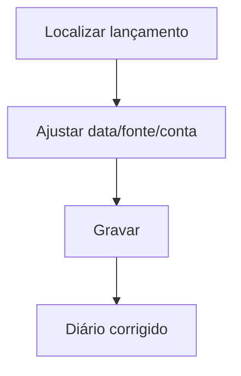

# Ajusta Diário Financeiro

## Objetivo

Corrigir/ajustar lançamentos do **Diário Financeiro** — a data, a fonte, a forma de pagamento, as
contas (valor, juros, multa, desconto) e demais dados de um lançamento já registrado. É uma
ferramenta de correção usada com cautela pelo setor financeiro.

---

## Como acessar

```
Financeiro
→ Ajusta Diário Financeiro
```

---

## Quando utilizar

- Para corrigir um lançamento do diário lançado com fonte/conta/data incorreta.

---

## Como utilizar

1. Abra **Ajusta Diário Financeiro**.
2. Localize o lançamento (por aluno/recibo/parcela e período).
3. Ajuste os campos necessários: **Data Lançamento/Pagamento/Disponível**, **Fonte**,
   **Forma de Pagamento**, **Conta Valor/Juros/Multa/Desconto**, **Número Documento**.
4. Salve o ajuste.

---

## Campos (principais)

| Campo | Descrição |
|-------|-----------|
| Matrícula / Nome | Aluno do lançamento |
| Parcela / Recibo / Referência | Identificação do lançamento |
| Data Lançamento / Pagamento / Disponível | Datas do lançamento |
| Fonte | Fonte financeira |
| Forma de Pagamento | Forma de pagamento |
| Conta Valor / Juros / Multa / Desconto | Contas do plano de contas |
| Número Documento | Documento vinculado |
| Operador | Usuário responsável |

---

## Botões

| Botão | O que faz |
|-------|-----------|
| **Opção** | Ações do lançamento |
| **Gravar** | Salva o ajuste |

---

## Resultados

- O lançamento do diário é corrigido, refletindo nos relatórios e saldos.

---

## Regras importantes

- Operação **sensível**: alterar o diário muda relatórios e conciliações. Use com cautela.
- Lançamentos em datas com **caixa encerrado** podem estar bloqueados.

---

## Fluxo da funcionalidade



---

## Exemplos práticos

**Exemplo:** um recebimento foi lançado na fonte errada — abrir o lançamento e corrigir a **Fonte**.

---

## Dicas

- Anote o motivo do ajuste; alterações no diário devem ser rastreáveis.

---

## FAQ

**Posso estornar por aqui?**
O estorno é feito na movimentação de origem; esta tela ajusta dados do lançamento no diário.

---

## Prints

- [ ] Localização do lançamento.
- [ ] Campos de ajuste.

---

## Histórico

| Data | Alteração |
|------|-----------|
| 30/07/2026 | Página criada. Observação: correção de duplicidade de REF no diário (jul/2026). |
