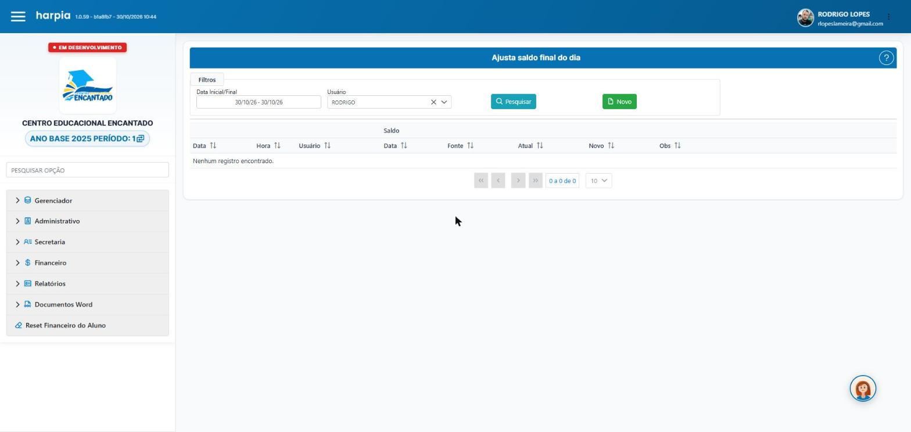
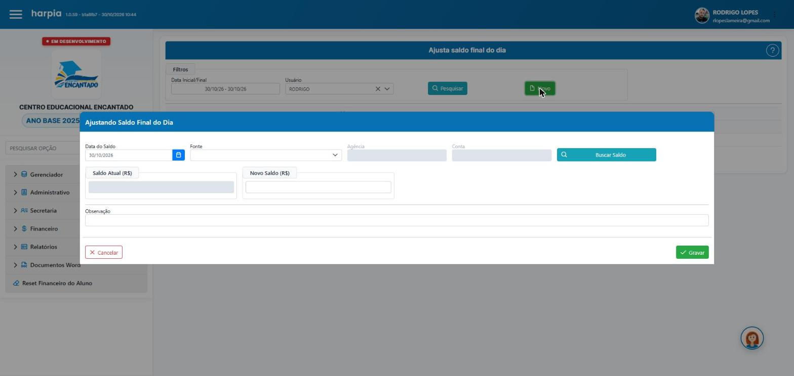
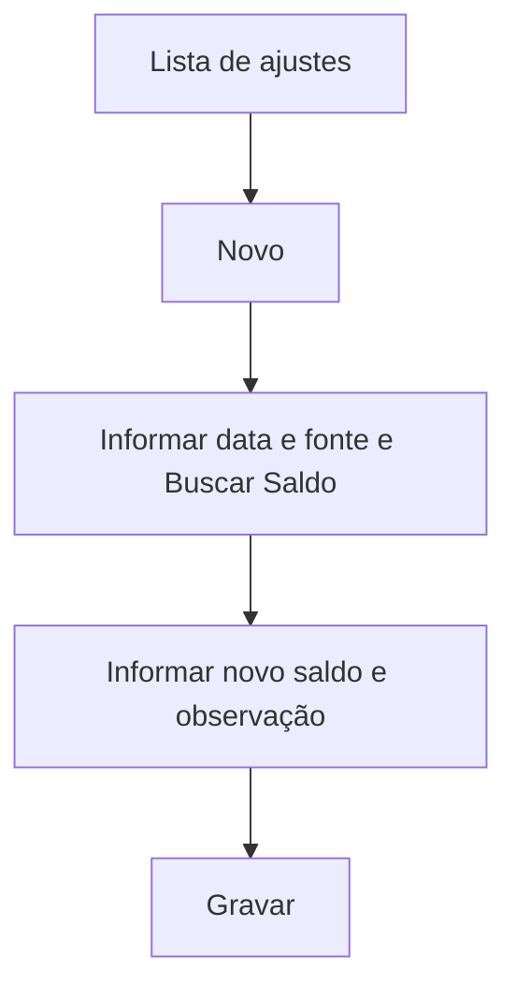

# Ajusta Saldo Final do Dia

## Objetivo

Ajustar/registrar o **saldo final de uma fonte em uma data** — o valor de fechamento em dinheiro
de um caixa/fonte no dia. Usado para conciliar o saldo do sistema com o saldo físico.

---

## Como acessar

```
Financeiro
→ Ajusta Saldo Final do Dia
```

---

## Quando utilizar

- Para conciliar o saldo de fechamento de uma fonte em uma data específica.

---

## Como utilizar

1. Abra **Ajusta Saldo Final do Dia**. A tela mostra primeiro a **lista dos ajustes já feitos**, filtrada pelo dia de hoje.
2. Para ver outros dias, ajuste **Data Inicial/Final** e, se quiser, o **Usuário**, e clique em **Pesquisar**.
3. Para fazer um novo ajuste, clique em **Novo** (fica desabilitado se houver caixa pendente — veja o aviso abaixo). Abre a janela **Ajustando Saldo Final do Dia**.
4. Informe a **Data do Saldo** (já vem com hoje) e selecione a **Fonte**.
5. Clique em **Buscar Saldo**; o sistema mostra o **Saldo Atual (R$)**.
6. Informe o **Novo Saldo (R$)** e preencha a **Observação** (obrigatória).
7. Clique em **Gravar**. Para desistir, clique em **Cancelar**.




---

## Campos

**Filtros da lista**

| Campo | Descrição | Obrigatório |
|-------|-----------|-------------|
| Data Inicial/Final | Período dos ajustes | Não (padrão: hoje) |
| Usuário | Quem fez o ajuste | Não |

**Colunas da lista:** Data, Hora e Usuário (do ajuste); em **Saldo**: Data, Fonte, Atual e Novo; e Obs.

**Formulário (janela Novo)**

| Campo | Descrição | Obrigatório |
|-------|-----------|-------------|
| Data do Saldo | Data do fechamento (padrão: hoje) | Sim |
| Fonte | Fonte a ajustar | Sim |
| Agência / Conta | Dados bancários | Condicional |
| Saldo Atual (R$) | Saldo em dinheiro da fonte na data (preenchido por **Buscar Saldo**) | — |
| Novo Saldo (R$) | Saldo correto, em dinheiro | Sim |
| Observação | Justificativa do ajuste | Sim |

---

## Botões

| Botão | Onde | O que faz |
|-------|------|-----------|
| **Pesquisar** | Lista | Mostra os ajustes do período e usuário escolhidos |
| **Novo** | Lista | Abre a janela de ajuste |
| **Buscar Saldo** | Janela | Consulta o saldo atual da fonte na data |
| **Gravar** | Janela | Grava o saldo final ajustado (substitui *Ajustar Saldo*) |
| **Cancelar** | Janela | Fecha sem gravar |

---

## Resultados

- O saldo final da fonte na data é ajustado/registrado.

---

## Regras importantes

- Use com critério — o ajuste altera o saldo de fechamento considerado nos controles.
- A data precisa ser válida e, em geral, o caixa da data não pode estar encerrado.
- O saldo é **somente em dinheiro** (a opção cheque saiu da tela).
- Com **caixa aberto de data anterior** ou **caixa de hoje encerrado**, o botão **Gravar** (e o **Novo** da lista) fica desabilitado.

---

## Mensagens do sistema

- *"Alterações salvas com sucesso!"* / *"Registro salvo com sucesso!"*
- *"Data Inválida!"* / *"Valor Inválido!"*
- *"Clique em Buscar Saldo para consultar o saldo atual da fonte."*
- *"O novo saldo não pode ser igual ao saldo atual."*
- *"Preencha a observação."* / *"Preencha o novo saldo."* / *"Selecione a fonte."*
- *"Erro ao carregar os ajustes de saldo!"*

---

:::caution Aviso de caixa pendente
Ao abrir esta tela, o sistema confere o **seu caixa**. Se houver **caixa aberto de data anterior**
e/ou o **caixa de hoje já estiver encerrado**, aparece um **aviso amarelo** logo abaixo do título
(fecha no **X**), por exemplo: *"Existe caixa aberto de data(s) anterior(es) (dd/mm/aaaa). Verifique
as pendências no Encerramento de Caixa."* ou *"O caixa de hoje já está encerrado. Verifique o
Encerramento de Caixa antes de continuar."* Enquanto o aviso estiver ativo, o botão de gravar
(Gravar) fica **desabilitado**. Resolva a pendência em [Encerramento de Caixa](encerramento-caixa.md)
(a situação de cada dia pode ser consultada em [Consulta de Caixas](consulta-de-caixas.md)).
:::

---

## Fluxo da funcionalidade



---

## Exemplos práticos

**Exemplo:** ao conferir o caixa físico, ajustar o saldo final do dia para bater com o contado.

---

## Dicas

- Registre a **observação** explicando o motivo do ajuste, para auditoria.

---

## FAQ

**Isso substitui o encerramento?**
Não; é uma conciliação de saldo. O fechamento é o [Encerramento de Caixa](encerramento-caixa.md).

---

## Prints

- [ ] Seleção de fonte/data.
- [ ] Ajuste de saldo.

---

## Histórico

| Data | Alteração |
|------|-----------|
| 30/07/2026 | Página criada. |
| 07/10/2026 | **Cheque removido** (um só saldo em dinheiro); campo **Fonte** (antes Fonte de Origem); data de hoje por padrão; campos não são limpos após ajustar; aviso/bloqueio de caixa pendente. |
| 30/10/2026 | Passou a ter **lista (consulta)** de ajustes com filtros **Data Inicial/Final** e **Usuário**; o ajuste é feito em janela aberta por **Novo**, com **Buscar Saldo**, **Gravar** e **Cancelar**. **Observação** passou a ser obrigatória e não é aceito novo saldo igual ao atual. |
