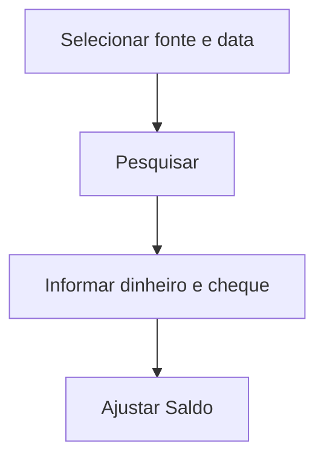

# Ajusta Saldo Final do Dia

## Objetivo

Ajustar/registrar o **saldo final de uma fonte em uma data** — o valor de fechamento em dinheiro
e cheque de um caixa/fonte no dia. Usado para conciliar o saldo do sistema com o saldo físico.

---

## Como acessar

```
Financeiro
→ Ajusta Saldo Final do Dia
```

---

## Quando utilizar

- Para conciliar o saldo de fechamento de uma fonte em uma data específica.

---

## Como utilizar

1. Abra **Ajusta Saldo Final do Dia**.
2. Selecione a **Fonte de Origem** e a **Data do Saldo**.
3. Clique em **Pesquisar**.
4. Informe os valores em **Dinheiro** e **Cheque** e uma **Observação**.
5. Confira o **Total**.
6. Clique em **Ajustar Saldo**.

---

## Campos

| Campo | Descrição | Obrigatório |
|-------|-----------|-------------|
| Fonte de Origem | Fonte a ajustar | Sim |
| Data do Saldo / Data | Data do fechamento | Sim |
| Dinheiro | Saldo em dinheiro | Condicional |
| Cheque | Saldo em cheque | Condicional |
| Total | Soma | — |
| Agência / Conta | Dados bancários | Condicional |
| Observação | Justificativa | Não |

---

## Botões

| Botão | O que faz |
|-------|-----------|
| **Pesquisar** | Busca o saldo da fonte na data |
| **Ajustar Saldo** | Grava o saldo final ajustado |

---

## Resultados

- O saldo final da fonte na data é ajustado/registrado.

---

## Regras importantes

- Use com critério — o ajuste altera o saldo de fechamento considerado nos controles.
- A data precisa ser válida e, em geral, o caixa da data não pode estar encerrado.

---

## Mensagens do sistema

- *"Alterações salvas com sucesso!"* / *"Registro salvo com sucesso!"*
- *"Data Inválida!"* / *"Valor Inválido!"*

---

## Fluxo da funcionalidade



---

## Exemplos práticos

**Exemplo:** ao conferir o caixa físico, ajustar o saldo final do dia para bater com o contado.

---

## Dicas

- Registre a **observação** explicando o motivo do ajuste, para auditoria.

---

## FAQ

**Isso substitui o encerramento?**
Não; é uma conciliação de saldo. O fechamento é o [Encerramento de Caixa](encerramento-caixa.md).

---

## Prints

- [ ] Seleção de fonte/data.
- [ ] Ajuste de saldo.

---

## Histórico

| Data | Alteração |
|------|-----------|
| 30/07/2026 | Página criada. |
