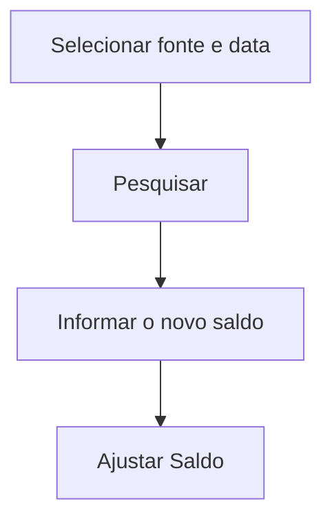

# Ajusta Saldo Final do Dia

## Objetivo

Ajustar/registrar o **saldo final de uma fonte em uma data** — o valor de fechamento em dinheiro
de um caixa/fonte no dia. Usado para conciliar o saldo do sistema com o saldo físico.

---

## Como acessar

```
Financeiro
→ Ajusta Saldo Final do Dia
```

---

## Quando utilizar

- Para conciliar o saldo de fechamento de uma fonte em uma data específica.

---

## Como utilizar

1. Abra **Ajusta Saldo Final do Dia**.
2. Selecione a **Fonte** (a **Data** já vem com hoje).
3. Clique em **Pesquisar**; o sistema mostra o **Saldo Atual (R$)**.
4. Informe o **Novo Saldo (R$)** e uma **Observação**.
5. Clique em **Ajustar Saldo**. Os campos continuam preenchidos depois de ajustar, para conferência.

*(Print sugerido: Saldo Atual (R$) e Novo Saldo (R$) lado a lado.)*

---

## Campos

| Campo | Descrição | Obrigatório |
|-------|-----------|-------------|
| Fonte | Fonte a ajustar | Sim |
| Data | Data do fechamento (padrão: hoje) | Sim |
| Saldo Atual (R$) | Saldo em dinheiro da fonte na data | — |
| Novo Saldo (R$) | Saldo correto, em dinheiro | Sim |
| Agência / Conta | Dados bancários | Condicional |
| Observação | Justificativa | Não |

---

## Botões

| Botão | O que faz |
|-------|-----------|
| **Pesquisar** | Busca o saldo da fonte na data |
| **Ajustar Saldo** | Grava o saldo final ajustado |

---

## Resultados

- O saldo final da fonte na data é ajustado/registrado.

---

## Regras importantes

- Use com critério — o ajuste altera o saldo de fechamento considerado nos controles.
- A data precisa ser válida e, em geral, o caixa da data não pode estar encerrado.
- O saldo é **somente em dinheiro** (a opção cheque saiu da tela).
- Com **caixa aberto de data anterior** ou **caixa de hoje encerrado**, o botão **Ajustar Saldo** fica desabilitado.

---

## Mensagens do sistema

- *"Alterações salvas com sucesso!"* / *"Registro salvo com sucesso!"*
- *"Data Inválida!"* / *"Valor Inválido!"*

---

:::caution Aviso de caixa pendente
Ao abrir esta tela, o sistema confere o **seu caixa**. Se houver **caixa aberto de data anterior**
e/ou o **caixa de hoje já estiver encerrado**, aparece um **aviso amarelo** logo abaixo do título
(fecha no **X**), por exemplo: *"Existe caixa aberto de data(s) anterior(es) (dd/mm/aaaa). Verifique
as pendências no Encerramento de Caixa."* ou *"O caixa de hoje já está encerrado. Verifique o
Encerramento de Caixa antes de continuar."* Enquanto o aviso estiver ativo, o botão de gravar
(Ajustar Saldo) fica **desabilitado**. Resolva a pendência em [Encerramento de Caixa](encerramento-caixa.md)
(a situação de cada dia pode ser consultada em [Consulta de Caixas](consulta-de-caixas.md)).
:::

---

## Fluxo da funcionalidade



---

## Exemplos práticos

**Exemplo:** ao conferir o caixa físico, ajustar o saldo final do dia para bater com o contado.

---

## Dicas

- Registre a **observação** explicando o motivo do ajuste, para auditoria.

---

## FAQ

**Isso substitui o encerramento?**
Não; é uma conciliação de saldo. O fechamento é o [Encerramento de Caixa](encerramento-caixa.md).

---

## Prints

- [ ] Seleção de fonte/data.
- [ ] Ajuste de saldo.

---

## Histórico

| Data | Alteração |
|------|-----------|
| 30/07/2026 | Página criada. |
| 07/10/2026 | **Cheque removido** (um só saldo em dinheiro); campo **Fonte** (antes Fonte de Origem); data de hoje por padrão; campos não são limpos após ajustar; aviso/bloqueio de caixa pendente. |
