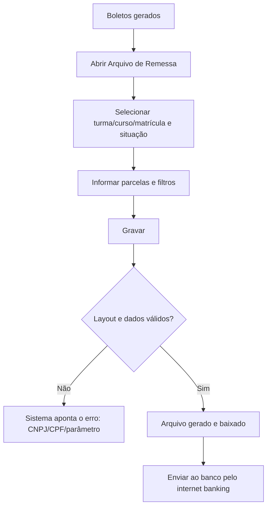

# Arquivo de Remessa (CNAB)

## Objetivo

Gerar o **arquivo de remessa** (padrão bancário CNAB) que é enviado ao banco para registrar os
boletos das mensalidades. É a etapa que transforma os boletos gerados no Harpia em um arquivo
que o banco reconhece e processa.

---

## Como acessar

```
Financeiro
→ Bancário
→ Arquivo de Remessa
```

---

## Quando utilizar

- Depois de [gerar os boletos](geracao-boletos.md), para enviar as informações ao banco.
- Sempre que houver novas mensalidades a registrar junto ao banco.

---

## Como utilizar

1. Abra **Arquivo de Remessa**.
2. Escolha o alcance: **Turma**, **Curso** ou **Matrícula**.
3. Defina a situação: **Matriculados**, **Fichados** ou **Ambos**.
4. Informe **Parcela Inicial**, **Parcela Final** e o **Dia do Vencimento**, se aplicável.
5. Marque **Filtrar apenas as mensalidades que ainda não foram geradas** para evitar duplicar
   registros já enviados.
6. Ajuste a **Nomenclatura Automática** do arquivo, se desejar.
7. Clique em **Gravar** para gerar o arquivo.
8. O arquivo é baixado; envie-o ao banco pelo canal do próprio banco (internet banking).

*(Print sugerido: tela do arquivo de remessa com filtros.)*

---

## Campos

| Campo | Descrição | Obrigatório | Exemplo | Observações |
|-------|-----------|-------------|---------|-------------|
| Turma / Curso / Matrícula | Alcance da remessa | Sim | Turma 3ºA | |
| Matriculados / Fichados / Ambos | Situação dos alunos | Sim | Matriculados | |
| Parcela Inicial | Primeira parcela | Condicional | 1 | |
| Parcela Final | Última parcela | Condicional | 12 | Não pode ser menor que a inicial |
| Dia do Vencimento | Filtro por dia de vencimento | Não | 10 | |
| Filtrar apenas as mensalidades que ainda não foram geradas | Evita reenviar registros | Não | — | Recomendado |
| Nomenclatura Automática | Nome automático do arquivo | Não | — | |

---

## Botões

| Botão | O que faz |
|-------|-----------|
| **Gravar** | Gera o arquivo de remessa e o disponibiliza para download |

---

## Resultados

- É gerado o arquivo de remessa no layout do banco.
- O sistema informa *"Arquivo de remessa gerado com sucesso. Verifique seus downloads."*.

---

## Regras importantes

- **A Parcela Final não pode ser menor que a inicial.**
- O sistema **valida o layout** do arquivo de remessa antes de gerar.
- O **CNPJ do banco** precisa estar cadastrado e válido; o **CPF do responsável financeiro** de
  cada aluno também é validado.
- Parâmetros do banco (como **NOSSO NÚMERO**) precisam estar configurados no [cadastro do banco](../bancario/bancos.md).

---

## Mensagens do sistema

**Sucesso**
- *"Arquivo de remessa gerado com sucesso. Verifique seus downloads."*

**Erro / Atenção**
- *"A parcela final não pode ser menor que a inicial."*
- *"CNPJ do banco inválido. Verifique!"* / *"CNPJ do banco não cadastrado. Verifique!"*
- *"CPF inválido do responsável financeiro do aluno [nome]. Verifique!"*
- *"Parâmetro NOSSO NÚMERO não encontrado. Verifique!"* / *"Parâmetro não encontrado. Verifique!"*
- *"Nenhum registro encontrado!"*

---

## Fluxo da funcionalidade



---

## Exemplos práticos

**Exemplo — remessa mensal:** Após gerar os boletos do mês, abra o Arquivo de Remessa,
selecione a turma, marque **"Filtrar apenas as mensalidades que ainda não foram geradas"** e
clique em **Gravar**. Envie o arquivo baixado ao banco.

---

## Dicas

- Sempre marque **"apenas as que ainda não foram geradas"** para não reenviar boletos.
- Confira o cadastro do banco (CNPJ, carteira, NOSSO NÚMERO) antes da primeira remessa.

---

## Erros comuns

- **"CNPJ do banco inválido/não cadastrado"** → corrija o [cadastro do banco](../bancario/bancos.md).
- **"CPF inválido do responsável financeiro..."** → corrija o CPF do responsável no cadastro do aluno.
- **"Parâmetro NOSSO NÚMERO não encontrado"** → complete a configuração do banco.

---

## FAQ

**Qual a diferença entre boleto e remessa?**
O boleto é o documento de cobrança; a remessa é o arquivo que informa esses boletos ao banco.

**Gerei a remessa e preciso gerar de novo?**
Use o filtro de "mensalidades ainda não geradas" para incluir só o que falta.

---

## Prints

- [ ] Tela de Arquivo de Remessa com filtros.
- [ ] Mensagem de sucesso / download.

---

## Histórico

| Data | Alteração |
|------|-----------|
| 30/07/2026 | Página criada. Inclui validação de layout do arquivo de remessa e validações de CNPJ/CPF/parâmetros. |
